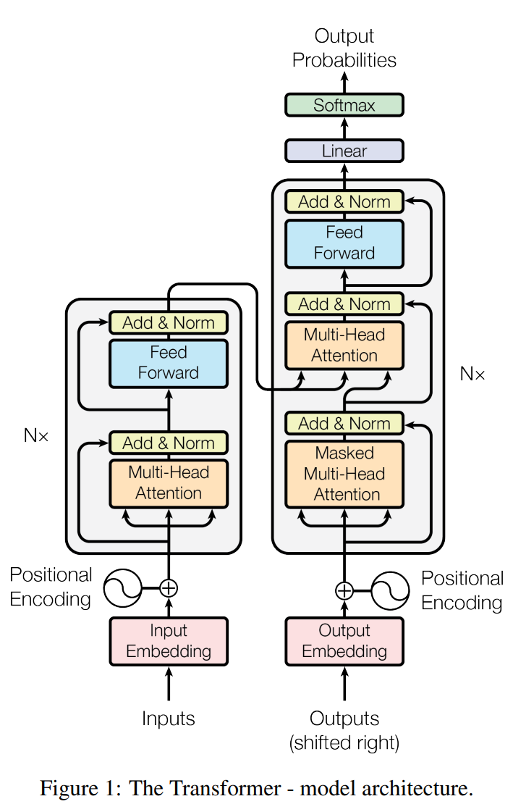
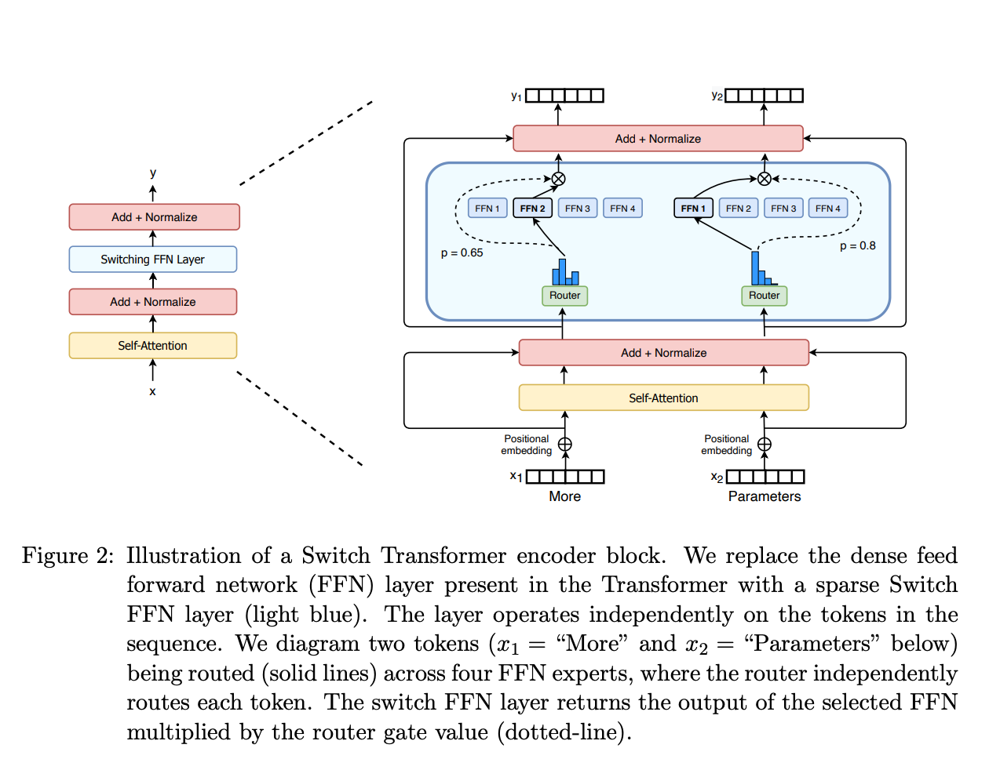

# 本地部署大语言模型的中文教学

> 最后一次大修：2026 年 8 月 30 日
> 这篇文章变化得很快，所以我会尽量讲清楚“为什么”，而不是只列一堆过几个月就失效的型号和命令。

Hello！大家好，这里是 Anser！

这是一篇尽可能详细、但尽量让人看懂的本地大语言模型（LLM）部署教程。

如果你想让模型在自己的电脑上聊天、写代码、读 PDF，或者给一个几十到几百人的小团队搭一套内部 AI 服务，但看到 CUDA、显存、量化、KV cache、vLLM 这些词就头大，那么这篇文章就是写给你的。

我很有可能会犯错。LLM 软硬件的发展速度实在太离谱了，如果你发现哪里过时了或者讲错了，欢迎提 Issue 或 PR。谢谢！

赞助我：[Buy me a coffee](https://buymeacoffee.com/ansertbyu)

也感谢 [r/LocalLLaMA](https://www.reddit.com/r/LocalLLaMA/) 里愿意分享测试和踩坑经验的各位。

---

## 目录

- [先说结论：我到底该用什么？](#先说结论我到底该用什么)
- [第一部分：LLM 到底在干什么？](#第一部分llm-到底在干什么)
  - [Token、Transformer 与自回归生成](#tokentransformer-与自回归生成)
  - [Prefill 和 Decode](#prefill-和-decode)
  - [KV cache：模型为什么不用每次从头算？](#kv-cache模型为什么不用每次从头算)
  - [Prefix caching：为什么相同前缀会便宜很多？](#prefix-caching为什么相同前缀会便宜很多)
  - [MTP 与 speculative decoding](#mtp-与-speculative-decoding)
- [第二部分：决定速度的到底是什么？](#第二部分决定速度的到底是什么)
  - [容量、带宽和算力](#容量带宽和算力)
  - [Latency 与 Throughput](#latency-与-throughput)
  - [模型到底要占多少内存？](#模型到底要占多少内存)
  - [MoE：总参数很大，激活参数很小](#moe总参数很大激活参数很小)
- [第三部分：精度与量化](#第三部分精度与量化)
  - [FP4 为什么必须缩放？](#fp4-为什么必须缩放)
  - [MXFP4 与 NVFP4](#mxfp4-与-nvfp4)
  - [不同 GPU 架构支持什么精度？](#不同-gpu-架构支持什么精度)
  - [训练和推理应该选什么精度？](#训练和推理应该选什么精度)
- [第四部分：如何为 LLM 配一台电脑](#第四部分如何为-llm-配一台电脑)
- [第五部分：如何选择模型](#第五部分如何选择模型)
- [第六部分：部署方法](#第六部分部署方法)
- [第七部分：vLLM、PagedAttention 与高并发](#第七部分vllmpagedattention-与高并发)
- [第八部分：怎样提高 KV cache 命中率](#第八部分怎样提高-kv-cache-命中率)
- [第九部分：三套实际方案](#第九部分三套实际方案)
- [常见误区](#常见误区)
- [延伸阅读与资料来源](#延伸阅读与资料来源)

---

## 先说结论：我到底该用什么？

如果你现在就想把模型跑起来，不想先读两万字：

| 你的情况 | 建议从这里开始 |
|---|---|
| 完全小白，只想在自己的电脑上聊天 | [LM Studio](https://lmstudio.ai/) |
| 想用一条命令启动模型，给别的软件调用 | [Ollama](https://ollama.com/) |
| Windows、macOS、Linux 都想跑，或者只有 CPU/核显 | [llama.cpp](https://github.com/ggml-org/llama.cpp) |
| 有 NVIDIA/AMD GPU，想给多人提供高吞吐 API | [vLLM](https://github.com/vllm-project/vllm) |
| 只用 NVIDIA，愿意折腾以追求极限性能 | [TensorRT-LLM](https://github.com/NVIDIA/TensorRT-LLM) |
| 公司需要经过验证的容器、监控、生命周期和支持 | [NVIDIA NIM](https://docs.nvidia.com/nim/large-language-models/latest/about-nim-llm/overview.html) |
| Intel CPU、核显或独显，且需要 Intel 官方路线 | [OpenVINO GenAI](https://github.com/openvinotoolkit/openvino.genai) |

然后模型先别贪大：挑一个你的内存能轻松放下的 7B～14B 级模型，使用 Q4 或 Q5 量化，确认聊天、上下文和 GPU 加速都正常，再往上加。

---

## 第一部分：LLM 到底在干什么？

### Token、Transformer 与自回归生成

LLM 看到的不是“字”和“单词”，而是 Token。

比如 `unbelievable` 可能被切成一个或几个 Token；中文的一个汉字有时是一个 Token，有时多个字会合成一个 Token。不同模型使用的 tokenizer 也不同，所以两个模型都显示 50 token/s，并不代表它们每秒生成的中文字符一定一样多。

Tokenizer 通常不是神经网络，它会把文本转换成一串整数 ID。模型再把这些 ID 变成向量，也就是 embedding。

目前绝大多数聊天 LLM 的主体依然属于 decoder-only Transformer。经典起点当然还是那篇神之论文：[Attention Is All You Need](https://arxiv.org/abs/1706.03762)。想看特别适合小白的视觉讲解，我依然强烈推荐 3Blue1Brown 的 [But what is a GPT?](https://www.youtube.com/watch?v=wjZofJX0v4M)。



“自回归”听起来很吓人，其实就是：

1. 给模型一段已有 Token；
2. 模型预测下一个 Token 的概率；
3. 按照 temperature、top-p 等规则选出一个；
4. 把这个新 Token 接回末尾；
5. 再预测下一个。

所以模型写一句话，不是一次把整句“想”出来，而是一格一格往右生成。

### Prefill 和 Decode

一次 LLM 请求可以粗略分成两段：

**Prefill（预填充）**：模型一次性读取你的 system prompt、聊天记录、文档和问题，为这些输入 Token 计算中间状态，并生成第一个新 Token。

**Decode（解码）**：之后一个 Token 一个 Token 地继续生成答案。

这两个阶段的脾气完全不一样：

- Prefill 能把大量输入 Token 并行计算，矩阵很大，通常更吃计算能力；
- Decode 每一步只有少量新 Token，却要经过整套模型，低并发时通常更吃内存带宽。

因此，请不要只问“这张卡多少 TFLOPS”。一张计算能力很强但显存小、带宽低的卡，并不一定适合你要跑的模型。

### KV cache：模型为什么不用每次从头算？

在 causal Transformer 中，前面的 Token 看不到未来。第 100 个 Token 的出现，不会回头改变第 1～99 个 Token 已经算出的 Key 和 Value。

于是生成第 101 个 Token 时，我们不需要把前 100 个 Token 的注意力中间结果全部重算，只要把之前每一层的 Key 和 Value 留在内存里。这块缓存就是 **KV cache**。

可以把它理解成模型在每一层做的“读书笔记”：

- 没有 KV cache：每写一个字，都把前面的书从第一页重读一次；
- 有 KV cache：前面的笔记保留，只阅读刚新增的内容。

代价是 KV cache 很占内存，而且会随着上下文长度、同时服务的请求数量和 KV cache 精度近似线性增长。

一个常用的粗略公式是：

```text
KV cache 字节数 ≈ 2 × 层数 × KV head 数 × head dimension
                 × 每个元素字节数 × 已缓存 Token 数 × 并发序列数
```

前面的 `2` 是 K 和 V 两份。

例如一个 32 层、8 个 KV heads、head dimension 为 128 的 GQA 模型，用 BF16 保存 KV，单个 32K 上下文大约需要：

```text
2 × 32 × 8 × 128 × 2 bytes × 32768 ≈ 4 GiB
```

注意，这还没算模型权重、运行时 workspace 和其他请求。

这就是为什么“模型文件明明只有 20GB，我有 24GB 显存，为什么开 128K 上下文就爆了？”答案：你忘了给 KV cache 留座位。

现代模型常用 GQA、MQA 或 MLA 来减少 KV cache；有些运行时也支持 FP8、INT8，甚至 NVFP4 KV cache。代价依然是可能有精度损失，而且必须有合适的 kernel 才会真的更快。

### Prefix caching：为什么相同前缀会便宜很多？

KV cache 不只能在同一次回答中使用，还能跨请求复用。

假设 100 个员工都在询问同一本 200 页的公司手册：

```text
[完全相同的 system prompt]
[完全相同的公司手册]
[每个人不同的问题]
```

前两部分的 Token 前缀完全一致，那么它们对应的 KV cache 也一致。服务器第一次算完后，后续请求可以直接复用这部分缓存，只计算各自不同的问题。

这叫 **prefix caching（前缀缓存）**。它节省的是 prefill，不会让后面的长答案自动生成得更快。vLLM 的 [Automatic Prefix Caching](https://docs.vllm.ai/en/latest/features/automatic_prefix_caching.html) 就是干这个的。

“相同”通常指相同模型、相同 tokenizer、相同 Token 序列和相同位置。肉眼看上去差不多不够：一个时间戳、随机 ID、JSON 字段顺序或聊天模板变化，都可能从那里开始让缓存 miss。

### MTP 与 speculative decoding

普通自回归生成一次只确认一个 Token，这个串行过程是低延迟推理的天敌。

**Multi-Token Prediction（MTP）** 的训练目标，是让额外的预测模块学习预测更远的未来 Token，而不只学习紧邻的下一个 Token。它有两个作用：

1. 训练时给模型更多学习信号，可能提升主模型能力；
2. 推理时把 MTP 模块当作一个轻量的“草稿员”，用于 speculative decoding。

Speculative decoding 的过程大概是：

1. 小草稿模型或 MTP head 先快速猜出接下来几个 Token；
2. 大主模型用一次并行 forward 验证这几个猜测；
3. 接受符合主模型分布的部分，拒绝后从正确位置继续。

只要验证算法实现正确，它不是“用小模型偷偷换掉大模型”，而是在保持目标模型输出分布的前提下减少昂贵的大模型串行步骤。

但是请注意：**MTP 是一种训练目标/模型结构；speculative decoding 是一种推理算法。两者经常搭配，但不是同一个词。** 也可以用独立小模型、EAGLE 等方法做 speculative decoding。

DeepSeek-V3 的公开权重就包括单独的 MTP 模块；vLLM 也已经提供 [MTP speculative decoding](https://docs.vllm.ai/projects/speculators/en/latest/user_guide/algorithms/mtp/) 支持。实际加速取决于草稿接受率、batch size、模型结构和 kernel 开销，并不是写上 `MTP` 就必然两倍速度。

---

## 第二部分：决定速度的到底是什么？

### 容量、带宽和算力

买硬件时最容易混在一起的三个概念是：

**容量（GB）**：能不能装下模型权重、KV cache 和运行时。装不下就是装不下，再高的 TFLOPS 也没用。

**内存带宽（GB/s 或 TB/s）**：每秒能把多少权重和 KV 数据喂给处理器。单用户、batch size 很小的 Decode 经常被它限制。

**计算能力（FLOPS/TOPS）**：每秒能做多少运算。Prefill、训练和高 batch 的矩阵乘法更容易吃满算力。

还有一个经常被忽略的量：**互联带宽**。当模型跨显卡、跨机器或跨 MoE 专家时，PCIe、NVLink、Infinity Fabric、网络都可能成为瓶颈。

一个帮助理解的简化上限：假设 batch=1，每生成一个 Token 都需要从内存读一遍主要权重，那么：

```text
理论 Decode 速度上限（token/s）≈ 可用内存带宽 ÷ 每 Token 需要读取的权重字节数
```

例如一个 8B 密集模型，量化后的有效大小是 5GB，设备真实可用带宽假设是 250GB/s：

```text
250 ÷ 5 ≈ 50 token/s
```

这是天花板，不是承诺。实际还有 attention、KV cache、kernel 启动、量化解码和系统开销。

批量增大后，一次读入的权重可以服务更多 Token，算术强度上升，工作负载可能从 bandwidth-bound 逐渐变成 compute-bound。这也是为什么服务 100 个用户时，硬件选择和只服务自己时完全不同。

NVIDIA 对 [prefill 与 decode](https://developer.nvidia.com/blog/mastering-llm-techniques-inference-optimization/) 以及 [roofline 模型](https://developer.nvidia.com/blog/ai-model-co-design-hardware-friendly-llm-design/) 有很清楚的解释。

### Latency 与 Throughput

你必须先决定自己在追求什么。

**Latency（延迟）**关心单个用户等多久：

- TTFT（Time To First Token）：点发送后多久看到第一个字；
- ITL/TPOT（Inter-Token Latency / Time Per Output Token）：之后每个 Token 间隔多久；
- End-to-end latency：整个回答多久完成。

**Throughput（吞吐）**关心整台服务器单位时间做多少工作：总 output tokens/s、requests/s，以及在某个延迟 SLA 下每张 GPU 每秒能处理多少 Token。

如果只给自己聊天，你一般希望 batch 小、TTFT 低、每个对话 token/s 高。

如果你是一家小公司，有几十到几百人共用一个模型，就应该更关心总吞吐、并发、P95/P99 延迟和每百万 Token 的成本。允许每个人稍微慢一点，把更多请求放进 continuous batching，通常能显著提高硬件利用率。

没有一种配置能同时把每个指标拉满。大 batch 提高 throughput，但可能让单请求排队更久；长时间等待凑 batch 更省钱，但用户会觉得它在发呆。

### 模型到底要占多少内存？

最简单的权重估算：

```text
模型权重 GB ≈ 参数量（B）× 每参数 bit 数 ÷ 8
```

所以 8B 模型：

| 理论精度 | 纯权重理论大小 |
|---|---:|
| FP32 | 32GB |
| FP16/BF16 | 16GB |
| FP8/INT8 | 8GB |
| 4-bit | 4GB |

实际文件会更大，因为还有 scale、zero point、embedding、metadata 和未量化层。GGUF 的 `Q4_K_M` 也不是正好 4 bit/parameter，粗略按 4.5～5 bit/parameter 留空间更靠谱。

完整内存预算应该是：

```text
模型权重 + KV cache + 临时 activation / workspace + 推理框架开销 + 操作系统和其他程序
```

我建议不要把 24GB 显存算成 24GB 全都能给权重。至少留出 10%～20%，长上下文和高并发时要留更多。

训练更夸张：除了权重，还可能需要梯度、optimizer states、master weights 和 activation。Adam 全参数训练的总内存可以是权重推理的很多倍。LoRA/QLoRA、gradient checkpointing、ZeRO/FSDP 能减少占用，但“能推理”完全不等于“能训练”。

### MoE：总参数很大，激活参数很小

Mixture of Experts（MoE）模型会把部分 FFN 层拆成很多“专家”，再用 router 为每个 Token 选择少数几个专家。



因此 MoE 有两个参数数字：

- **总参数（total parameters）**：所有专家加起来，决定权重至少要占多少内存；
- **激活参数（active parameters）**：一个 Token 实际经过的参数，和单 Token 计算量、理想情况下的权重读取量更相关。

比如 Qwen3-Next-80B-A3B 是约 80B 总参数、3B 激活；2026 年 8 月发布的 [Qwen3.8-Flash-Next](https://qwen.ai/blog?id=qwen3.8-flash-next) 则是 125B 主模型参数、每 Token 激活 6B，另外还有 51B N-gram embedding。它们需要“大模型级别的容量”，但理想 Decode 工作量更接近一个小得多的密集模型。

这也是大容量 LPDDR5X/统一内存机器突然变得很有意思的原因：它们可能有 128GB、256GB 甚至更多容量，带宽没有 HBM 那么夸张，但对于低激活比例的 MoE，单用户交互速度可能仍然很实用。

不过，千万不要把它简化成“MoE 不吃带宽”：

- attention、shared expert 和其他 dense 层仍然要算；
- router 的不规则访问会降低实际效率；
- 不同 Token 选不同专家，高 batch 时可能同时触碰很多专家；
- 专家分布在多张卡上时会产生 all-to-all 通信；
- 如果专家权重必须每层从普通 RAM 通过 PCIe 搬进显存，那 PCIe 会把速度打回原形。

MoE 的优势要靠 fused MoE kernel、expert parallel、负载均衡和高速互联才能充分发挥。总参数、激活参数、batch size 和运行时支持必须一起看。

---

## 第三部分：精度与量化

### 浮点数和整数到底差在哪？

精度不是“数字越小模型就等比例变笨”。它同时影响权重文件大小、内存流量、硬件加速和最终模型质量。

| 格式 | 典型用途 | 特点 |
|---|---|---|
| FP32 | 科学计算、部分累加和 master weight | 稳，但大且慢 |
| TF32 | NVIDIA Tensor Core 上加速“FP32 风格”训练 | 范围像 FP32，尾数精度更低 |
| FP16 | 训练、推理 | 精度较好，但数值范围比 BF16 小 |
| BF16 | 训练首选之一、推理 | 和 FP32 一样的 exponent 宽度，更不容易溢出 |
| FP8 | Hopper/Ada/CDNA3 以后训练与推理 | E4M3 与 E5M2 在精度和范围间取舍 |
| INT4 / GGUF Q4 | 消费级本地推理常见 | 多为 weight-only，省容量和带宽 |
| MXFP4 | OCP 标准微缩放 FP4 | 32 个 E2M1 值共享一个 E8M0 scale |
| NVFP4 | NVIDIA 的 FP4 recipe | 16 个 E2M1 值共享 E4M3 scale，另有全 tensor FP32 scale |

关键提醒：**“权重以 4 bit 保存”不等于“GPU 用原生 FP4 做矩阵乘法”。**

很多旧 GPU 会把 4-bit 权重读进来，在寄存器或 shared memory 中反量化成 FP16/BF16，再做 W4A16 运算。这样仍然能省显存和带宽，但不等于获得原生 FP4 Tensor Core 的计算吞吐。

### FP4 为什么必须缩放？

FP4 E2M1 只有 1 个 sign bit、2 个 exponent bit 和 1 个 mantissa bit。它能表达的非负数大致只有：

```text
0, 0.5, 1, 1.5, 2, 3, 4, 6
```

如果一组真实权重从 0.001 到 200，直接塞进去不是都变成 0，就是大的全部溢出。

所以低精度量化不是简单“砍掉小数位”，而是先找一个 scale，把一组数缩放进 FP4 能表示的范围：

```text
量化：q = round_to_fp4(x / scale)
还原：x_hat = q × scale
```

一整个 tensor 只用一个 scale 很省事，但某个离群值可能把 scale 拉得很大，让其余小数全挤在 0 附近。解决方法就是 block scaling：每一小块数各用自己的 scale。

block 越小，越能适应局部数值范围，通常误差越低；但 scale 本身也占空间，计算和内存布局也更复杂。

### MXFP4 与 NVFP4

两者的元素主体都是 E2M1 FP4，区别主要在缩放方法。

OCP [Microscaling Formats (MX) 规范](https://www.opencompute.org/documents/ocp-microscaling-formats-mx-v1-0-spec-final-pdf)规定 MXFP4：

- 每 32 个 E2M1 元素共享一个 scale；
- scale 使用 E8M0；
- E8M0 基本上只能表示 2 的幂，所以 scale 很紧凑、硬件也容易处理，但刻度比较粗。

```text
x ≈ fp4_value × block_scale_E8M0
```

NVIDIA 的 [NVFP4](https://docs.nvidia.com/deeplearning/transformer-engine/user-guide/features/low_precision_training/nvfp4/nvfp4.html) 使用两级缩放：

- 每 16 个 E2M1 元素共享一个 FP8 E4M3 block scale；
- 整个 tensor 再共享一个 FP32 global scale。

```text
x ≈ fp4_value × block_scale_E4M3 × global_scale_FP32
```

E4M3 scale 不必只能取 2 的幂，加上 block 更小，因此通常能比 MXFP4 更细地贴合局部数据，量化误差也更小；代价是 recipe 和 scale 管理更复杂。

NVIDIA 在权重训练中还会使用二维 16×16 scaling、随机 Hadamard Transform、stochastic rounding 等方法控制离群值和训练误差。这里最重要的结论不是背公式，而是：**FP4 能好用，靠的是数据格式、缩放策略、量化校准和硬件 kernel 一起工作。**

### 不同 GPU 架构支持什么精度？

下面是面向 LLM 用户的简化表。具体型号和软件栈仍然可能有差异：

| 硬件架构 | 适合关注的原生低精度能力 | 对本地 LLM 的含义 |
|---|---|---|
| NVIDIA Turing（RTX 20/T4） | FP16、INT8、INT4 Tensor Core | 适合 INT4/INT8 或 FP16；没有 BF16/FP8 原生矩阵优势 |
| NVIDIA Ampere（RTX 30/A100） | FP16、BF16、TF32、INT8、INT4 | BF16/FP16 很成熟；没有原生 FP8/FP4 |
| NVIDIA Ada（RTX 40/L4/L40） | 增加 FP8 Tensor Core | FP8 可有计算优势；FP4 通常仍是 weight-only 路线 |
| NVIDIA Hopper（H100/H200） | FP8、BF16、FP16、TF32、INT8 | FP8 是甜点位；**没有原生 FP4 Tensor Core** |
| NVIDIA Blackwell（B100/B200、RTX 50/RTX PRO Blackwell、GB10） | FP4/FP6/FP8、BF16/FP16 等 | NVFP4/MXFP4 才能获得原生 4-bit 矩阵加速 |
| AMD CDNA2（MI200） | FP16、BF16、INT8 等 | 训练/推理以 16-bit 和整数为主 |
| AMD CDNA3（MI300/MI325） | 增加 FP8/BF8 | FP8 成为重要选择；无 CDNA4 的原生 MXFP4 |
| AMD CDNA4（MI350/MI355） | MXFP4、MXFP6、MXFP8、OCP FP8 | 原生支持标准 microscaling 低精度 |
| Apple Silicon / AMD RDNA 核显 | 依赖 Metal/MLX、Vulkan/HIP 等优化 kernel | 4-bit 多数表示权重存储与 weight-only 推理，不要套用 NVIDIA 峰值表 |

资料可参考 NVIDIA 的 [Ampere](https://www.nvidia.com/en-us/data-center/ampere-architecture/)、[Hopper](https://developer.nvidia.com/blog/nvidia-hopper-architecture-in-depth/) 与 [Blackwell NVFP4](https://developer.nvidia.com/blog/introducing-nvfp4-for-efficient-and-accurate-low-precision-inference/) 说明，以及 AMD 的 [CDNA 架构页面](https://www.amd.com/en/technologies/cdna.html)。

特别回答一个常见问题：**H100 上要不要下载 NVFP4 模型？**

H100 可以通过软件 kernel 读取 NVFP4 权重，但它没有原生 FP4 Tensor Core。常见兼容路径是在 kernel 内把 FP4 权重反量化到 BF16/FP16，做 W4A16；某些路径也可能转换到其他受支持精度。因此它可能节省显存和带宽，但不应期待 Blackwell 的原生 FP4 算力优势，甚至可能比一个优秀的 FP8 checkpoint 更慢。NVIDIA NIM 也明确把 pre-Blackwell 的 NVFP4 路径称为 emulation，并提示它可能慢于同卡原生精度。

所以：H100 优先比较模型官方 FP8 与 BF16；Blackwell 才优先考虑经过验证的 NVFP4/MXFP4。

### 训练和推理应该选什么精度？

| 场景 | 常见甜点位 | 为什么 |
|---|---|---|
| 从零预训练，优先稳定 | BF16 + FP32 累加/optimizer state | 数值范围好，生态成熟 |
| Hopper/Ada/CDNA3 大规模训练 | 经过验证的 FP8 mixed precision | 省内存和计算，但要用动态/块缩放 recipe |
| Blackwell/CDNA4 大规模训练 | NVFP4 或 MXFP4 mixed precision（需严格验证） | 可能进一步提高吞吐，但不是所有层都适合 4-bit |
| LoRA/QLoRA 微调 | 4-bit frozen base + BF16/FP16 compute + 16-bit adapter | 大幅减小显存，训练参数仍保留较高精度 |
| 消费级单用户推理 | GGUF Q4_K_M/Q5_K_M 或 AWQ/GPTQ INT4 | 通常是容量、质量和带宽的好平衡 |
| Hopper 生产推理 | FP8 或成熟的 INT4 weight-only | 看模型、batch 和 kernel 实测 |
| Blackwell 生产推理 | 经过模型评测的 NVFP4/MXFP4/FP8 | 原生低精度有明显潜力 |
| KV cache | BF16/FP16 最稳；FP8/INT8 更省；FP4 更激进 | KV 精度影响长上下文和并发，需要单独评测 |

对聊天模型，我一般建议从 Q4/Q5 开始。Q2/Q3 不是不能用，但数学、代码、工具调用、长上下文和小模型更容易掉质量。不要再用一句“更大的 Q2 一定强于更小的 Q5”当定律，必须拿你的实际任务测。

对于训练，也别以为把所有 tensor 统统设成最低精度就结束了。现代 mixed-precision recipe 会给敏感层、累加、梯度和 optimizer state 保留更高精度。理论 FP4 FLOPS 只是上限，量化和缩放也有开销；矩阵太小或 batch 太小照样吃不满。

### GGUF、GPTQ、AWQ、FP8 又是什么？

- **Safetensors**：安全、常见的权重文件容器，本身不说明量化方法；
- **GGUF**：llama.cpp 生态的模型与 metadata 容器，常见 Q4_K_M、Q5_K_M、IQ4 等量化；
- **GPTQ**：经典的 post-training weight-only 量化方法/生态；
- **AWQ**：利用 activation-aware 信息保护重要权重的 weight-only 量化；
- **bitsandbytes NF4**：QLoRA 中常见的 4-bit 格式；
- **FP8/NVFP4 checkpoint**：通常需要相应框架、scale 布局和硬件 kernel；
- **EXL2**：ExLlama 生态的可变 bit 量化格式。

一个模型“有 4-bit 版”还不够，你要确认运行时能否加载、硬件有没有高效 kernel、是 W4A16 还是 W4A4、KV cache 精度，以及量化作者是否做过可信的质量评测。

---

## 第四部分：如何为 LLM 配一台电脑

### 先问自己四个问题

1. 我要跑多大的模型，密集还是 MoE？
2. 我要多长上下文，同时几个人用？
3. 我更在意单对话速度，还是总吞吐？
4. 我要推理、LoRA 微调，还是从零训练？

然后再做内存预算。不要反过来先买卡，再祈祷模型正好能塞进去。

### 独立显卡路线

NVIDIA 最大的优势不是纸面参数，而是 CUDA 生态：vLLM、TensorRT-LLM、FlashAttention、量化 kernel 和新模型支持通常最省心。

挑卡时大致按这个顺序：

1. 显存容量能不能装下目标权重和 KV cache；
2. 显存带宽；
3. 该架构是否原生支持你要用的精度；
4. 软件栈是否支持；
5. 功耗、散热、价格和保修。

一张旧的 24GB RTX 3090 可能比新的 16GB 卡更适合 20GB 模型，因为前者能全放进显存。反过来，如果两张卡都放得下，小模型的 prefill、高 batch 和新精度 kernel 往往是新架构更强。

显存不够时可以 CPU offload，但独显通过 PCIe 反复读取系统内存会很慢。它适合“我偶尔等一等也要跑起来”，不适合“这就等于拥有了 128GB 显存”。

不要把魔改 48GB 游戏卡当普通消费品推荐：焊接、BIOS、散热、驱动、保修和稳定性都有额外风险。如果你依赖它工作，请把失败成本算进去。

AMD 独显和 Instinct 在 ROCm、vLLM、SGLang、llama.cpp 上进步很快，尤其 MI300/MI350 的容量和带宽很有吸引力。但购买前务必按具体 GPU、操作系统、模型架构和 quant kernel 查支持矩阵，不要只看“支持 ROCm”四个字。

### 大容量统一内存路线

统一内存的优势是 CPU 和 GPU 共用一大池内存，不必把整个模型塞进传统独显 VRAM，也避免了频繁 PCIe offload。它特别适合很大但激活参数较少的 MoE、单用户或低并发本地推理，以及需要安静、低功耗和大容量的工作站。

截至 2026-08-30，值得看的几类机器：

| 平台 | 内存与带宽 | 适合什么 | 需要注意 |
|---|---|---|---|
| Apple M5 Ultra Mac Studio | 最高 512GB unified memory，1.2TB/s | 超大模型本地推理、MLX、安静工作站 | 2026-08-25 刚发布，9 月开始供货；CUDA-only 工具不能直接用 |
| Apple M5 Max | 最高 128GB，最高 614GB/s | 便携/桌面单用户，中大型量化模型 | 软件主要走 MLX/Metal/llama.cpp |
| NVIDIA DGX Spark（GB10） | 128GB coherent LPDDR5X，273GB/s | CUDA/Blackwell 开发、FP4、约 200B 以内模型实验 | 带宽远低于 HBM 卡；“1 PFLOP FP4”包含特定精度/稀疏条件 |
| AMD Strix Halo / Ryzen AI Max+ 395 | 最高 128GB LPDDR5X，256GB/s | 性价比大内存 Windows/Linux 机器、llama.cpp/ROCm | RDNA 3.5 不是 CDNA4，别把 MI350 的原生 MXFP4 能力套过来 |
| Intel Crescent Island | 最高 480GB LPDDR5X，350W PCIe 卡 | 未来的大容量数据中心推理 | 仍是面向客户采样/生态建设的产品，不等于现在能买到的家用卡 |

官方规格来源：[Apple M5 Ultra](https://www.apple.com/newsroom/2026/08/apple-introduces-new-mac-studio-with-m5-max-and-m5-ultra/)、[DGX Spark](https://www.nvidia.com/en-us/products/workstations/dgx-spark/)、[Ryzen AI Halo](https://www.amd.com/en/products/processors/desktops/ryzen/ryzen-ai-halo/ryzen-ai-max-plus-395.html)、[Intel Crescent Island](https://newsroom.intel.com/client-computing/intel-outlines-architectures-for-agentic-ai-at-hot-chips-2026)。

这里顺便更正一个容易记混的名字：能查到 Intel 官方资料的是 **Crescent Island**，不是 Crescent Lake。

以 Qwen3-Next-80B-A3B 这类超稀疏 MoE 为例，Q4 权重加运行时可能落在几十 GB，128GB 统一内存机器有空间容纳权重和较长 KV cache；每 Token 激活参数又比较少，所以 Decode 可能达到实用速度。这是合理的购买逻辑。

但如果你要同时服务 100 人，专家并行、高 batch prefill、总吞吐和生态可能会让多张数据中心 GPU 更合适。统一内存不是“便宜 H100”，而是另一种取舍。

### 多显卡与多机

多卡能解决容量问题，但不会自动线性加速。

- **Tensor Parallel（TP）**：一层矩阵分到多卡，每层都要通信；
- **Pipeline Parallel（PP）**：不同层放不同卡，容易产生 pipeline bubble；
- **Expert Parallel（EP）**：MoE 的专家分到不同卡，需要 all-to-all；
- **Data Parallel（DP）**：每组卡复制一份模型，服务不同请求，适合提升吞吐。

两张卡的总显存可以装更大模型，但如果只通过普通 PCIe 互联，单用户 latency 可能变差。NVLink/Infinity Fabric 对高频通信非常重要。

多机更要小心：10GbE 理论只有约 1.25GB/s，和显存内部数百 GB/s、数 TB/s 完全不是一个量级。它可以用于 pipeline、请求级分流或特定 offload，但别期待四台普通电脑通过交换机就自然变成一台四 GPU 服务器。

Thunderbolt 5、RDMA 和高速 NIC 能改善互联；Apple 新款 Mac Studio 也支持通过 Thunderbolt 5/RDMA 组集群。但软件支持、切分方式和通信模式决定最终效果，绝不能只把四台机器的内存和带宽数字相加。

---

## 第五部分：如何选择模型

### 不要只看一个排行榜

选择模型至少要同时看：任务、dense/MoE、thinking/instruct、总参数与激活参数、context、tokenizer、运行时支持、量化、许可证，以及你的硬件上的 TTFT、token/s、并发和功耗。

排行榜提供候选名单，不替你做最终决定。公开 benchmark 可能被训练数据污染，也可能和你的任务完全不同。

最靠谱的办法还是自己做一个小 eval：收集 30～200 个真正代表你工作的问题，写清楚判分规则，把候选模型都跑一遍。对于代码就跑测试；对于抽取就比 JSON；对于客服就让真实使用者盲评。

### Artificial Analysis

[Artificial Analysis](https://artificialanalysis.ai/models/) 是现在很有用的模型比较网站。它不只给一个 Intelligence Index，还把模型能力、首 Token 延迟、输出速度、缓存价格、reasoning token 使用量和每任务真实成本放在一起。

它的 [methodology](https://artificialanalysis.ai/methodology) 也值得读。尤其重要的是，它区分“每百万 Token 的标价”和“完成一件事花多少钱”。

但是 Artificial Analysis Index 仍然是多个 benchmark 的加权组合。权重由网站定义，不是由你的业务定义。所以我建议：用它筛选候选，再用自己的 eval 决赛。

LMArena 的人类盲选榜也有参考价值，但更偏人类偏好，容易奖励好看、详细、讨喜的回答。技术报告则最适合确认架构、context、训练方法和许可证。三种资料互相补。

### Reasoning、RLVR 与真实成本

现在已经是 reasoning model 的时代了。

很多模型通过 reinforcement learning 学会在回答前进行更长的推理。RLVR（Reinforcement Learning with Verifiable Rewards）会对数学答案、代码测试、格式约束等可以自动验证的结果给奖励。DeepSeek-R1 等工作证明了这种训练能显著强化数学和代码推理；OpenAI 也公开说明 reasoning 能力会随训练时 RL compute 和测试时 thinking compute 增长。

这里有一个非常容易被价格表骗到的地方：

> 一个输出价格 $1 / 1M token 的模型，不一定真的只有 $10 / 1M token 模型的十分之一成本。

原因是前者可能为了得到同样正确率，生成十几倍甚至几十倍的 reasoning trajectory。

真实成本大致应该按任务算：

```text
任务成本 = 非缓存输入 Token × 输入价
         + 缓存输入 Token × 缓存价
         +（reasoning Token + 可见答案 Token）× 输出价
```

自部署虽然没有 API 账单，但 reasoning 也绝不是免费：更长的 trajectory 意味着更长 latency、更多 GPU 时间、更多电和更低的同时并发数。

因此比较 reasoning 模型时至少记录任务成功率、平均 reasoning + answer tokens、end-to-end latency、每个成功任务的成本，以及不同 reasoning effort 下的能力曲线。

“More reasoning, smarter model”经常成立，但不是永远成立。模型也会 overthink、绕圈和浪费 Token。简单抽取、翻译、分类任务通常不需要最高 reasoning effort。

### 模型许可证

“权重能下载”不等于“开源”，更不等于“可以随便商用”。

检查商业用途、用户规模限制、attribution、蒸馏/再分发、地区与用途限制，以及训练数据、代码和权重是否使用不同许可证。

Apache-2.0、MIT 通常比较宽松，但仍然要阅读原文；自定义 community license 不能只看别人一句“差不多开源”。正式商业产品请让懂法律的人确认。

---

## 第六部分：部署方法

### 路线 A：LM Studio

[LM Studio](https://lmstudio.ai/) 适合第一次部署的人：搜索模型、下载 GGUF、调整上下文、聊天和启动本地 OpenAI-compatible API 都有图形界面。

基本流程：安装后在 Discover 搜索模型，先选 Q4_K_M 或 Q5_K_M；context 先设 4K/8K；确认 GPU offload；运行正常后再逐渐增加 context。

优点是直观；缺点是自动配置不一定是最快配置，高并发服务也不是它的主要定位。

### 路线 B：Ollama

[Ollama](https://ollama.com/) 把模型下载、运行和本地 API 包装得很简单。

```bash
ollama run qwen3:8b
ollama list
```

它默认提供本地 HTTP API，也很容易连接 Open WebUI、编辑器插件和自己的程序。

优点是简单、跨平台、生态大；缺点是底层高级参数和新模型特性的暴露可能晚于直接使用 llama.cpp/vLLM。模型标签对应什么量化一定要看清楚。

### 路线 C：llama.cpp

[llama.cpp](https://github.com/ggml-org/llama.cpp) 是本地推理生态的地基之一。它支持 CPU、CUDA、Metal、Vulkan、HIP 等多种后端，GGUF 格式也非常普及。

```bash
llama-server -hf Qwen/Qwen3-8B-GGUF:Q4_K_M \
  -ngl 99 \
  -c 8192 \
  --port 8080
```

Windows 下可执行文件可能叫 `llama-server.exe`。

- `-ngl 99`：尽量把所有层 offload 到 GPU；
- `-c 8192`：最大 context 先设 8K；
- `--port 8080`：启动本地服务。

如果爆显存，先减小 context 或 GPU layers；如果速度很慢，检查启动日志里是否真的使用了 CUDA/Metal/Vulkan，而不是全部落到 CPU。

llama.cpp 特别适合单用户、边缘设备、Apple Silicon、AMD APU 和各种“不是标准 CUDA 服务器”的机器。它也能 serve，但如果目标是几十到几百个并发用户，通常应优先评估 vLLM/SGLang。

### 路线 D：vLLM

[vLLM](https://docs.vllm.ai/) 是当前最重要的高吞吐 LLM serving engine 之一。它提供 continuous batching、PagedAttention、prefix caching、tensor/pipeline/expert parallel、量化和 OpenAI-compatible API。

推荐在 Linux 上使用。Windows 用户可以使用 WSL2，但 GPU、网络和文件路径会多一层复杂度。

```bash
python -m venv .venv
source .venv/bin/activate
pip install vllm

vllm serve Qwen/Qwen3-8B \
  --dtype auto \
  --max-model-len 8192 \
  --enable-prefix-caching \
  --port 8000
```

调用 OpenAI-compatible API：

```bash
curl http://localhost:8000/v1/chat/completions \
  -H "Content-Type: application/json" \
  -d '{
    "model": "Qwen/Qwen3-8B",
    "messages": [{"role": "user", "content": "你好！请介绍一下你自己。"}]
  }'
```

多张 GPU 常用 `--tensor-parallel-size 2`。不要第一次就把所有开关打开：先用短 context、单 GPU 跑通，再逐项加量化、TP、speculative decoding、长 context 和高并发，并对每一步做 benchmark。

### SGLang、TensorRT-LLM、NIM 与 OpenVINO

#### SGLang

[SGLang](https://github.com/sgl-project/sglang) 是另一个非常重要的高性能 serving framework，在 structured generation、prefix/radix cache、MoE、speculative decoding 和大规模部署上很强。vLLM 和 SGLang 更新都很快，新模型发布时哪个先支持并不固定。

对团队服务，我建议两者都用你的实际 prompt length、output length 和并发做 benchmark，而不是只看网上某张图。

#### TensorRT-LLM

[TensorRT-LLM](https://nvidia.github.io/TensorRT-LLM/) 是 NVIDIA 针对自家 GPU 的高性能 LLM 推理工具包，支持 in-flight batching、paged KV cache、量化、speculative decoding 和多 GPU/多节点优化。

它适合 NVIDIA-only、模型和硬件相对固定、愿意投入 engine build 和版本匹配工作、追求特定模型极限性能的团队。它通常比 vLLM 更“专用”；vLLM 通常更灵活、新模型接入更快。

#### NVIDIA NIM

NIM 没有过时。2026 年的 NIM LLM 更像一套生产级打包与运维层：经过验证的容器、模型 profile、健康检查、监控、安全更新和企业支持。当前 NIM LLM 2.x 的核心 inference backend 已经直接对齐 vLLM；不是一种神秘的新 Transformer 算法。

如果你是个人玩家，直接用 vLLM 通常更透明；如果公司希望有人负责 CVE、兼容性和生命周期，NIM 的价值才明显。

#### OpenVINO

[OpenVINO GenAI](https://github.com/openvinotoolkit/openvino.genai) 也没有过时。它仍在积极开发，并支持 continuous batching、prefix caching、speculative decoding、paged attention 和 Intel CPU/GPU/NPU。

如果你有 Intel 硬件，OpenVINO 是应该测试的官方路线。ONNX Runtime 也仍是活跃的通用推理运行时，只是对“最新开源 LLM 一键本地聊天”这件事，通常不是小白最省力的第一选择。

### 已经过时或不再推荐的项目

**IPEX-LLM**：项目已经在 2026-01-28 被 Intel 官方归档。仓库明确写明不再维护、不再修复，并提示存在已知安全问题。新部署不要继续选择它；Intel 路线优先看 OpenVINO GenAI、llama.cpp 的 Intel 后端或当前 Intel 官方推荐栈。

**旧的 NIM 1.x 多 backend 说明**：很多旧文章会说 NIM 自动在 TensorRT-LLM、vLLM 等 backend 间选择。NIM 2.x 已改成 one-container/one-backend，当前文档要以对应版本为准。

**把 Hugging Face Transformers 直接当生产服务器**：Transformers 是非常好的开发和研究基线，但单纯 `model.generate()` 没有自动变成高吞吐服务。生产环境需要请求调度、continuous batching、KV 管理、监控和限流。

---

## 第七部分：vLLM、PagedAttention 与高并发

传统做法常为每个请求预留一块连续的最大 KV cache。

问题是每个用户的输入和输出长度都不一样：有人问一句话，有人贴一本书。提前预留会浪费，临时扩展又会产生碎片。

PagedAttention 的灵感来自操作系统虚拟内存：

- 把一个请求的 KV cache 切成固定 Token 数的小 block；
- 逻辑上连续的上下文，可以映射到物理上不连续的显存 block；
- 新 Token 生成时按需分配 block；
- 共享前缀的请求可以指向同一批物理 block；
- 分叉写入时使用类似 copy-on-write 的机制。

```text
请求 A 的逻辑 KV： [0] [1] [2] [3]
                       │   │   │   │
物理显存 block：     [17] [04] [91] [22]

请求 B 的相同前缀： [0] [1] [2] [8]
                       │   │   │   │
                      [17] [04] [91] [36]
```

这样做的主要收益不是“attention 数学公式变了”，而是 KV 内存管理更接近按需分配，显存能容纳更多活跃序列，从而提高 batch 和总 throughput。

再配合 **continuous batching**：某个请求完成后立刻移出，下一个等待请求立刻补进来，不必等整个静态 batch 全部结束。GPU 就不容易被一个特别长的回答拖着空转。

vLLM 原始 [PagedAttention 论文](https://arxiv.org/abs/2309.06180)报告了同等延迟下 2～4 倍的 serving throughput 提升；早期博客在特定旧基线下报告过更大的倍数。不要把任何一个历史倍数当成你今天硬件的保证，核心机制才是重点。

部署时常见的优化顺序：

1. 模型和 KV cache 全部放进目标 GPU；
2. 用真实输入/输出长度测 baseline；
3. 调整 `max-model-len`，别无脑开到模型理论最大值；
4. 开 prefix caching；
5. 调整并发与 batch token 上限；
6. 再试 FP8/INT8 KV、量化、chunked prefill；
7. 最后尝试 TP/PP/EP、speculative decoding 与 prefill/decode disaggregation。

优化 throughput 时，一定同时观察 TTFT、ITL、P50/P95/P99、GPU memory、cache hit rate 和错误率。只报一个 tokens/s 没什么意义。

---

## 第八部分：怎样提高 KV cache 命中率

Prefix cache 只喜欢稳定、完全一致的前缀。想让它更容易命中：

1. **稳定内容放前面，动态内容放后面。** 先 system prompt、工具 schema、共享文档，最后再放用户问题。
2. **不要在开头塞时间戳、request ID 和随机数。** 它们会让后面整段前缀都无法复用。
3. **固定聊天模板和 tool schema。** JSON 字段顺序、空格、工具排列都尽量 canonicalize。
4. **同一份长文档不要每次换格式。** 预处理一次并保存相同 Token 序列。
5. **做 cache-aware routing。** 多个 worker 时，把相同 tenant、conversation 或 document 的请求尽量路由到持有对应 KV 的 worker。
6. **别频繁重启或在模型间来回切。** 缓存是有生命周期和容量的。
7. **为高价值共享前缀留足 KV 空间。** cache 太小会不断 eviction，看起来“开了缓存”但命中仍然很低。
8. **监控命中，而不是靠感觉。** 分开记录 prefill tokens、cached tokens、TTFT 和 eviction。

适合缓存的布局：

```text
[固定 system prompt]
[固定工具定义]
[固定公司知识/文档]
[稳定的历史对话]
[本轮用户问题]
```

不适合缓存的布局：

```text
[当前时间 + 随机 request id]
[本轮问题]
[固定 system prompt]
[固定公司文档]
```

安全上也要注意：共享 KV cache 可能产生跨租户侧信道和数据隔离问题。多租户服务应使用 cache salt/namespace、租户隔离和访问控制，不要为了命中率让陌生客户共享敏感前缀。vLLM 已提供 `cache_salt` 等安全机制，生产环境要阅读对应版本文档。

---

## 第九部分：三套实际方案

### 方案一：我只想在自己的电脑上聊天

- 工具：LM Studio 或 Ollama；
- 模型：先从 7B～14B instruct、Q4/Q5 开始；
- context：先 8K；
- 目标：能完整放进显存/统一内存，单请求 decode 快；
- 指标：TTFT、单用户 token/s、回答质量。

### 方案二：我有一台 128GB 统一内存机器，想跑大 MoE

- 工具：Apple 优先 MLX/llama.cpp/LM Studio；AMD Strix Halo 优先实测 llama.cpp Vulkan/HIP/ROCm；DGX Spark 可用 CUDA/vLLM/TensorRT-LLM；
- 模型：看总参数确保权重能装下，再看 active parameters 估计 Decode；
- 量化：通常先 Q4/Q5 或官方 FP8/FP4 支持格式；
- 指标：真实 token/s、prompt processing speed、功耗、长上下文稳定性；
- 注意：新 MoE 架构可能权重装得下，但 runtime 还没有高效 fused kernel。

### 方案三：几十到几百人共用一个内部模型

- 操作系统：Linux；
- 工具：vLLM 或 SGLang，NVIDIA-only 极限优化可测 TensorRT-LLM；
- API：OpenAI-compatible endpoint 前加认证、限流和观测；
- 并行：先单机多 GPU TP/EP，再考虑多机；
- 优化：continuous batching、PagedAttention、prefix caching、cache-aware routing、chunked prefill；
- 指标：总 output tokens/s、requests/s、P95 TTFT、P95 ITL、每成功任务成本；
- 压测：必须用真实 prompt/output 长度分布，不能只拿 128 in / 128 out 的漂亮数字。

如果 workload 里有大量共享长文档，prefix cache 会非常重要；如果回答特别长，speculative decoding、低 bit 权重和 Decode 带宽更重要；如果输入特别长，prefill 算力和 chunked prefill 更重要。

---

## 常见误区

### “模型文件 20GB，24GB 显存一定能跑”

不一定。还有 KV cache、workspace、runtime 和 context。

### “量化成 4-bit，速度一定变成 FP16 的四倍”

不一定。可能只省带宽，计算前还要反量化；也可能 kernel 不适合你的 GPU。

### “H100 能加载 NVFP4，所以 H100 有原生 FP4 加速”

错误。Hopper 原生甜点位是 FP8；原生 FP4 是 Blackwell 才加入。

### “MoE 激活 3B，所以只需要 3B 模型的内存”

错误。内存容量仍要装总参数；激活参数主要影响每 Token 的计算和理想读取量。

### “显存可以直接相加，四张卡就是一张大卡”

容量可以通过切分利用，但每一步需要通信，速度和可用功能不会自动等同。

### “最大 context 写 1M，我就应该直接开 1M”

长 context 会吃 KV cache、降低并发、增加 TTFT，而且真实 recall 未必能保持。按需求开。

### “每百万 Token 更便宜的模型一定更省钱”

reasoning 长度、tokenizer、缓存率和成功率都会改变每任务真实成本。

### “缓存命中会让整段回答都免费”

Prefix caching 只跳过命中前缀的 prefill；新输出的 Decode 仍然要逐 Token 计算。

### “排行榜第一就是我的任务第一”

不是。最后必须用你的数据、你的 prompt、你的硬件评测。

---

## 延伸阅读与资料来源

这次大修尽量优先使用论文、项目官方文档和芯片厂商资料：

- Transformer：[Attention Is All You Need](https://arxiv.org/abs/1706.03762)
- PagedAttention：[论文](https://arxiv.org/abs/2309.06180)与 [vLLM 介绍](https://vllm.ai/blog/2023-06-20-vllm)
- vLLM prefix caching：[Automatic Prefix Caching](https://docs.vllm.ai/en/latest/features/automatic_prefix_caching.html)
- vLLM speculative decoding：[Speculators 文档](https://docs.vllm.ai/projects/speculators/en/latest/user_guide/algorithms/)
- DeepSeek-V3 MTP 与 FP8 权重：[官方仓库](https://github.com/deepseek-ai/DeepSeek-V3)
- OCP MX formats：[Microscaling Formats Specification](https://www.opencompute.org/documents/ocp-microscaling-formats-mx-v1-0-spec-final-pdf)
- NVIDIA NVFP4：[Transformer Engine 文档](https://docs.nvidia.com/deeplearning/transformer-engine/user-guide/features/low_precision_training/nvfp4/nvfp4.html)
- NVIDIA 各精度 GEMM 实测说明：[Transformer Engine Speedups](https://docs.nvidia.com/deeplearning/transformer-engine/user-guide/features/low_precision_training/speedups.html)
- AMD CDNA4：[架构说明](https://www.amd.com/en/technologies/cdna.html)
- Artificial Analysis：[模型比较](https://artificialanalysis.ai/models/)与[方法](https://artificialanalysis.ai/methodology)
- Reasoning 与 test-time compute：[OpenAI o1 说明](https://openai.com/index/learning-to-reason-with-llms/)
- RL reasoning：[DeepSeek-R1 论文](https://arxiv.org/abs/2501.12948)
- llama.cpp：[GitHub](https://github.com/ggml-org/llama.cpp)
- vLLM：[文档](https://docs.vllm.ai/)
- SGLang：[GitHub](https://github.com/sgl-project/sglang)
- TensorRT-LLM：[文档](https://nvidia.github.io/TensorRT-LLM/)
- NVIDIA NIM LLM：[官方概览](https://docs.nvidia.com/nim/large-language-models/latest/about-nim-llm/overview.html)
- OpenVINO GenAI：[GitHub](https://github.com/openvinotoolkit/openvino.genai)
- IPEX-LLM 归档状态：[官方仓库](https://github.com/intel/ipex-llm)

最后还是那句话：先明确需求，再算容量，然后测你的真实任务。

不要因为某个模型“能启动”就说它适合部署，也不要因为一台机器“跑不动 671B”就说它不能本地跑 LLM。能不能用、好不好用、值不值得，是三个完全不同的问题。

祝各位玩得开心！
