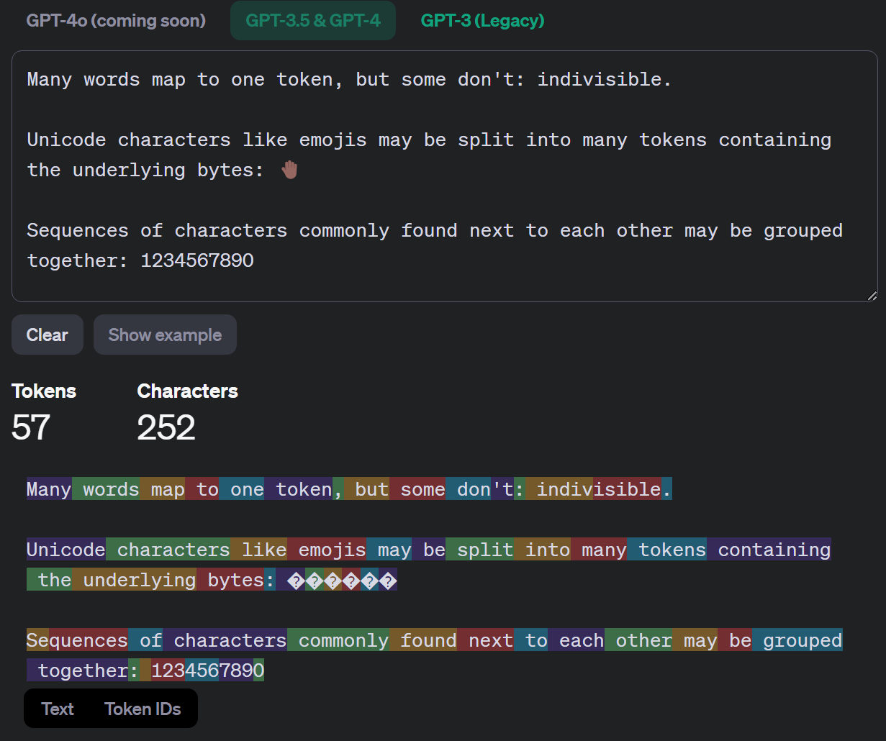
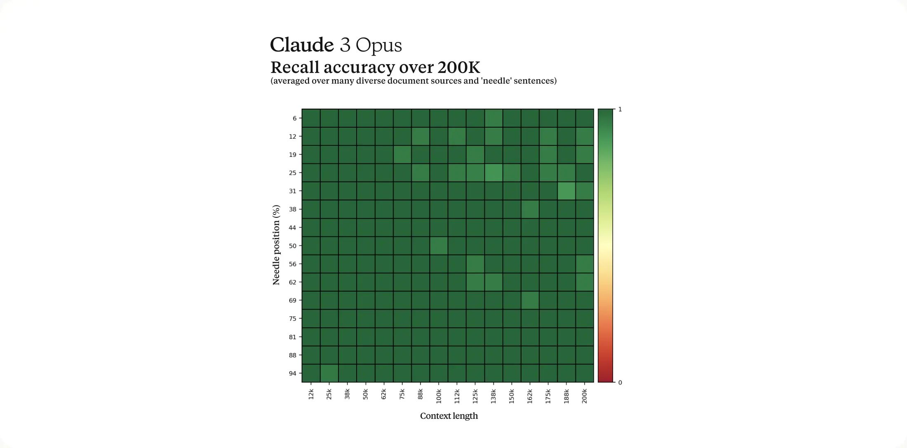
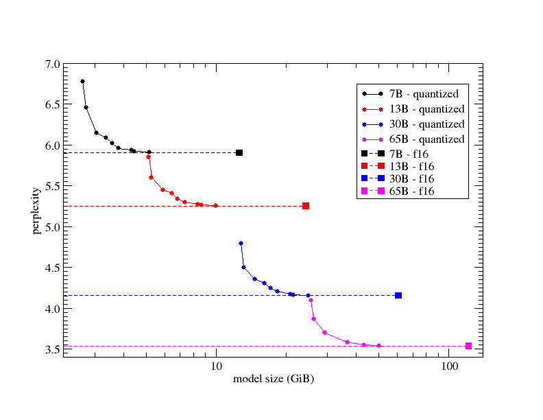

# 本地部署大语言模型的中文教学

> 🌏 **English readers:** this guide is also available in English. The [English edition (README.en.md)](README.en.md) is a full translation of this page, with the same sections, examples, numbers and images, so you only need to read one version. 本页是中文原版；英文版在 [README.en.md](README.en.md)。

> 最后一次大修：2026 年 10 月
> 具体型号、价格和命令变得很快，所以我会尽量把“为什么”讲清楚。这样就算哪天型号过时了，你也知道该怎么自己判断。

Hello！大家好，这里是 Anser！

你大概已经用过 ChatGPT、Claude 或者 DeepSeek，心想：“哇，这东西也太酷了吧。”然后某一天你冒出一个念头：**能不能让它在我自己的电脑上跑？** 不用联网，不用按月付费，聊什么都不用担心被别人看到，还能随便拿来做自己的小工具。

当然可以！这篇教程就是写给你的。

我自己就是这么一路折腾过来的。我用本地模型做过一个多语言翻译器，也做过一个总结长篇 PDF 和网课视频的小工具，中间踩了数不清的坑。所以我想把这些经验整理出来，让你少走一点弯路。

这篇文章会**手把手**带你走：先看看自己的电脑能干什么，然后十分钟内跑起第一个模型，再一点点弄懂背后到底发生了什么。

- **你不需要会编程，也不需要懂机器学习。** 每个新词第一次出现时，我都会先解释它是什么。
- 后面也有很硬核的内容，比如多显卡并行、几百人同时使用的服务器、FP4 数字格式。这些我都标出来了，第一次读完全可以跳过。

我很有可能会犯错，LLM 的软硬件更新速度也实在太离谱了。如果你发现哪里讲错了或者过时了，欢迎提 Issue 或 PR，谢谢！

赞助我：[微信赞助（点击查看二维码）](wechat-sponsor.jpg) · [Buy me a coffee](https://buymeacoffee.com/ansertbyu)

也非常感谢 [r/LocalLLaMA](https://www.reddit.com/r/LocalLLaMA/) 社区。很多人不吝公开自己的硬件测试、运行参数和踩坑过程，我从大家身上学到了太多东西。

---

## 先选一条适合你的路线

这篇文章很长，但你**完全不用从头读到尾**。找到最像你的那一行，按顺序点过去就好：

| 你现在的情况 | 推荐的阅读顺序 |
|---|---|
| 🌱 **只想先在自己电脑上跑起来**（大多数人从这里开始！） | [第 0 步](#第-0-步先看看你的电脑) → [第一部分](#第一部分十分钟跑起第一个模型) → [第二部分](#第二部分刚才到底发生了什么)，遇到问题看[第五部分](#第五部分出问题了怎么办) |
| 🧐 **已经跑起来了，想知道为什么快或慢、该换哪个模型** | [第三部分](#第三部分为什么有时快有时慢) → [第四部分](#第四部分怎么挑一个模型) → [常见误区](#常见误区) |
| 🛒 **准备买或者升级硬件** | [第 0 步](#第-0-步先看看你的电脑) → [第三部分](#第三部分为什么有时快有时慢) → [第六部分](#第六部分要不要升级硬件)，想算账再看[第十三部分](#第十三部分本地部署到底省不省钱) |
| 🏢 **要给团队或公司部署一个大家共用的模型** | 先快速过一遍[第二部分](#第二部分刚才到底发生了什么)和[第三部分](#第三部分为什么有时快有时慢)，然后读[第七部分](#第七部分更多部署工具) → [第八部分](#第八部分给很多人用vllm-与高并发) → [第九部分](#第九部分多-gpu多机与并行方法) → [第十部分](#第十部分认真评测和比较模型) |
| 🔬 **就是好奇，想把原理搞明白** | 新手部分读完后，看[第十一部分](#第十一部分精度与量化)和[第十二部分](#第十二部分速度上限的数学与-speculative-decoding) |

文中会用三种小标记告诉你某一段是写给谁的：

- 🌱 **新手必读**：第一次读就应该看的内容。
- 🔧 **进阶**：第一次读可以跳过，跑起来、用熟了以后再回来看。
- 🔬 **原理深入**：写给好奇心旺盛的你。不读完全不影响使用。

---

## 目录

**🌱 新手篇**

- [第 0 步：先看看你的电脑](#第-0-步先看看你的电脑)
- [第一部分：十分钟跑起第一个模型](#第一部分十分钟跑起第一个模型)
- [第二部分：刚才到底发生了什么？](#第二部分刚才到底发生了什么)
- [第三部分：为什么有时快、有时慢？](#第三部分为什么有时快有时慢)
- [第四部分：怎么挑一个模型](#第四部分怎么挑一个模型)
- [第五部分：出问题了怎么办](#第五部分出问题了怎么办)
- [第六部分：要不要升级硬件？](#第六部分要不要升级硬件)

**🔧 进阶篇**

- [第七部分：更多部署工具](#第七部分更多部署工具)
- [第八部分：给很多人用：vLLM 与高并发](#第八部分给很多人用vllm-与高并发)
- [第九部分：多 GPU、多机与并行方法](#第九部分多-gpu多机与并行方法)
- [第十部分：认真评测和比较模型](#第十部分认真评测和比较模型)

**🔬 原理深入与算账**

- [第十一部分：精度与量化](#第十一部分精度与量化)
- [第十二部分：速度上限的数学与 speculative decoding](#第十二部分速度上限的数学与-speculative-decoding)
- [第十三部分：本地部署到底省不省钱？](#第十三部分本地部署到底省不省钱)

**📚 收尾**

- [常见误区](#常见误区)
- [延伸阅读与资料来源](#延伸阅读与资料来源)

---

## 第 0 步：先看看你的电脑

> 🌱 新手必读，大概 10 分钟。

我被问得最多的问题是：“我的电脑能跑吗？”几乎所有电脑都能跑某个大小的模型，区别在于能跑多大、多快。要回答这个问题，需要先知道跑模型时每个硬件负责什么，以及数据在它们之间怎么移动。

### 以一台具体的机器为例

下面用一台常见的高端游戏主机举例：

| 部件 | 这台机器的配置 | 跑 LLM 时负责什么 | 关键数字 |
|---|---|---|---|
| 硬盘 | 2TB NVMe SSD（PCIe 4.0） | 存放模型文件。只在加载模型时读一次 | 顺序读取约 7GB/s |
| 系统内存（RAM） | 32GB DDR5-6000，双通道 | 加载时的中转站；显存装不下时，存放剩下的模型层 | 带宽约 96GB/s |
| CPU | AMD Ryzen 5 7600X，6 核 | 把文字切成 Token、调度 GPU、处理输出；显存装不下时，计算放在内存里的那些层 | FP32 峰值约 1 TFLOPS |
| PCIe 通道 | PCIe 4.0 x16 | 内存和显存之间传数据 | 单向约 32GB/s |
| GPU | NVIDIA RTX 4090 | 执行矩阵乘法，也就是模型的绝大部分计算 | FP16 Tensor Core 约 165 TFLOPS（FP32 累加，不含稀疏） |
| 显存（VRAM） | 24GB GDDR6X，焊在显卡上 | 存放模型权重、KV cache 和计算中间结果 | 带宽 1,008GB/s |

先注意两组对比：

- **算力**：GPU 约 165 TFLOPS，CPU 约 1 TFLOPS，相差上百倍。
- **带宽**：显存 1,008GB/s，系统内存约 96GB/s，PCIe 约 32GB/s。GPU 读显存比 CPU 读内存快约 10 倍，比通过 PCIe 从内存读快约 30 倍。

GPU 只能直接计算已经放在显存里的数据。所以跑模型时，我们希望模型完整地待在显存里。

### 跑模型时，数据在哪里、计算在哪里

假设我们在这台机器上跑一个 8B 参数、Q4 量化后约 5GB 的模型（“8B”和“Q4”是什么，下面马上解释）。

**加载（只发生一次）：** 模型文件从 SSD 读入系统内存，再通过 PCIe 复制到显存。5GB 从 SSD 读取约 1 秒，经 PCIe 复制约 0.2 秒。加载完成后，权重一直留在显存里。

**你发送一句话：** CPU 用 tokenizer 把文字切成一串 Token ID（一串整数），传给 GPU。这一步的数据量和计算量都很小。

**生成每一个 Token：**

1. GPU 从显存读出全部约 5GB 权重，和当前 Token 的数据做一遍矩阵乘法。计算量大约是 `2 × 参数量`，也就是约 16 GFLOPs；
2. 同时读写显存里的 KV cache（之前所有 Token 的中间结果，[第三部分](#kv-cache为什么不用每次从头算)会讲）；
3. 算出词表里每个 Token 作为下一个 Token 的概率，选出一个；
4. 把选出的 Token 转回文字显示给你，然后回到第 1 步。

现在算一下第 1 步各要多久：

```text
读权重：5GB ÷ 1,008GB/s ≈ 5 毫秒
做计算：16 GFLOPs ÷ 165 TFLOPS ≈ 0.1 毫秒
```

读数据比计算慢约 50 倍。GPU 的大部分时间都在等数据从显存送过来，所以生成速度的上限大约是 `1 ÷ 5 毫秒 ≈ 200 token/s`。这种被内存带宽限制住的情况，叫 **memory-bound**。

同一个模型如果完全放在系统内存里用 CPU 跑，读一遍权重要 `5GB ÷ 96GB/s ≈ 52 毫秒`，上限约 19 token/s。

再看一个装不下的例子：一个 Q4 量化后约 40GB 的 70B 模型。24GB 显存最多放约 22GB 权重，剩下约 18GB 放在系统内存里由 CPU 计算。每生成一个 Token：

```text
GPU 部分：22GB ÷ 1,008GB/s ≈ 22 毫秒
CPU 部分：18GB ÷ 96GB/s  ≈ 188 毫秒
合计约 210 毫秒，上限不到 5 token/s
```

只有不到一半的权重放在内存里，却占了 90% 的时间。这就是“模型放不进显存就会慢很多”的原因。

由此可以得到一条规则：

> **在一个用户、一次只处理一个请求（batch size = 1）的情况下：能不能跑，看模型和 KV cache 能不能放进显存（或统一内存）；跑多快，看每生成一个 Token 要读多少字节，以及读这些字节的内存带宽有多高。**

这条规则有前提。如果很多请求一起处理（batch size 变大），读一次权重可以同时给多个 Token 用，计算量成倍增加，瓶颈会逐渐从带宽转向算力，这叫 **compute-bound**。读很长的输入（Prefill）时也一样。[第三部分](#memory-bound-和-compute-bound)会讲这两种情况怎么区分。

### 统一内存的机器

苹果 M 系列芯片、AMD Strix Halo（Ryzen AI Max）和 NVIDIA DGX Spark 用的是**统一内存**：CPU 和 GPU 共用同一组 LPDDR 内存，没有单独的显存，也不需要经过 PCIe 复制。

这类机器的特点是容量大、带宽居中。例如：

| 机器 | 最大内存 | 内存带宽 |
|---|---:|---:|
| Apple M5 Max | 128GB | 最高 614GB/s |
| NVIDIA DGX Spark | 128GB | 273GB/s |
| AMD Strix Halo（Ryzen AI Max+ 395） | 128GB | 256GB/s |

容量比 RTX 4090 的 24GB 大得多，带宽在双通道 DDR5 和 RTX 4090 之间。所以它们能装下 4090 装不下的大模型，速度则取决于模型每个 Token 要读多少数据。[第六部分](#第六部分要不要升级硬件)会详细比较。

### 怎么查看自己的配置

**Windows：**

1. 按 `Ctrl + Shift + Esc` 打开任务管理器，点“性能”。
2. 点“内存”，看总容量和速度（比如 32GB、6000 MT/s）。
3. 点“GPU”，看显卡型号和**“专用 GPU 内存”**，这个就是显存。很多笔记本有两个 GPU（集成显卡和独立显卡），看 NVIDIA 或 AMD 的那一个。
4. NVIDIA 显卡也可以按 `Win + R`，输入 `cmd` 回车，再运行 `nvidia-smi`。输出里能看到型号和显存大小，比如 `24564MiB` 约等于 24GB。

任务管理器里的“共享 GPU 内存”**不是**显存，而是显存不够时 GPU 通过 PCIe 借用的系统内存，速度见上表。

**macOS：** 苹果菜单 → “关于本机”，可以看到芯片（比如 M4 Pro）和内存（比如 48GB）。Apple Silicon 是统一内存，系统默认允许 GPU 使用其中大约三分之二到四分之三，其余留给系统和其他程序。

**Linux：** `nvidia-smi` 看显卡和显存，`free -h` 看内存。

查到型号后，可以在厂商官网的规格页里找到显存或内存带宽。这个数字后面会一直用到。

### 我的电脑大概能跑多大的模型？

先解释两个会到处出现的词。

**参数量（8B、14B、70B）**：Transformer 的每一层主要由几个大矩阵组成，比如 4096×4096 或 4096×14336 的矩阵。矩阵里的每一个数叫一个**参数**（也叫权重）。“8B”表示模型总共约 80 亿个这样的数（B = billion，十亿）。训练时，用大量文本和梯度下降反复调整这些数，让模型预测下一个 Token 越来越准；训练完成后这些数就固定了，推理时模型只是用它们和输入做矩阵乘法。参数越多，模型通常能力越强，但占的内存越多、每个 Token 要读的数据也越多。

**量化（Q4、Q8）**：原版模型通常用 BF16 格式保存每个参数，每个占 2 字节，所以 8B 模型约 16GB。量化是把每个参数改用更少的位数保存，比如 4 位，再给每一小组参数额外存一个缩放系数，用来还原大致的数值。Q4 量化后平均每个参数约 4.5～5 位，8B 模型约 5GB，体积是原版的三分之一左右，质量损失通常不大。本地运行几乎都用量化版本，细节见[第二部分](#量化q4_k_m-到底是什么意思)。

按常见的 Q4 量化版本粗略估算，模型权重的大小约为 `参数量（B）× 0.6 GB`。再给上下文和程序留出空间，可以得到下面这张表（“可用显存”指独立显卡的显存，或统一内存机器里 GPU 能用的部分）：

| 可用显存/内存 | 推荐先试的模型大小 | 对应的 Q4 权重大小 |
|---|---|---|
| 没有独立显卡，16GB 内存 | 1B～4B，最多 8B | 约 1～5GB，用 CPU 跑 |
| 6～8GB 显存 | 4B～8B | 约 3～5GB |
| 12～16GB 显存 | 8B～14B | 约 5～9GB |
| 24～32GB 显存 | 14B～32B | 约 9～20GB |
| 64～128GB 统一内存 | 70B 级别，或 80B～120B 级别的 MoE 模型 | 约 40～75GB |

一个实际的例子：我以前的笔记本是 AMD R5 7640U（28W 低功耗处理器）+ 32GB 双通道 DDR5-5600，没有独立显卡。7B 模型的 Q4 版本约 4GB，按带宽估算上限是 `约 90GB/s ÷ 4GB ≈ 22 token/s`，实测大约 8 token/s。所以没有独显也能用小模型正常聊天。

### 下一步

知道了自己的硬件，下一步直接跑一个模型。

---

## 第一部分：十分钟跑起第一个模型

> 🌱 新手必读。先跑起来，再讲原理。说真的，先跑起来比先研究买四张显卡重要多了。

运行模型需要一个**推理程序**（也叫推理框架或 runtime）。它负责读取模型文件、把权重放到显存或内存里、调用 GPU 或 CPU 计算，并提供聊天界面或 API。最适合新手的两个是：

| 程序 | 适合谁 |
|---|---|
| [LM Studio](https://lmstudio.ai/) | 想要图形界面，不想碰命令行。**第一次我最推荐用它** |
| [Ollama](https://ollama.com/) | 习惯命令行，或者想让别的软件调用模型 |

两个都免费，都支持 Windows、macOS 和 Linux。它们底层都基于 llama.cpp 这类推理引擎（[第七部分](#第七部分更多部署工具)会讲）。下面先用 LM Studio 走一遍。

### 用 LM Studio 跑第一个模型

> 软件界面经常更新，按钮名字可能和我写的不完全一样，但流程是一样的。

1. **安装**：去 [lmstudio.ai](https://lmstudio.ai/) 下载对应系统的安装包，装好后打开。
2. **找模型**：点左侧的放大镜图标（Discover），输入模型名字。第一次建议选一个 **4B～8B**、名字里带 Instruct 或 Chat 的模型（这类模型经过对话训练，原因见[第二部分](#base-模型和-instruct-模型)），比如搜 `Qwen3 8B`。显存小的话，按[第 0 步的表](#我的电脑大概能跑多大的模型)选更小的。
3. **选文件**：同一个模型会有好几个版本，后缀像 `Q4_K_M`、`Q5_K_M`、`Q8_0`，这些是不同的量化程度：数字越小，文件越小、越快，质量也略低。**第一次选 `Q4_K_M`。** LM Studio 一般会标出哪个版本能整个放进你的显存（类似“Full GPU Offload Possible”），优先选这种。
4. **下载**：8B 的 Q4 约 5GB。
5. **加载**：回到聊天页面，点顶部的“选择要加载的模型”，选刚下载的模型。加载前展开设置，看两个选项：
   - **Context Length（上下文长度）**：先设成 `8192`（8K）。开得越大，KV cache 占的显存越多，原因在[第三部分](#kv-cache为什么不用每次从头算)。
   - **GPU Offload**：拉到最大，表示把所有层都放到 GPU 上。拉不到最大，说明显存放不下，部分层会留在系统内存里由 CPU 计算，速度会像第 0 步的 70B 例子那样明显下降。
6. **开聊**：输入“你好，介绍一下你自己”，回车。

看到文字逐个出现，就说明模型已经在你的电脑上跑起来了。

界面上通常会显示速度，比如 `45 tok/sec`，即每秒生成 45 个 Token。作为参考：

- 每秒 **20 个以上**：比阅读速度快，很流畅；
- **5～20 个**：可以用；
- **5 个以下**：通常说明有一部分模型没放进显存，看[第五部分](#第五部分出问题了怎么办)。

也可以把这个数字和[第 0 步](#跑模型时数据在哪里计算在哪里)的估算对比一下：实测一般能达到“带宽 ÷ 模型大小”上限的一半到八成。如果差得很远，多半是 GPU 没有被完全用上。

### 另一个选择：Ollama

如果你习惯命令行，Ollama 更直接。去 [ollama.com](https://ollama.com/) 下载安装，然后打开终端（Windows 上是 PowerShell 或“命令提示符”，macOS 上是“终端”），输入：

```bash
ollama run qwen3:8b
```

第一次运行会自动下载模型，下载完就能直接在终端里聊天，输入 `/bye` 退出。新版 Ollama 也带了图形聊天窗口，可以在那里选模型聊天。

```bash
ollama list   # 查看已经下载的模型
```

`qwen3:8b` 是 Ollama 的模型标签。Ollama 会默认选一个量化版本，通常是 Q4 左右；具体是哪个版本，可以在 Ollama 官网的模型页面上看。

### 加分项：让别的软件也用上你的模型

LM Studio 和 Ollama 都可以开一个**本地 API 服务**。API 是程序之间互相调用的接口：网页聊天是你直接用模型，而笔记软件、编辑器插件或你自己写的脚本要用模型，就要通过 HTTP 请求调用 API。

很多软件支持 **OpenAI-compatible API**，即请求和返回的格式与 OpenAI 的 API 相同。把软件设置里的服务器地址从 OpenAI 改成你自己电脑的地址，它就会改用本地模型：

- LM Studio：在开发者（Developer）页面打开本地服务器，默认地址是 `http://localhost:1234/v1`；
- Ollama：装好后默认在 `http://localhost:11434` 运行。

`localhost` 指的是本机。我的翻译器和 PDF 总结工具，就是这样接上本地模型的。

### 下一步

模型跑起来以后，下一部分解释你刚才看到的 Token、`Q4_K_M`、Context Length 分别是什么。

如果没跑起来，直接看[第五部分：出问题了怎么办](#第五部分出问题了怎么办)。

---

## 第二部分：刚才到底发生了什么？

> 🌱 新手必读。这一部分解释你刚才在 LM Studio 或 Ollama 里看到的东西：Token、模型怎样生成文字、为什么要选 Instruct 版本、上下文长度和量化。

想系统了解 LLM 的话，推荐两个不需要编程和数学基础的视频：

- Andrej Karpathy 的 [Intro to Large Language Models](https://www.youtube.com/watch?v=zjkBMFhNj_g)：一小时讲清楚 LLM 怎么训练、怎么使用；
- 3Blue1Brown 的 [But what is a GPT?](https://www.youtube.com/watch?v=wjZofJX0v4M)：用动画讲 Transformer 内部的计算，B 站上有中文字幕版。

### Token 与 tokenizer

**Token** 是模型输入和输出的基本单位。模型不直接处理文字，而是处理一串整数：**tokenizer** 按一张固定的词表，把文本切成片段，再把每个片段换成它在词表里的编号（Token ID）。词表通常有十几万个条目，例如 Qwen3 的词表约 15 万个。

切出来的片段长短不一：

- 英文中常见的单词通常是一个 Token，不常见的长单词会被切成几段；
- 中文里，常见的词或短语可能是一个 Token，不常见的字可能单独一个 Token，甚至被拆成几个；
- Emoji 和少见符号可能被拆成好几个 Token，每个 Token 只对应它 UTF-8 编码里的几个字节。

下图是 OpenAI 的 Tokenizer 演示页面，每种颜色是一个 Token。最后那串问号就是一个 emoji 被拆成的几个 Token，单独一个 Token 无法显示成完整字符：



不同模型的词表不同，同一段中文切出的 Token 数也不同。所以两个模型都显示 `50 tok/s`，每秒生成的汉字数不一定一样。计算上下文长度、API 价格和生成速度时，用的都是 Token 数，而不是字数。

### 模型怎样生成文字：一次预测一个 Token

模型每次运行（一次 **forward pass**）的过程是：

1. 把每个 Token ID 换成一个向量（embedding），比如 4096 个数字；
2. 让这些向量依次通过几十层 Transformer。每一层主要做两件事：attention（让每个 Token 读取前面所有 Token 的信息）和 MLP（对每个 Token 的向量再做几次矩阵乘法）；
3. 最后一层输出词表里每个 Token 的分数，换算成概率，表示“下一个 Token 是它”的可能性。

然后程序从这个概率分布里选出一个 Token，接到输入末尾，再运行一次，预测再下一个。这叫**自回归生成**。生成 1000 个 Token，就要按顺序运行约 1000 次，后一次必须等前一次选出结果。你在屏幕上看到文字逐个出现，就是这个原因。

选 Token 的规则由几个采样参数控制：

- **temperature**：调整概率分布的平坦程度。越低越倾向于选概率最高的 Token，输出稳定但容易重复；越高越可能选到低概率的 Token，输出更多样，也更容易出错；
- **top-p / top-k**：只在概率最高的一部分 Token 里选，过滤掉概率很低的选项。

做这些计算的神经网络结构叫 **Transformer**，出自 2017 年的神之论文 [Attention Is All You Need](https://arxiv.org/abs/1706.03762)。它提出后多年，主流 LLM 的基本结构都没有大的改变。


这张图是论文里的原始架构。左边是编码器（Encoder），右边是解码器（Decoder），因为这篇论文是为机器翻译设计的。今天的聊天模型基本都是 **decoder-only**：只保留右边的解码器结构（去掉其中连接编码器的那一块），再把它重复堆叠几十层。参数越多的模型，通常层数越多、每层的矩阵越大。

### base 模型和 instruct 模型

模型训练一般分两个阶段：

1. **预训练（pre-train）**：用海量文本（网页、书籍、代码等）训练模型预测下一个 Token。得到的是 **base 模型**。它学到了大量知识，但只会续写文本。输入“中国的首都是哪里？”，它可能接着写出几道类似的考题，而不是回答问题。
2. **后训练（post-train）**：用对话数据、人类偏好反馈和强化学习继续训练，让模型按照指令回答问题。得到的是 **instruct 模型**（也叫 chat 模型）。ChatGPT 就是这样训练出来的。

所以**下载时请选名字里带 Instruct、Chat 或明确说明是对话模型的版本**。现在很多模型默认发布的就是对话版；名字里带 `Base` 的，通常不是你要的。

相关的三个概念：

- **聊天模板（chat template）**：模型的输入只是一串 Token。为了区分“用户说的话”和“助手说的话”，训练时会用一些特殊 Token 把每一轮对话包起来，比如 `<|im_start|>user ... <|im_end|>`。推理时必须用和训练时完全相同的格式，模型才能正常回答。每个模型的模板不同，LM Studio 和 Ollama 一般会从模型文件里读取并自动套用。模板不对时，模型会自问自答、输出奇怪的标记，或者停不下来。
- **系统提示（system prompt）**：放在对话最开头的一段指令，比如“只用中文回答，回答尽量简短”。它和用户消息一样只是输入的一部分，但模型被训练成会优先遵守它。
- **推理模型（reasoning / thinking 模型）**：回答前先生成一段思考过程（有的界面会折叠起来），再给出答案。在数学、代码这类任务上通常更准，但要多生成很多 Token，所以更慢。很多模型和程序提供开关，日常聊天可以关掉思考模式。

### 上下文长度（context length）

模型本身没有记忆。多轮对话时，程序每次都会把**整段聊天记录**加上你的新问题，重新作为输入交给模型。模型一次能处理的最大 Token 数叫**上下文长度**，比如 8K、32K、128K，这是训练时决定的。

聊天记录超过上下文长度后，程序只能丢掉或压缩最早的内容，模型也就看不到开头说过什么了。

上下文不是开得越大越好：

1. **占内存。** 模型要为上下文里的每个 Token 保存一份中间结果（KV cache），它随上下文长度线性增长，长上下文时可能比模型本身还大。所以在 LM Studio 里建议先开 8K。[第三部分](#kv-cache为什么不用每次从头算)会具体计算。
2. **能放进去，不代表能用好。** 模型声称支持 128K，不代表它在 128K 的输入里还能准确找到并使用每个细节。

厂商常用 needle in a haystack 测试第二点：在一篇长文的某个位置插入一句话，然后问模型这句话的内容。下图是 Anthropic 发布 Claude 3 Opus 时公开的结果：横轴是上下文长度，纵轴是那句话在文中的位置，颜色越绿表示找得越准。



顶级模型在这项测试上已接近满分，但它只检查“能不能找到一句话”。真实任务通常要求理解和综合整篇文档，难度高得多；本地的小模型在长上下文上一般也明显弱于顶级模型。我的建议是：**日常聊天 8K 足够；读长文档时开到 16K～32K，并用你自己的文档测试模型是否真的读懂了。**

### 量化：Q4_K_M 到底是什么意思

[第 0 步](#我的电脑大概能跑多大的模型)说过，量化是用更少的位数保存每个参数。GGUF 文件名里的后缀是这样读的：

- **Q**：quantized，量化；
- **4**：每个参数大约 4 位（加上缩放系数等辅助数据后，平均会多一点）；
- **K**：k-quant，llama.cpp 的一种量化方法，按小块分别计算缩放系数，比早期方法误差更小；
- **M**：medium。同一档位通常有 S（small）、M、L（large）三种，越大保留的精度越多。

量化会损失多少质量？下图来自 llama.cpp 引入 k-quant 时的[测试](https://github.com/ggml-org/llama.cpp/pull/1684)：



读图方法：

- 横轴是模型文件大小，纵轴是 **perplexity**（困惑度）。它衡量模型对测试文本中每个下一个 Token 预测得有多准，**越低越好**。它和实际任务表现相关，但不完全等价；
- 每种颜色是一个尺寸的模型，虚线是不量化（f16）时的 perplexity；
- 同一条曲线上越往左，量化越狠、文件越小。

从图上可以看到：

- 量化到中间档位时，曲线几乎贴着虚线，质量损失很小；
- 量化到最左边的 Q2 一档时，曲线明显上翘，质量下降很多；
- 在这组测试里，大模型量化后仍好于小模型不量化，比如 13B 的 Q4 好于 7B 的 f16。

这张图是 2023 年用 LLaMA 模型测的，具体数字已经过时，但规律基本仍然成立。我的推荐：

- **默认选 `Q4_K_M`**，体积和质量最平衡；
- 显存有富余，选 `Q5_K_M` 或 `Q6_K`；`Q8_0` 几乎无损，但体积接近 Q4 的两倍；
- 装不下时再考虑 Q3；Q2 是最后的选择；Q1 基本不可用；
- 越小的模型对量化越敏感；数学、代码和长上下文任务也更容易受影响。

“大模型 Q2 一定好于小模型 Q5”没有保证，最好用你自己的任务分别测试。

下载页面上还会看到其他格式：

- **GGUF**：llama.cpp 定义的模型文件格式，LM Studio、Ollama 都用它。上面的 Q4_K_M 就是 GGUF 的量化档位。**本地个人使用，认准 GGUF 即可。**
- **safetensors**：原版模型最常见的格式，通常没有量化、体积大，主要给 vLLM 这类服务器程序使用。
- **GPTQ、AWQ、FP8、NVFP4、MLX 等**：其他量化方法或格式，面向特定程序或硬件（MLX 是苹果芯片专用的）。见[第十一部分](#第十一部分精度与量化)。

### 下一步

现在你知道了模型怎样逐个生成 Token、为什么要选 Instruct 版本，以及上下文和量化是什么。下一部分把[第 0 步](#跑模型时数据在哪里计算在哪里)的估算方法展开：不同硬件、不同模型的速度怎么估，什么时候受带宽限制，什么时候受算力限制。

---

## 第三部分：为什么有时快、有时慢？

> 🌱 新手必读。只用到乘除法。读完这部分，你就能自己估算“这个模型在这台机器上大概多快”，也能看懂大部分硬件评测。

[第 0 步](#跑模型时数据在哪里计算在哪里)用 RTX 4090 算过一次：生成一个 Token 时，读权重要 5 毫秒，计算只要 0.1 毫秒。这一部分把这个方法推广到不同的硬件和使用方式。

### 四个硬件指标

**容量（GB）**：显存或内存能不能放下模型权重、KV cache 和运行时需要的其他数据。放不下时，只能换更小的模型、用更低的量化、缩短上下文，或者把一部分放到更慢的内存里。算力再高也解决不了容量问题。

**内存带宽（GB/s）**：每秒能从显存或内存读出多少数据。一个用户、一次一个请求时，生成速度主要由它决定。

**算力（FLOPS）**：每秒能做多少次浮点运算。处理长输入、同时服务很多请求、训练模型时，它变得重要。显卡规格里常写的是 Tensor Core 在某种精度（FP16、FP8、FP4）下的峰值。

**互联带宽**：多张显卡之间、多台机器之间传数据的速度，比如 PCIe、NVLink、网络。只用一张卡时不用考虑，多卡时可能成为瓶颈，见[第九部分](#第九部分多-gpu多机与并行方法)。

### 估算单用户的生成速度

一个用户、一次一个请求（batch size = 1）时，每生成一个 Token，都要把几乎全部权重从内存读一遍，所以：

```text
生成速度上限（token/s）≈ 内存带宽（GB/s）÷ 每个 Token 要读的权重（GB）
```

对普通的（非 MoE）模型，“每个 Token 要读的权重”就是模型文件大小。以 Q4 量化后约 5GB 的 8B 模型为例：

| 设备 | 内存带宽 | 上限 |
|---|---:|---:|
| 双通道 DDR5-5600 内存，CPU 计算 | 约 90GB/s | 约 18 token/s |
| AMD Strix Halo（Ryzen AI Max+ 395） | 256GB/s | 约 51 token/s |
| RTX 4060 Ti 16GB | 288GB/s | 约 58 token/s |
| Apple M5 Max（最高配置） | 614GB/s | 约 123 token/s |
| RTX 3090 | 936GB/s | 约 187 token/s |
| RTX 4090 | 1,008GB/s | 约 202 token/s |
| RTX 5090 | 1,792GB/s | 约 358 token/s |

这些是上限。实际还要读 KV cache、把量化数据还原成计算用的格式、启动 GPU 计算任务，硬件也很难持续跑满标称带宽，所以实测一般在上限的五成到八成之间。这个公式最适合用来**比较**：同一个模型，带宽翻倍，速度大致也接近翻倍；模型大小减半，速度也接近翻倍。

用它可以直接解释几个常见现象：

- Q4 比原版 BF16 快：每个 Token 要读的数据从 16GB 降到约 5GB；
- 显存放不下一部分层时速度骤降：那部分权重要从约 90GB/s 的系统内存读，[第 0 步的 70B 例子](#跑模型时数据在哪里计算在哪里)里，不到一半的权重占了 90% 的时间；
- Mac 跑模型比同价位 PC 的 CPU 快：M 系列芯片的统一内存带宽是普通双通道内存的数倍。

### memory-bound 和 compute-bound

一项计算的速度受带宽还是算力限制，取决于**每读一个字节，要做多少次运算**，这叫算术强度（arithmetic intensity）。

以 RTX 4090 为例，它的算力和带宽之比约为：

```text
165 TFLOPS ÷ 1,008GB/s ≈ 164 FLOPs/byte
```

意思是：每读一个字节，至少要做约 164 次运算，算力才会被用满。低于这个值，GPU 在等数据（memory-bound）；高于这个值，带宽有富余、GPU 在忙着计算（compute-bound）。

Q4 权重平均每个参数约 0.6 字节，每个参数对每个 Token 做 2 次运算（一次乘法、一次加法）：

- **一次处理 1 个 Token**（一个用户逐个生成）：每读 0.6 字节做 2 次运算，约 3 FLOPs/byte，远低于 164，所以是 memory-bound；
- **一次处理 N 个 Token**：读一遍权重可以给 N 个 Token 共用，算术强度约为 `3 × N`。N 达到大约 50 时，开始接近 4090 的算力上限，变成 compute-bound。

什么时候会一次处理很多 Token？两种情况：

1. **处理输入（Prefill）**：你发来的几千个 Token 可以一起计算；
2. **同时服务很多请求（batching）**：很多用户的请求合在一起，每一步每个请求各生成一个 Token。

这两种情况下，算力就变得重要了。

> 🔬 更精确的计算（包括 H200 的完整数值例子）见[第十二部分](#第十二部分速度上限的数学与-speculative-decoding)。

### Prefill 和 Decode

一次请求分两个阶段：

**Prefill（预填充）**：模型一次性处理全部输入，包括系统提示、聊天记录、文档和问题，并生成第一个 Token。输入里的所有 Token 可以一起计算，属于 compute-bound。例如在 RTX 4090 上处理 2,000 Token 的输入，8B 模型的计算量约为 `2,000 × 16 GFLOPs = 32 TFLOPs`，按 165 TFLOPS 算至少约 0.2 秒；实际还要加上 attention 的计算，输入越长，attention 部分增长得越快。

**Decode（解码）**：之后每一步生成一个 Token，每一步都要读一遍全部权重，属于 memory-bound（单用户时）。

这就是为什么贴进一篇长文章后，要等一会儿才出第一个字，而开始出字后速度比较稳定。从发送请求到看到第一个 Token 的时间叫 **TTFT**（Time To First Token，首字延迟），主要由 Prefill 决定；之后的 token/s 主要由 Decode 决定。

所以比较硬件时，不能只看算力或只看带宽：算力决定处理长输入有多快，带宽决定单用户生成有多快。

### KV cache：为什么不用每次从头算

Transformer 的 attention 让每个 Token 读取前面所有 Token 的信息。具体做法是：每一层为每个 Token 算出两组向量，Key（K）和 Value（V）；新 Token 用自己的向量和前面所有 Token 的 K 做比较，再按比较结果加权组合它们的 V。

在聊天模型使用的 causal Transformer 里，每个 Token 只能看到它前面的 Token。第 100 个 Token 出现后，第 1～99 个 Token 的 K 和 V 不会改变。所以生成第 101 个 Token 时，前 100 个 Token 的 K 和 V 可以直接复用，不需要重新计算。程序把它们保存在显存里，这块数据就叫 **KV cache**。

- 没有 KV cache：生成第 `t` 个 Token 时，要把前 `t-1` 个 Token 在每一层的 K 和 V 全部重算一遍，越往后越慢；
- 有 KV cache：每个 Token 的 K 和 V 只在它第一次进入模型时算一次，之后直接从显存读取。

代价是占显存，而且和上下文长度、同时进行的对话数成正比：

```text
KV cache 字节数 ≈ 2 × 层数 × KV head 数 × head dimension
                 × 每个元素字节数 × 已缓存 Token 数 × 并发序列数
```

开头的 `2` 是 K 和 V 两份。层数、KV head 数和 head dimension 写在模型的 `config.json` 里。

例如一个 32 层、8 个 KV head、head dimension 为 128 的模型，用 16 位（2 字节）保存 KV cache，单个 32K 上下文需要：

```text
2 × 32 × 8 × 128 × 2 bytes × 32768 ≈ 4 GiB
```

128K 上下文约 16GiB；同时 8 个这样的对话，还要再乘 8。

所以**一个 20GB 的模型放进 24GB 显卡后，剩下的空间不一定够用长上下文**：单个 32K 上下文的 KV cache 就要约 4GiB，还没算运行时的其他开销。这也是[第一部分](#用-lm-studio-跑第一个模型)建议先开 8K 的原因。

KV cache 也要在 Decode 时读取，所以上下文很长时，每个 Token 除了读权重，还要读一大块 KV cache，速度也会变慢。

> 🔧 新模型用 GQA、MQA、MLA 等结构减少每个 Token 要保存的 K/V 数据量。一些程序还支持把 KV cache 量化到 8 位甚至 4 位，进一步节省显存，但可能影响长上下文的准确率；如果程序没有对应的低精度计算代码，也可能只省容量、不提速。

### 一个模型到底要占多少内存？

只算权重：

```text
模型权重 GB ≈ 参数量（B）× 每参数位数 ÷ 8
```

以 8B 模型为例：

| 精度 | 纯权重大小 |
|---|---:|
| FP32（32 位） | 32GB |
| FP16/BF16（16 位，原版模型常见） | 16GB |
| FP8/INT8（8 位） | 8GB |
| 4 位 | 4GB |

实际文件会更大一点，因为还要存缩放系数等辅助数据，部分层也不量化。GGUF 的 `Q4_K_M` 可以按每参数 4.5～5 位估算，下载后以实际文件大小为准。

运行时的总占用是：

```text
模型权重 + KV cache + 计算中间结果（activation）+ 推理程序开销 + 系统和其他程序
```

所以 24GB 显存不能全部用来放权重。一般至少留出 10%～20%；上下文长、并发多时，按上面的 KV cache 公式算出具体数字。另外，同时开着的游戏、浏览器视频和其他 AI 软件也会占用显存。

能推理一个模型，不代表能训练它。训练除了权重，还要保存梯度、优化器状态等数据，用常见的混合精度 Adam 训练时，每个参数可能要 16 字节左右，是 BF16 推理的 8 倍，还不算 activation。LoRA/QLoRA 等方法能大幅减少训练所需的内存。

### MoE：总参数很大，激活参数很小

你会经常看到 `80B-A3B`、`235B-A22B` 这种名字，它们是 **MoE（Mixture of Experts，混合专家）** 模型。

普通模型（也叫密集模型，dense）的每一层 MLP，对每个 Token 都用到全部参数。MoE 把 MLP 拆成很多个较小的“专家”网络，每层还有一个 router，为每个 Token 选出其中少数几个（比如 128 个里选 8 个）参与计算，其余专家这一步不计算。


所以 MoE 有两个参数数字：

- **总参数**（名字里的 80B）：所有专家加起来，决定**要占多少内存**；
- **激活参数**（名字里的 A3B）：每个 Token 实际参与计算的参数，决定每个 Token 大约**要读多少数据、算多少次**。

比如 Qwen3-Next-80B-A3B 是约 80B 总参数、每个 Token 激活 3B；2026 年 8 月发布的 [Qwen3.8-Flash-Next](https://qwen.ai/blog?id=qwen3.8-flash-next) 是 125B 主模型参数、每个 Token 激活 6B，另外还有 51B 的 N-gram embedding。它们需要大模型的内存容量，但单用户的生成速度接近一个小得多的密集模型。

具体算一下：80B 模型按每参数 4.5 位，权重约 45GB，需要 64GB 以上的可用内存。每个 Token 激活 3B 参数，要读的权重约 `3B × 4.5 ÷ 8 ≈ 1.69GB`。在 256GB/s 的 Strix Halo 上，上限约 `256 ÷ 1.69 ≈ 151 token/s`。实际还要读 attention 层、共享专家、KV cache 等，所以会明显低于这个数，但同样内存放一个 45GB 的密集模型，上限只有 `256 ÷ 45 ≈ 6 token/s`。这就是大内存、中等带宽的统一内存机器特别适合跑 MoE 的原因。

但 MoE 并不是不受带宽限制：

- attention、共享专家等非专家部分，每个 Token 都要用到；
- 每个 Token 选哪些专家是动态决定的，内存访问不连续，实际效率会打折扣；
- 很多请求一起处理时，不同 Token 选中不同专家，一步下来可能大部分专家都要读一遍；
- 专家分布在多张卡上时，卡之间要来回传数据；
- 专家权重如果放在系统内存里，每次都要经过 PCIe 传到显卡（PCIe 4.0 x16 约 32GB/s），速度会被 PCIe 限制。

### 一个用户和很多用户

上面的估算大多针对一个用户。如果一个团队几十上百人共用一个模型，情况就不同了：服务器把很多请求合在一起处理，读一遍权重可以同时给几十个请求各生成一个 Token。根据上面的 memory-bound / compute-bound 分析，这时整台服务器每秒生成的总 Token 数会高很多，但每个用户分到的速度会下降，排队时间也会变长。这些在[第八部分](#第八部分给很多人用vllm-与高并发)详细讲。

### 小结

- 能不能跑：看**容量**，权重 + KV cache + 其他开销要放得下；
- 单用户（batch size = 1）生成速度：看**带宽**，上限 ≈ 带宽 ÷ 每个 Token 要读的权重；
- 长输入（Prefill）和多用户（大 batch）：**算力**开始成为限制；
- MoE：总参数决定占多少内存，激活参数决定单用户大概多快。

下一部分用这些方法来挑模型。

---

## 第四部分：怎么挑一个模型

> 🌱 新手必读。

没有对所有任务都最好的模型。挑模型的顺序是：先按硬件筛掉跑不动的，再在剩下的里面用自己的任务比较。

### 第一步：先筛掉跑不动的

排行榜上的模型再强，在你的电脑上跑不动也没用。所以第一步永远是按[第三部分](#第三部分为什么有时快有时慢)的方法筛一遍：

1. **装得下吗？** 模型文件 + KV cache + 其他开销，要能放进你的显存或统一内存；
2. **够快吗？** 用“带宽 ÷ 模型大小”估一下速度上限，再打个折，看看能不能接受；
3. **程序支持吗？** 特别新的模型架构，可能要等 LM Studio、Ollama 或 llama.cpp 更新之后才能跑。

举个例子：一张 24GB 的显卡，给 KV cache、推理程序和操作系统桌面留 6GB，能给模型的大约是 18GB。27B 模型按每参数 4.5 位算，大约 15.2GB，放得下；70B 模型光权重就要约 39.4GB，直接排除。如果这张卡带宽约 1,000GB/s，27B 模型实际文件 17GB，速度上限大约 `1,000 ÷ 17 ≈ 59 token/s`，实测会更低一些，但聊天已经很舒服了。

另外，不一定要用能跑的最大模型，**够用就行**。如果 8B 模型就能完成你的任务，它会比 32B 模型快三到四倍，还能留出更多显存给长上下文。

### 现在可以先试试这些

> 这一节写于 2026 年 8 月。模型差不多每三个月就更新一轮，同样大小的模型一代比一代强。看到这里的时候，请在 LM Studio 或 Hugging Face 上搜一下同一系列、同样大小的**最新版本**。

按[第 0 步](#我的电脑大概能跑多大的模型)的显存档位，下面是一些可以先试的方向：

| 可用显存/内存 | 先试这个大小 | 例子 |
|---|---|---|
| 8GB 左右 | 4B～8B | Qwen3-8B（就是[第一部分](#用-lm-studio-跑第一个模型)里用的那个） |
| 12～16GB | 8B～14B | Qwen3-14B、Gemma 3 12B |
| 24～32GB | 27B～32B | Qwen3.8-27B、Gemma 3 27B |
| 64～128GB 统一内存 | 大 MoE | Qwen3-Next-80B-A3B、Qwen3.8-Flash-Next |

中文场景下，Qwen、DeepSeek、GLM、Kimi 这些国产系列一般中文更好；Gemma、Llama、Mistral 等系列也各有特点。挑的时候注意两件事：

- 不同模型被优化的方向差别很大。有的擅长写代码，有的擅长多语言，有的擅长工具调用。**最好的办法就是拿你自己常用的几个问题，挨个试一下。**
- 要选对话版（instruct/chat），别下成 base 版。原因在[第二部分](#base-模型和-instruct-模型)。

### 去哪里下载：Hugging Face

[Hugging Face](https://huggingface.co/) 是托管模型权重和数据集的网站，几乎所有开源模型都在这里发布。LM Studio 的搜索功能搜的就是 Hugging Face，所以用 LM Studio 时不需要自己去网站下载。

如果你想自己去网站上看，一个模型页面通常有：

- **Model card（模型说明）**：介绍模型能干什么、上下文多长、许可证是什么、推荐的使用参数；
- **Files（文件）**：模型文件本体。

原版模型一般是 safetensors 格式，体积很大。想用 LM Studio、Ollama 或 llama.cpp 跑，就搜“模型名 + GGUF”。很多官方团队会自己发布 GGUF 版本（比如 `Qwen/Qwen3-8B-GGUF`），社区里也有一些专门做量化的人和团队（比如 unsloth、bartowski），会把热门模型做成各种量化档位。在文件列表里找到带 `Q4_K_M` 的那个文件就行。

### 下载之前先试一试

模型动辄几 GB 到几十 GB，下载前可以先在线试用：

- 很多模型的官方网站或者 Hugging Face 页面上有可以直接聊天的在线版本（Hugging Face 上叫 Spaces）；
- [LMArena](https://lmarena.ai/)：匿名展示两个模型对同一个问题的回答，由用户选更好的那个，再把大量投票汇总成排行榜。可以直接在上面提问对比，也可以看它按语言、代码、长文本等分类的排行榜。

不过要记住，**排行榜分数高，不代表它最适合你的任务**。人类的喜好也是可以被专门“讨好”的，比如回答写得更长、格式更漂亮，往往就更容易被选中。排行榜适合帮你缩小范围，最后还是得自己试。

> 🔧 想认真比较模型，比如给公司选模型、建立自己的测试集？看[第十部分](#第十部分认真评测和比较模型)。

### 别忘了看许可证！

“能下载”不等于“随便用”。如果你只是自己玩、做研究，一般都没问题；但如果要拿去**赚钱**（商用），一定要看清楚许可证。

- Apache-2.0、MIT 这类许可证一般允许商用，但也请仔细看原文；
- 有些模型用的是自定义许可证，可能限制用户数量、要求署名、禁止用它的输出训练别的模型，或者限制使用的地区和用途；
- 像 CC-BY-NC 这种带 NC（Non-Commercial）的，就是禁止商用。拿去做收费的小应用，很容易收到律师函。

许可证写在模型页面上，请看你下载的那个版本对应的原文。正式商用之前，最好请懂法律的人核对一下。

### 下一步

选好模型、跑起来之后，如果遇到问题，看下一部分；一切顺利的话，可以直接跳到[第六部分](#第六部分要不要升级硬件)，或者去[常见误区](#常见误区)看看有没有踩坑。

---

## 第五部分：出问题了怎么办

> 🌱 新手必读。下面是最常见的几类问题和排查顺序。

### 模型加载失败，或者提示内存不足（out of memory）

模型加上下文装不下了。按这个顺序试：

1. **把上下文长度调小**，比如从 32K 降到 8K；
2. **关掉占显存的程序**，比如游戏、浏览器里的视频、其他 AI 软件；
3. **换一个更小的量化档位**，比如从 Q5_K_M 换成 Q4_K_M；
4. **降低 GPU Offload**（也叫 GPU 层数）：让一部分层留在普通内存里给 CPU 算。能跑，但会慢；
5. **换一个更小的模型**。

### 速度特别慢（每秒只有几个 Token）

最常见的原因是**模型没有完全放进显存**，一部分层在系统内存里由 CPU 计算（原因见[第 0 步](#跑模型时数据在哪里计算在哪里)）：

- 在 LM Studio 里检查 GPU Offload 是不是拉满了，提示里有没有说“部分 offload”；
- 打开任务管理器的“性能 → GPU”，聊天时看“专用 GPU 内存”是不是接近满了、GPU 有没有在忙；
- 如果“共享 GPU 内存”占用很高，说明显存不够，GPU 正在通过 PCIe 借用系统内存；
- 笔记本请插上电源，并确认用的是独立显卡而不是集成显卡；
- 显卡驱动太旧也可能导致 GPU 没被用上，更新一下驱动。

如果模型确实比显存大，那慢是正常的，参考上面的办法换小一点的模型或量化档位。

### 等了很久才开始出第一个字

- 输入太长：模型要先处理全部输入（Prefill）才能生成第一个 Token，见[第三部分](#prefill-和-decode)；
- 用的是 thinking 模型：它先生成一段思考过程，再给答案。不需要的话可以关掉思考模式；
- 第一次加载模型：要先从硬盘读入内存再复制到显存，机械硬盘或慢速 SSD 会多花一些时间。

### 回答胡言乱语、不停重复、或者冒出奇怪的标签

- **聊天模板不对**：模型会自问自答，或者输出 `<|im_end|>` 这类奇怪标记。一般更新 LM Studio、Ollama 或换一个更规范的 GGUF 文件就能解决；
- **下载成了 base 模型**：它只会续写，不会好好回答。换成 instruct/chat 版本；
- **量化压得太狠**：Q2、Q1 很容易变笨、重复。换 Q4 或更高；
- **参数调得太极端**：temperature 太高会胡说，太低可能会重复。先恢复默认值试试。

### 提示“不支持的模型架构”（unknown architecture）

模型太新了，你的程序还不认识。更新 LM Studio（以及它里面的运行时）、Ollama 或 llama.cpp 到最新版本。如果还不行，就等几天，或者先用老一点的模型。

### 中文回答很别扭，或者总是用英文回答

有些模型的中文本来就一般。可以在系统提示里写“请始终用中文回答”，或者换一个中文更好的模型（比如 Qwen 系列）。

---

## 第六部分：要不要升级硬件？

> 🌱 准备买电脑或显卡时再看。如果你只是想用现有的电脑，可以先跳过。

我的建议是：**先用现有的电脑跑一段时间再决定买什么。** 用过之后才知道自己需要多大的模型、多长的上下文、多快的速度。不少人一开始就计划买多张显卡，用下来发现 14B 模型已经够用。

### 先问自己四个问题

1. 我要跑多大的模型？是普通的密集模型，还是 MoE？
2. 我要多长的上下文？同时有几个人用？
3. 我更在意一个对话的速度，还是整台机器的总吞吐？
4. 我只是推理（用模型），还是要微调，甚至从零训练？

想清楚之后，用[第三部分](#一个模型到底要占多少内存)的方法算出需要多少内存，再去挑硬件。只看显卡型号或者算力数字去买，很可能买回来发现模型根本装不下。

对于单用户本地推理，挑硬件的优先级通常是：容量 > 带宽 > 算力。

### 独立显卡路线

如果你买独立显卡，NVIDIA 目前依然是最省心的选择。原因不是它的卡一定最快，而是 **CUDA 生态**：vLLM、TensorRT-LLM、FlashAttention 和各种量化计算代码，通常最先提供 NVIDIA 版本；新模型发布后，也往往最先在 NVIDIA 卡上跑起来。

挑卡时我建议按这个顺序看：

1. **显存容量**：能不能装下你想跑的模型和 KV cache。这一条最重要！
2. **显存带宽**：决定一个人用时的生成速度；
3. **架构支不支持你要用的精度**：比如 FP8、FP4，详见[第十一部分](#不同-gpu-架构支持什么精度)；
4. **软件支不支持**；
5. **功耗、散热、价格和保修**。

举个例子：如果模型需要约 20GB 权重，还要留 KV cache 的空间，一张二手的 24GB RTX 3090（936GB/s）可能比一张更新、更贵的 16GB 显卡更合适。16GB 的卡放不下，有几 GB 权重要放在系统内存里，按[第 0 步](#跑模型时数据在哪里计算在哪里)的计算方法，这几 GB 会占掉大部分时间。反过来，如果两张卡都装得下，那就再比带宽、精度支持和算力，新架构在读长输入和多人使用时通常更强。

显存不够时，可以把一部分层放在普通内存里由 CPU 计算。这样能跑比显存更大的模型，但每生成一个 Token 都要经过这些 CPU 层，速度取决于内存带宽、PCIe 带宽和切分的位置。所以**系统内存的容量不能当成同等速度的显存来算**。

网上还能买到一些非原厂改装、把显存扩到 48GB 的游戏卡。它们通常涉及重新焊接显存、修改 BIOS 和改造散热，一般没有原厂保修。真想买的话，先确认驱动能正常识别、满载温度和长期稳定性没问题，以及出了问题找谁。这和买原厂的 48GB 专业卡风险完全不同。

AMD 的独立显卡和 Instinct 加速卡也可以通过 ROCm、vLLM、SGLang 和 llama.cpp 运行很多模型。但购买前要按具体的显卡型号、操作系统、模型和量化格式查一下支持情况。“支持 ROCm”不代表你要跑的那个模型和格式一定能用。

### 大容量统一内存路线

[第 0 步](#统一内存的机器)介绍过统一内存：CPU 和 GPU 共用同一组内存，不需要经过 PCIe 复制，而且能用较低的价格获得 128GB 甚至更多 GPU 可用的内存。

代价是：它们的内存带宽一般比不上高端独立显卡，软件也必须为对应的硬件做过优化。所以这类机器最适合**一个人或少数几个人用大容量的 MoE 模型**（原因见[第三部分的 MoE](#moe总参数很大激活参数很小)），而不是用来替代给几百人服务的数据中心显卡服务器。

截至 2026-08-31，相关平台的公开规格如下：

| 平台 | 内存与带宽 | 可用软件与场景 | 限制 |
|---|---|---|---|
| Apple M5 Ultra Mac Studio | 最高 512GB unified memory，1.2TB/s | MLX、Metal、llama.cpp；可容纳超过 100B 参数的量化模型 | 2026-08-25 发布，9 月开始供货；CUDA-only 工具不能直接使用 |
| Apple M5 Max | 最高 128GB，最高 614GB/s | 便携/桌面单用户，中大型量化模型 | 软件主要走 MLX/Metal/llama.cpp |
| NVIDIA DGX Spark（GB10） | 128GB coherent LPDDR5X，273GB/s | CUDA/Blackwell 开发、FP4、约 200B 以内模型实验 | 带宽远低于 HBM 卡；“1 PFLOP FP4”包含特定精度/稀疏条件 |
| AMD Strix Halo / Ryzen AI Max+ 395 | 最高 128GB LPDDR5X，256GB/s | Windows/Linux，llama.cpp Vulkan/HIP 与部分 ROCm 路线 | RDNA 3.5 不是 CDNA4，不具有 MI350 的原生 MXFP4 矩阵能力 |
| Intel Crescent Island | 最高 480GB LPDDR5X，350W PCIe 卡 | 未来的大容量数据中心推理 | Intel 计划 2026 年下半年向客户采样；尚未公布广泛上市日期 |

官方规格来源：[Apple M5 Ultra](https://www.apple.com/newsroom/2026/08/apple-introduces-new-mac-studio-with-m5-max-and-m5-ultra/)、[DGX Spark](https://www.nvidia.com/en-us/products/workstations/dgx-spark/)、[Ryzen AI Halo](https://www.amd.com/en/products/processors/desktops/ryzen/ryzen-ai-halo/ryzen-ai-max-plus-395.html)、[Intel Crescent Island 2025 年采样计划](https://newsroom.intel.com/artificial-intelligence/intel-to-expand-ai-accelerator-portfolio-with-new-gpu)与 [Hot Chips 2026 规格更新](https://newsroom.intel.com/client-computing/intel-outlines-architectures-for-agentic-ai-at-hot-chips-2026)。

**Crescent Island** 是未来半年值得关注的产品，但“客户采样”不等于零售或广泛供货。Intel 当前公开信息把它定位为 Xe3P 架构、风冷、面向数据中心推理的大容量 GPU；在正式供货、软件支持和第三方实测出现之前，不能用纸面容量代替购买建议。

以 Qwen3-Next-80B-A3B 为例，按 4.5 bit/parameter 估算的纯权重约为 45GB；128GB 统一内存扣除 45GB 权重后，还剩约 83GB 供操作系统、运行时、未量化层和 KV cache 使用。每 Token 激活 3B 参数，对应的激活权重读取下限约为 1.69GB。购买前还需要用目标运行时的实测 token/s 和内存占用验证，因为专家 kernel、共享层和量化格式会使实际结果偏离这两个下限。

同时服务约 100 名用户时，应按请求到达率、平均输入/输出长度和延迟 SLA 计算所需总 tokens/s。高并发会增加 Prefill 计算量、KV cache 占用和同时被访问的专家数量。此时多张数据中心 GPU 的 HBM 带宽、矩阵吞吐、expert parallel 与 serving 软件通常比单个统一内存 SoC 提供更高吞吐。两类系统面向的负载不同。

### 如果你已经有一台 128GB 统一内存的机器

这类机器最适合跑大 MoE 模型。一些建议：

- **用什么程序**：Mac 优先试 LM Studio（它在苹果芯片上可以用 MLX 引擎）、llama.cpp 或 MLX；AMD Strix Halo 优先实测 llama.cpp 的 Vulkan/HIP/ROCm 后端；DGX Spark 可以用 CUDA 生态里的 vLLM、TensorRT-LLM 等；
- **选模型**：先看总参数，确保权重装得下；再看激活参数，估计生成速度；
- **量化**：一般先试 Q4/Q5，或者官方提供的 FP8/FP4 格式；
- **看什么指标**：实际的 token/s、读长输入的速度（prompt processing）、功耗，以及长上下文下稳不稳定；
- **注意**：特别新的 MoE 架构，可能权重装得下，但程序还没有为它写好高效的计算代码，速度会不如预期。

### 一张卡不够，要不要上多张卡？

用几张便宜的 16GB 显卡凑出大显存，比买一张大显存的卡便宜，以前我也这么计划过。这条路能走，但两张 32GB 的卡并不等于一张 64GB 的卡。模型要被切开放在不同的卡上，卡之间还要不停地传数据，速度也不会按卡数翻倍。另外卡一多，电源、主板 PCIe 插槽、机箱空间和散热都会变成新问题。

怎么切、怎么选，在[第九部分](#第九部分多-gpu多机与并行方法)有非常详细的讲解。那部分比较硬核，等你真的打算上多卡时再看就好。

---

> 🎉 **新手部分到这里就结束啦！**
>
> 如果你只是想在自己电脑上用模型，前面六部分已经完全够用了。推荐再去看看[常见误区](#常见误区)，然后就去玩吧！
>
> 从下一部分开始是 🔧 **进阶篇**：更多部署工具、给很多人同时用的服务器、多显卡并行、认真评测模型。之后还有 🔬 **原理深入**和算账的部分。等你用熟了、想走得更远的时候，欢迎回来。

---

## 第七部分：更多部署工具

> 🔧 进阶。LM Studio 和 Ollama 已经能满足大部分个人使用。当你想要更多控制、想给多人提供服务，或者用的是特殊硬件时，再来看这部分。

模型推理本质上是一系列矩阵运算，不同的推理程序在支持的硬件、模型格式、并发能力和易用性上各有取舍。前面用的 LM Studio，底层用的就是 llama.cpp（在苹果芯片上还可以用 MLX）。这一部分我们看看更多选择。

先给一张总表，按你的情况选：

| 使用场景 | 程序 |
|---|---|
| 第一次部署，希望使用图形界面 | [LM Studio](https://lmstudio.ai/) |
| 想用一条命令启动模型，给别的软件调用 | [Ollama](https://ollama.com/) |
| Windows、macOS、Linux 都想跑，或者只有 CPU/核显，想要更多控制 | [llama.cpp](https://github.com/ggml-org/llama.cpp) |
| 有 NVIDIA/AMD GPU，想给多人提供高吞吐 API | [vLLM](https://github.com/vllm-project/vllm) 或 [SGLang](https://github.com/sgl-project/sglang) |
| 只使用 NVIDIA GPU，模型和硬件固定，可以投入时间编译和调优 | [TensorRT-LLM](https://github.com/NVIDIA/TensorRT-LLM) |
| 公司需要经过验证的容器、监控、生命周期和支持 | [NVIDIA NIM](https://docs.nvidia.com/nim/large-language-models/latest/about-nim-llm/overview.html) |
| Intel CPU、核显或独显，且需要 Intel 官方路线 | [OpenVINO GenAI](https://github.com/openvinotoolkit/openvino.genai) |

### llama.cpp：轻量、哪里都能跑

[llama.cpp](https://github.com/ggml-org/llama.cpp) 是使用最广的本地推理引擎之一。它支持 CPU、NVIDIA（CUDA）、苹果（Metal）、Vulkan、AMD（HIP）等各种后端，GGUF 格式也是它定义的。LM Studio 和很多其他工具都建立在它上面。直接用它的好处是：新模型往往最先在这里得到支持，参数也可以调得最细。

**怎么安装**：去它 GitHub 的 Releases 页面下载对应系统和显卡的预编译版本，解压就能用；macOS 也可以用 Homebrew 安装（`brew install llama.cpp`）。

然后在终端里运行：

```bash
llama-server -hf Qwen/Qwen3-8B-GGUF:Q4_K_M \
  -ngl 99 \
  -c 8192 \
  --port 8080
```

Windows 下可执行文件可能叫 `llama-server.exe`。这几个参数的意思是：

- `-hf Qwen/Qwen3-8B-GGUF:Q4_K_M`：从 Hugging Face 自动下载这个模型的 Q4_K_M 版本；
- `-ngl 99`：尽量把所有层放到 GPU 上（ngl 是 number of GPU layers 的缩写）；
- `-c 8192`：上下文先设 8K；
- `--port 8080`：在 8080 端口启动服务。

看到日志里提示服务器已经启动后，用浏览器打开 `http://localhost:8080`，就能看到 llama.cpp 自带的聊天网页。同一个地址也提供 OpenAI-compatible API，可以给其他软件调用。

如果出现内存不足，先减小 `-c`（上下文）或 `-ngl`（GPU 层数）。如果速度明显低于同类硬件的公开结果，看看启动日志，确认 CUDA、Metal 或 Vulkan 后端真的加载了，以及实际放到 GPU 上的层数。

llama.cpp 很适合个人使用、边缘设备、Apple Silicon、AMD APU 和没有 CUDA 的系统。如果要给几十到几百个人同时用，还应该测试 vLLM 或 SGLang，因为它们在“很多人同时请求”这件事上做了大量专门优化（[第八部分](#第八部分给很多人用vllm-与高并发)会讲）。

### vLLM：给很多人同时用的服务器

[vLLM](https://docs.vllm.ai/) 是专门为“很多请求同时进来”设计的 LLM 服务程序。它提供 continuous batching、PagedAttention、prefix caching、多卡并行、量化和 OpenAI-compatible API。这些名词第一次见没关系，[第八部分](#第八部分给很多人用vllm-与高并发)和[第九部分](#第九部分多-gpu多机与并行方法)会一个个讲。

**开始之前你需要：**

- **Linux 系统**。vLLM 原生运行在 Linux 上。Windows 可以通过 WSL2（Windows 里内置的 Linux 子系统）使用，但需要额外检查显卡直通、网络端口和文件路径；
- **装好显卡驱动**。NVIDIA 显卡在终端里运行 `nvidia-smi` 能正常显示显卡信息，就说明驱动没问题；
- **Python**，以及一点点命令行基础。

安装和启动：

```bash
python -m venv .venv          # 创建一个独立的 Python 环境，避免和系统里的其他包冲突
source .venv/bin/activate     # 进入这个环境（之后安装的东西都在里面）
pip install vllm              # 安装 vLLM

vllm serve Qwen/Qwen3-8B \
  --dtype auto \
  --max-model-len 8192 \
  --enable-prefix-caching \
  --port 8000
```

`vllm serve` 会自动从 Hugging Face 下载原版模型（注意 vLLM 一般用 safetensors 格式，不是 GGUF），然后启动服务。日志里出现服务器开始监听端口的信息，就说明成功了。这时可以在另一个终端窗口里调用它：

```bash
curl http://localhost:8000/v1/chat/completions \
  -H "Content-Type: application/json" \
  -d '{
    "model": "Qwen/Qwen3-8B",
    "messages": [{"role": "user", "content": "你好！请介绍一下你自己。"}]
  }'
```

调参数的时候有一个好习惯：先用短上下文和单张 GPU 测一个基线，然后**每次只改一个变量**（比如开启量化、多卡并行、speculative decoding、更长上下文或更高并发），并记录首字延迟、出字速度、总吞吐和显存占用。这样出了问题，你一眼就知道是哪个改动造成的。多张 GPU 怎么配置，看[第九部分](#vllm-中怎样选择和配置并行方式)。

### SGLang、TensorRT-LLM、NIM 与 OpenVINO

#### SGLang

[SGLang](https://github.com/sgl-project/sglang) 是另一个 serving framework，提供 structured generation、radix cache、MoE、speculative decoding 和分布式部署。vLLM 与 SGLang 的模型和硬件支持范围随版本变化。

团队部署应在相同模型、量化、prompt length、output length、并发和延迟限制下测试两者。不同测试若没有固定这些变量，throughput 数字不能直接比较。

#### TensorRT-LLM

[TensorRT-LLM](https://nvidia.github.io/TensorRT-LLM/) 是 NVIDIA GPU 专用的 LLM 推理工具包，支持 in-flight batching、paged KV cache、量化、speculative decoding 和多 GPU/多节点部署。

TensorRT-LLM 仅面向 NVIDIA GPU，适用于模型和硬件固定、可以投入 engine build 与版本匹配工作的部署。vLLM 直接加载 Hugging Face 模型的路径通常更短；TensorRT-LLM 可针对固定配置生成和选择更专门的 kernel。最终性能需要在同一负载下测试。

#### NVIDIA NIM

NIM 仍在积极更新。2026 年的 NIM LLM 提供经过验证的容器、模型 profile、健康检查、监控、安全更新和企业支持。当前 NIM LLM 2.x 使用直接对齐上游版本的 vLLM 作为核心 inference backend；NIM 的主要功能是打包、配置验证和运维支持，而不是定义新的 Transformer 推理算法。

个人或研究环境可以直接使用 vLLM。需要 CVE 修复、兼容性验证、稳定更新周期和厂商支持的企业环境可以评估 NIM。

#### OpenVINO

[OpenVINO GenAI](https://github.com/openvinotoolkit/openvino.genai) 当前仍在维护，并支持 continuous batching、prefix caching、speculative decoding、paged attention 和 Intel CPU/GPU/NPU。

Intel 硬件应测试 OpenVINO 的官方执行路径。ONNX Runtime 仍是通用推理运行时，但新 LLM 架构的模型转换、量化和生成式服务功能需要逐项验证，不应仅根据 ONNX 模型能加载就推断其吞吐。

### 已经过时或不再推荐的项目

**IPEX-LLM**：项目已经在 2026-01-28 被 Intel 官方归档。仓库明确写明不再维护、不再修复，并提示存在已知安全问题。新部署不要继续选择它；Intel 路线优先看 OpenVINO GenAI、llama.cpp 的 Intel 后端或当前 Intel 官方推荐栈。

**旧的 NIM 1.x 多 backend 说明**：很多旧文章会说 NIM 自动在 TensorRT-LLM、vLLM 等 backend 间选择。NIM 2.x 已改成 one-container/one-backend，当前文档要以对应版本为准。

**把 Hugging Face Transformers 直接当生产服务器**：Transformers 可作为开发和研究基线，但单独调用 `model.generate()` 不提供生产服务所需的请求调度、continuous batching、跨请求 KV 管理、监控和限流。

---

## 第八部分：给很多人用：vLLM 与高并发

> 🔧 进阶。给团队、公司或者一个小产品部署共享模型时看。只给自己用的话可以跳过。

自己一个人用的时候，我们关心的是“我等多久、每秒出几个字”。可一旦几十上百个人同时用同一个模型，问题就完全变了：显卡要怎么同时照顾这么多人？大家要排多久的队？这一部分就来讲 vLLM 这类服务程序是怎么解决这些问题的。

### Latency 与 Throughput：先想清楚你要什么

部署之前，先要想清楚你在追求什么，因为“快”有两种完全不同的意思。

**Latency（延迟）**说的是**每个用户**要等多久：

- **TTFT**（Time To First Token，首字延迟）：点了发送之后，多久看到第一个字；
- **ITL/TPOT**（Inter-Token Latency / Time Per Output Token）：之后每个 Token 之间隔多久，也就是用户感受到的“打字速度”；
- **End-to-end latency**：整个回答多久写完。

**Throughput（吞吐）**说的是**整台服务器**单位时间里干了多少活：总共每秒生成多少 Token（output tokens/s）、每秒完成多少个请求（requests/s），以及在满足某个延迟要求（常叫 SLA）的前提下，每张 GPU 每秒能处理多少 Token。

只给自己用时，你想要的是首字快、每秒出字多。几十上百人共用一个模型时，更重要的是总吞吐、最多能同时服务多少人、最慢的那一小部分用户要等多久（常用 P95/P99 延迟表示，也就是“95%/99% 的请求都比这个快”），以及每百万 Token 的成本。

这两类指标经常互相打架。[第三部分](#一个用户和很多用户)说过，同时处理的请求越多（batch 越大），显卡读一次模型就能服务越多 Token，总吞吐就越高；但每个请求可能要等调度器凑够一批才开始算，首字延迟就上去了。比如调度器多等 20ms 再开工，满载吞吐可能更高，但每个请求最多会多排 20ms 的队。没有一种配置能把所有指标同时拉满，所以要先定下目标延迟（比如 P95 首字延迟小于 2 秒），再在这个约束下把吞吐调到最高。

那 vLLM 是怎么让一张卡同时服务这么多人的？关键是两件事：一是 **PagedAttention**，像操作系统管理内存一样精打细算地管理 KV cache，让同样的显存装下更多对话；二是 **continuous batching**，每一步都重新安排“这一轮算谁”，不让显卡闲着。我们一个一个看。

### PagedAttention 怎样管理 KV block

传统做法常为每个请求预留一块连续的最大 KV cache。

请求的输入与输出长度不固定。如果按照最大长度为每个请求预留连续 KV cache，短请求会留下大量未使用空间；如果运行中不断申请不同大小的连续空间，则会产生内存碎片。两种情况都会减少同一时刻可以保留的序列数量。

PagedAttention 使用与操作系统虚拟内存相似的 block 映射：

- 把一个请求的 KV cache 切成固定 Token 数的小 block；
- 逻辑上连续的上下文，可以映射到物理上不连续的显存 block；
- 新 Token 生成时按需分配 block；
- 共享前缀的请求可以指向同一批物理 block；
- 分叉写入时使用类似 copy-on-write 的机制。

```text
请求 A 的逻辑 KV： [0] [1] [2] [3]
                       │   │   │   │
物理显存 block：     [17] [04] [91] [22]

请求 B 的相同前缀： [0] [1] [2] [8]
                       │   │   │   │
                      [17] [04] [91] [36]
```

PagedAttention 不改变模型的 attention 定义。它改变 KV cache 的物理存储和地址映射，使内存按 block 分配，并把浪费主要限制在每个序列最后一个未填满的 block。可用显存因此可以容纳更多活跃序列，提高 continuous batch 的大小和总 throughput。

下面这张 vLLM 官方图把请求调度和 KV block 放在了一起：三个不同长度的请求被压成一次没有右侧 padding 的 token sequence；CPU 端的 block table 决定每个逻辑 block 对应 GPU 上的哪个物理 KV block；后续 Decode 只追加新 Token，并通过 `slot_mapping` 写入对应位置。图中每个 sequence 的历史 KV 不需要在显存中连续。图来自 [vLLM《Anatomy of vLLM》](https://vllm.ai/blog/2025-09-05-anatomy-of-vllm)。


### Continuous Batching 到底调度什么

静态 batching 会先固定一组请求，再运行到整组完成。假设四个请求分别输出 32、128、512 和 1,024 Token：第一个请求完成后，它原来的位置不能立刻交给新请求，整组通常仍要等 1,024 Token 的请求结束。输出长度差异越大，空闲位置越多。

Continuous batching 不把“一个 batch”视为从开始到结束不变的请求集合。vLLM 的调度器会在每一次模型迭代前重新决定本轮处理哪些 Token。当前调度受三个不同上限约束：

- `max_num_batched_tokens`：一次迭代最多处理多少 Token；
- `max_num_seqs`：一次迭代最多包含多少条 sequence；
- KV cache 容量：所有正在运行请求的已生成和历史 Token 能否继续保存在 GPU 中。

以普通自回归 Decode 为例，一条正在运行的 sequence 在一次迭代中通常只请求计算一个新 Token；Prefill 则可能一次提交数百或数千个输入 Token。一次典型调度过程如下：

1. 接收新请求并放入 waiting queue；
2. 移除已经完成或取消的请求，释放其 KV block；
3. 在 `max_num_seqs`、Token budget 和剩余 KV cache 允许的范围内选择本轮 sequence；
4. 把选中的 Decode Token 与 Prefill Token 组成一次 batched forward；
5. 保存新产生的 KV，输出采样结果；
6. 下一轮重新调度，刚释放的位置可以立即接纳等待请求。

vLLM 默认调度策略是 FCFS，也可以使用 priority。当前 vLLM V1 在可以启用 chunked prefill 时，会先调度等待中的 Decode，再用 `max_num_batched_tokens` 的剩余预算处理 Prefill；一个长 prompt 如果放不下，会拆成多个 chunk。这样做可以避免一条 100,000 Token 的 Prefill 独占整次迭代，也可以在同一个 batch 中混合 compute-bound 的 Prefill 和 memory-bound 的 Decode。

假设设置为：

```text
max_num_seqs = 256
max_num_batched_tokens = 8,192
```

某轮已经有 200 条 Decode sequence，每条需要下一个 Token，那么它们先使用约 200 个 Token budget；剩余约 7,992 个可以用于新请求的 Prefill chunk。这里的 256 是单次迭代的 sequence 上限，不表示服务器最多只能接收 256 个 HTTP 请求。其余请求可以继续排队；能否同时保留 256 条活跃 sequence，还要看它们的上下文占用是否超过 KV cache。

调度器能够直接填满的是 Token budget 和 sequence slots，不是一个精确的 FLOP budget。一个带有很长 KV context 的 Decode Token、一个短上下文 Decode Token 和一个 Prefill Token 的实际计算量、内存访问量并不相同。因此 `max_num_batched_tokens=8,192` 不能直接换算成固定 GPU 利用率，仍需用真实长度分布测量。

如果 KV cache 不足，调度器不能只靠增加 `max_num_seqs` 解决。vLLM 可能需要 preempt 一些 sequence，并在之后重新计算被释放的 KV；频繁 preemption 会浪费计算。启动日志中的 `GPU KV cache size` 和 `Maximum concurrency` 是容量估算，实际并发仍会随每条请求的真实上下文长度变化。

### 10,000 个请求到来后，吞吐和单请求速度怎样变化

需要把四个数字分开：到达并发、活跃 sequence 数、总 output tokens/s、每条请求的 token/s。它们不是同一个指标。

| 请求负载 | GPU 与活跃 batch | 总吞吐 | 单条活跃请求速度 | 排队与 TTFT |
|---|---|---|---|---|
| 很低 | GPU 经常没有足够 Token 可算 | 增加请求通常会明显提高总 tokens/s | 通常最高或接近最高 | 很低 |
| 接近饱和 | 权重读取和矩阵计算被更多 Token 复用，活跃 batch 增大 | 继续上升，但增幅逐渐变小 | 可能开始下降 | P95/P99 TTFT 开始上升 |
| 已饱和 | GPU、KV cache 或调度上限已满 | 接近平台上限，不再随请求数线性增加 | 大致受“总吞吐 ÷ 活跃 Decode 数”限制 | 新请求主要进入 waiting queue |
| 长期超载 | 请求进入速度高于完成速度 | 仍停在平台上限 | 不会因队列更长而提高 | 队列持续增长，超时和取消增加 |

举一个只说明数量关系的例子。假设某个模型在目标输出长度下实测为 8,000 output token/s，最多保持约 256 条活跃请求，现在同时到达 10,000 条请求，并且每条都要输出 512 Token。如果 256 条活跃请求都处于 Decode，并近似公平地分享调度时间：

```text
活跃请求平均可分到的速度 ≈ 8,000 ÷ 256 = 31.25 token/s
总输出量 = 10,000 × 512 = 5,120,000 Token
忽略 Prefill 的理想最短清空时间 = 5,120,000 ÷ 8,000 = 640 秒
```

Continuous batching 会让先完成的请求立即被 waiting queue 中的新请求替换，但它不能把 8,000 token/s 变成无限吞吐。后面的请求可能等待数分钟才开始 Prefill。实际时间还要加入输入 Prefill、长度差异、采样、网络和调度开销，因此会超过 640 秒。

同样可以用到达率判断服务是否会持续积压。如果平均每个请求输出 512 Token，8,000 output token/s 对应的 Decode 完成率上限约为 `8,000 ÷ 512 = 15.6 requests/s`，而请求长期以 20 requests/s 到达，那么只考虑输出也会每秒积压约 4.4 个请求。增加 queue 长度只能减少立即拒绝，不能消除这个容量缺口。

总吞吐达到平台后，继续提高并发通常会降低每个用户看到的 token/s，并提高 TTFT 和 end-to-end latency。反过来，把并发限制得过低又可能使 GPU 的矩阵单元和内存带宽没有被充分利用。因此正确目标不是“batch 越大越好”，而是在 P95/P99 TTFT、ITL 和错误率约束下找到最高总吞吐。

调 `max_num_batched_tokens` 时也存在具体取舍。较小的值限制每轮插入的 Prefill 工作量，通常有利于 Decode ITL；较大的值能一次处理更多 Prefill Token，可能缩短长 prompt 的 TTFT 并提高总吞吐，但也会让混合 batch 中的 Decode 等待更久。vLLM 当前文档对小模型和大 GPU 给出过大于 8,192 的吞吐建议，这不是所有模型的固定最优值。需要按真实 prompt/output 长度、请求到达率和 GPU 重新 sweep。

vLLM 原始 [PagedAttention 论文](https://arxiv.org/abs/2309.06180)在论文所用模型、硬件和基线下报告了同等延迟时 2～4 倍的 serving throughput 提升；早期博客在其他旧基线下报告过更大的倍数。这些数字不能直接外推到不同模型、运行时版本和 GPU，当前部署需要使用相同负载重新测试。

部署时常见的优化顺序：

1. 模型和 KV cache 全部放进目标 GPU；
2. 用真实输入/输出长度测 baseline；
3. 按业务需要调整 `max-model-len`，不要直接使用模型声明的最大值，因为 KV cache 预留和可支持并发会受其影响；
4. 开 prefix caching；
5. 调整并发与 batch token 上限；
6. 再试 FP8/INT8 KV、量化、chunked prefill；
7. 最后尝试 TP/PP/EP、speculative decoding 与 prefill/decode disaggregation。

优化 throughput 时应同时记录 TTFT、ITL、P50/P95/P99、GPU memory、cache hit rate 和错误率。单独一个 tokens/s 数字不能说明是单请求生成速度、所有请求的总速度，还是以更高延迟换取的吞吐。

### Prefix caching：相同的开头只算一次

[KV cache](#kv-cache为什么不用每次从头算) 不只能在一次生成中复用，也可以**跨请求复用**。

假设 100 个员工都在询问同一本 200 页的公司手册：

```text
[完全相同的 system prompt]
[完全相同的公司手册]
[每个人不同的问题]
```

前两部分的 Token 前缀完全一致，那么它们对应的 KV cache 也一致。服务器第一次算完后，后续请求可以直接复用这部分缓存，只计算各自不同的问题。

这种跨请求复用称为 **prefix caching（前缀缓存）**。它减少命中部分的 prefill 计算，不减少新输出 Token 的 Decode 计算。vLLM 的 [Automatic Prefix Caching](https://docs.vllm.ai/en/latest/features/automatic_prefix_caching.html) 实现了这一功能。

复用条件通常是模型、tokenizer、Token ID 序列和位置完全相同。文本语义相似不构成命中；时间戳、随机 ID、JSON 字段顺序或聊天模板中的任一差异，都会使差异位置之后的前缀无法复用。

### 怎样提高 prefix cache 命中率

Prefix cache 的命中条件是完全一致的 Token 前缀。可以采用以下配置提高命中率：

1. **稳定内容放前面，动态内容放后面。** 先 system prompt、工具 schema、共享文档，最后再放用户问题。
2. **把时间戳、request ID 和随机数放在共享前缀之后。** 这些动态字段之后的 Token 都无法复用。
3. **固定聊天模板和 tool schema。** JSON 字段顺序、空格、工具排列都尽量 canonicalize。
4. **同一份长文档不要每次换格式。** 预处理一次并保存相同 Token 序列。
5. **做 cache-aware routing。** 多个 worker 时，把相同 tenant、conversation 或 document 的请求尽量路由到持有对应 KV 的 worker。
6. **减少 worker 重启和模型切换。** 两者都会清除或替换已有缓存。
7. **为高频共享前缀分配足够的 KV 空间。** 容量不足会频繁 eviction，使实际命中率下降。
8. **记录缓存指标。** 分开记录 prefill tokens、cached tokens、TTFT、hit rate 和 eviction。

提高共享前缀长度的布局：

```text
[固定 system prompt]
[固定工具定义]
[固定公司知识/文档]
[稳定的历史对话]
[本轮用户问题]
```

动态字段截断共享前缀的布局：

```text
[当前时间 + 随机 request id]
[本轮问题]
[固定 system prompt]
[固定公司文档]
```

共享 KV cache 可能产生跨租户侧信道和数据隔离问题。多租户服务应使用 cache salt/namespace、租户隔离和访问控制；不同客户的敏感前缀不应进入同一缓存命名空间。vLLM 提供 `cache_salt` 等机制，具体行为应以部署版本的文档和安全测试为准。

### 一份团队部署清单

把前面的内容合起来，给几十到几百人部署一个内部模型时，可以按这个清单来：

- 操作系统：Linux；
- 工具：vLLM 或 SGLang；仅使用 NVIDIA 且配置固定时，可以同时测试 TensorRT-LLM；
- API：OpenAI-compatible endpoint 前加认证、限流和观测；
- 并行：先单机多 GPU 的 TP/EP，再考虑多机（这些缩写[第九部分](#第九部分多-gpu多机与并行方法)会讲）；
- 优化：continuous batching、PagedAttention、prefix caching、cache-aware routing、chunked prefill；
- 指标：总 output tokens/s、requests/s、P95 TTFT、P95 ITL、每成功任务成本；
- 压测：使用真实 prompt/output 长度分布。128 input / 128 output 的结果不能代表长文档输入、长 reasoning 输出或混合长度请求。

如果 workload 里有大量共享长文档，prefix cache 会非常重要；如果回答特别长，speculative decoding、低 bit 权重和 Decode 带宽更重要；如果输入特别长，prefill 算力和 chunked prefill 更重要。

---

## 第九部分：多 GPU、多机与并行方法

> 🔧 进阶，而且是整篇文章最硬核的部分之一。只有当一张卡装不下你的模型，或者你要给很多人提供服务时，才需要读它。

“一张卡不够，那就多插几张”，听起来很简单。但多张卡怎么分工，差别非常大：分得好，容量和速度都上去了；分得不好，几张卡可能大部分时间都在互相等数据。这一部分会讲清楚几种分工方式，以及怎么根据你的机器选。

### 为什么会需要多 GPU？

多卡有两个不同目标：

1. **容量**：模型、KV cache 或并发请求装不进一张卡；
2. **速度**：模型能装进一张卡，但单卡的计算或带宽不够，需要提高总吞吐。

“两张 32GB 显卡一共有 64GB”只说明物理容量总和。两张卡的显存仍然彼此独立，运行时必须决定哪些权重放在哪张卡，以及推理过程中何时跨卡传输数据。不同并行方式不能只按名称比较，需要看三件事：权重如何放置、每次传输什么、传输在一层模型中发生几次。

| 方法 | 权重如何放置 | 推理时主要传什么 | 适合解决的问题 |
|---|---|---|---|
| Data Parallel（DP） | 每个 replica 保存一份完整模型；一个 replica 也可以由一组 TP/PP GPU 构成 | 不同 replica 之间通常没有逐层 activation 通信 | 模型已经能装下，希望处理更多独立请求 |
| Tensor Parallel（TP） | 每一层的大矩阵沿行或列切到多张 GPU | 每层 attention 和 MLP 的中间 activation，需要 all-reduce、all-gather 或 reduce-scatter | 单卡装不下，且 GPU 之间有低延迟、高带宽互联 |
| Pipeline Parallel（PP） | 连续的层分别放到不同 GPU，例如 80 层模型两卡各放约 40 层 | 每个 microbatch 在 stage 边界传一次 hidden state | 单卡装不下，但跨卡互联比 NVLink 慢；或需要跨机器切分 |
| Expert Parallel（EP） | MoE 的不同 expert 放到不同 GPU；attention、router 和 shared expert 可能复制或另行 TP | 每个 MoE 层把 Token hidden state 发给被选中的 expert，再把结果发回，通常是两次 all-to-all | MoE expert 权重装不下或需要并行计算多个 expert |

### Data Parallel：每张卡处理不同请求

如果一个模型连同 KV cache 能装进单张 GPU，DP 是提高多用户吞吐最直接的方法。两张 GPU 各加载一份模型，请求 A 交给 GPU 0，请求 B 交给 GPU 1。两张卡不需要在每一层同步 activation，因此即使两张卡之间只有 PCIe，甚至两台机器之间只有普通网络，也可以工作。

DP 不会增加单个 replica 的模型容量。一个 40GB 权重模型不能因为有两张 32GB 卡就使用纯 DP；它仍然需要 TP 或 PP 把一个 replica 切开。另一方面，如果 20GB 模型已经能装进每张卡，两张卡做 DP 通常比把同一个请求做 TP 更适合提高总 requests/s。理想情况下总吞吐接近 replica 数量的倍数，直到 API 网关、CPU、网络、请求分布或某个 replica 的 KV cache 成为限制。

### Tensor Parallel：一层矩阵由多张卡共同计算

TP 会切分每一层的权重。例如一个线性层的权重矩阵可以按输出列切开，两张 GPU 各计算一半；下一步需要把结果合并，或把下一层输入按另一种方式切开。大矩阵的每卡占用接近原来的 `1 / TP`，但 norm、部分 embedding 和 metadata 可能复制；attention 的 KV heads 通常随 TP 切分，GQA 模型在 KV head 数不能整除 TP degree 时也可能复制，所以每卡显存不会严格等于总占用除以卡数。Megatron 风格的 Transformer TP 通常在一个 Transformer layer 中为 attention output 和 MLP output 各进行一次 collective；具体是 all-reduce、all-gather 还是 reduce-scatter，取决于模型和运行时。

下图是 vLLM 官方博客中的两卡 TP 例子：同一个输入 `X` 交给两张 GPU，每张卡只保存和计算权重矩阵的一部分，再通过 collective 合并结果。图来自 [vLLM《Distributed Inference and Serving》](https://vllm.ai/blog/2025-02-17-distributed-inference)。


TP 传输的是 activation，不是每一步重新传整份模型权重。设一次 collective 的 activation payload 为：

```text
S = 本次参与计算的 Token 数 M × hidden size H × 每元素 bytes
```

使用 ring all-reduce 时，`P` 张卡中每张卡的发送量近似为 `2 × (P-1) / P × S`，接收量也近似相同。假设模型 hidden size 为 8,192，activation 使用 BF16，TP=2，并且每层有两次同等大小的 collective：

```text
M = 1：S = 1 × 8,192 × 2 bytes = 16KiB
每层每张卡约发送 2 × 16KiB = 32KiB，同时接收约 32KiB
80 层约发送 2.5MiB，同时接收约 2.5MiB，但会启动约 160 次 collective

M = 2,048：S = 32MiB
80 层约发送 5GiB，同时接收约 5GiB
```

`M=1` 时总字节数不大，但 160 次同步的启动延迟可能比传输时间更重要；`M=2,048` 时数据量明显增大，互联带宽更重要。因此 TP 同时要求低延迟和高带宽。NVLink/NVSwitch 更适合 TP；跨 NUMA 的 PCIe 或跨机器 Ethernet 即使能够运行，也可能抵消一部分计算加速。上面的数字用于说明数量级，GQA、sequence parallel、fused collective 和不同 TP 实现会改变实际通信次数和 payload。

### Pipeline Parallel：不同 GPU 保存不同层

PP 不切一层内部的矩阵。假设模型有 80 层，PP=2 时可以让 GPU 0 保存前 40 层、GPU 1 保存后 40 层。KV cache 也按层保存在对应 GPU。每个 microbatch 经过第一个 stage 后，只需要把边界处的 hidden state 发给第二个 stage。

hidden size 仍为 8,192、BF16 时，单个 Token 通过一个 stage 边界的 payload 约为：

```text
8,192 × 2 bytes = 16KiB
```

两阶段 PP 每个 Token 只跨一个边界；TP=2 则几乎每层都要同步。因此 PP 对慢互联更宽容。代价是一个请求必须先完成前半模型，再计算后半模型。只有一个 Decode 请求时，两张卡不能同时计算这个 Token 的不同层，单请求 latency 通常不会因为 PP=2 减半。请求或 microbatch 足够多时，GPU 0 可以处理下一批请求的前半段，同时 GPU 1 处理上一批的后半段，才会形成流水线。stage 的层数、计算量或 KV 占用不均衡时，较慢的 stage 决定总吞吐。

### Expert Parallel：MoE Token 在 GPU 之间重新分发

EP 只适用于 MoE。router 为每个 Token 选择 top-k expert 后，运行时需要把该 Token 的 hidden state 发到保存相应 expert 的 GPU；expert 完成计算后再把结果送回原来的 Token 顺序。一次 MoE 层通常至少包括 dispatch 和 combine 两次 all-to-all。

忽略协议和 padding，单方向的原始 payload 下限约为：

```text
Token 数 M × top-k × hidden size H × 每元素 bytes
```

例如 `M=256`、`top-k=2`、`H=8,192`、BF16 时，dispatch 数据约为 8MiB，返回结果又约为 8MiB；如果有 64 个 MoE 层，所有层的这部分原始数据总和约为 1GiB。实际流量还受 expert 分布、负载不均、capacity/padding、量化和通信实现影响。EP 的 all-to-all 会同时使用多条链路，因此比只跨 stage 边界一次的 PP 更依赖互联拓扑。大量 Token 被路由到少数 expert 时，即使总带宽足够，也会出现部分 GPU 忙、部分 GPU 等待。

### vLLM 中怎样选择和配置并行方式

下面是当前 vLLM 中最直接相关的参数。参数名需要以实际安装版本的 `vllm serve --help` 为准；旧教程中的默认值不一定仍然有效。

| 参数 | 控制什么 | 容易混淆的地方 |
|---|---|---|
| `--tensor-parallel-size N` / `-tp N` | 一个 replica 内，每一层切到多少张 GPU | TP 越大，每卡权重通常越少，但逐层 collective 的参与卡数也越多 |
| `--pipeline-parallel-size N` / `-pp N` | 一个 replica 分成多少个连续 layer stage | PP 解决容量时很有效；低并发下会有 pipeline bubble，单请求 latency 不会按 stage 数等比例下降 |
| `--data-parallel-size N` / `-dp N` | 建立多少个模型 replica | 每个 DP rank 都保存自己的一套权重和 KV cache；`--max-num-seqs` 按每个 rank 计算 |
| `--enable-expert-parallel` / `-ep` | MoE layer 使用 EP，而不是仅按 TP 切 expert 权重 | attention 等非 MoE 部分仍可能使用 TP；还要测试 all-to-all backend 和 expert 负载均衡 |
| `--distributed-executor-backend mp\|ray` | worker 由本机多进程还是 Ray 管理 | 单机通常可用 `mp`；官方多节点示例通常使用 Ray，也可按当前文档配置原生多进程 |
| `--gpu-memory-utilization 0.90` | 每个 vLLM instance 可使用的 GPU 显存比例 | 这是每个 instance 的比例，不是整台机器共享的一笔显存 |
| `--kv-cache-memory-bytes ...` | 明确指定每张 GPU 的 KV cache 大小 | 设定后会覆盖基于 `gpu-memory-utilization` 的 KV cache 自动估算 |
| `--max-model-len N` | 服务允许的最大序列长度 | 设得过大可能压缩可用并发；实际占用还取决于已经缓存的 Token 数 |
| `--max-num-seqs N` | 一次 scheduler iteration 最多包含多少条 sequence | 它不是 HTTP waiting queue 的长度，也不是同时连接数 |
| `--max-num-batched-tokens N` | 一次 iteration 最多安排多少 Token | 较大值通常有利于 Prefill throughput，但可能增加 Decode 的 ITL |
| `--cpu-offload-gb N` | 每张 GPU 额外从 CPU 内存换入多少 GiB 权重 | 这是以 PCIe 传输换容量；每次 forward 都可能付出传输成本 |

常见配置可以直接写成下面几种形式。

```bash
# 4 张有高速 NVLink/NVSwitch 互联的 GPU：一个 TP=4 replica
vllm serve MODEL \
  --tensor-parallel-size 4 \
  --gpu-memory-utilization 0.90

# 两张没有 NVLink 的消费卡：按层分成两个 pipeline stage
CUDA_VISIBLE_DEVICES=0,1 vllm serve MODEL \
  --tensor-parallel-size 1 \
  --pipeline-parallel-size 2 \
  --gpu-memory-utilization 0.90

# 两个节点、每节点 8 张高速互联 GPU：节点内 TP=8，节点间 PP=2
vllm serve MODEL \
  --tensor-parallel-size 8 \
  --pipeline-parallel-size 2 \
  --distributed-executor-backend ray

# 8 张 GPU：两个 replica，每个 replica 内 TP=4
vllm serve MODEL \
  --data-parallel-size 2 \
  --tensor-parallel-size 4

# MoE：8 张 GPU 切分 expert，并启用 expert load balancing
vllm serve MODEL \
  --tensor-parallel-size 8 \
  --enable-expert-parallel \
  --enable-eplb
```

第二个例子不是说“两张无 NVLink GPU 永远应该 PP=2”。它来自 vLLM 当前对无 NVLink GPU 的一般建议：如果 TP 的高频 collective 太慢，可以用 PP 减少通信。模型结构是否能均匀分层、请求并发能否填充 pipeline、PCIe P2P 是否可用，都会改变结果。先分别跑 `TP=2` 和 `PP=2`，再比较相同负载下的 TTFT、ITL、总 tokens/s 和每卡显存。

vLLM 官方对多节点的一般建议是：高速互联留给 TP，较慢的节点边界使用 PP。下图左侧表示一个主进程控制同一 replica 内的多个 GPU worker；每个 worker 持有自己 rank 对应的模型分片。图来自 [vLLM《Anatomy of vLLM》](https://vllm.ai/blog/2025-09-05-anatomy-of-vllm)。


### 并行方式怎样影响 latency、单请求速度和 throughput

下面的“增加/减少”都是在模型、精度和请求分布相同，并且没有出现其他瓶颈时的常见方向，不是固定倍数。

| 改动 | 模型容量 | 单请求 latency / token speed | 多用户 throughput | 主要代价 |
|---|---|---|---|---|
| DP 从 1 增到 2 | 单个 replica 容量不变，总显存保存两份权重 | 单个请求基本不变 | 请求足够多时可接近 2 倍 | 权重和 KV cache 复制；负载均衡不均会损失吞吐 |
| TP 从 1 增到 2 | 每卡权重通常接近减半 | 大矩阵并行可能加快；低 batch Decode 可能被 collective latency 抵消 | 更大的 batch/KV 容量可能提高吞吐 | 几乎每层通信，依赖低延迟和高带宽 |
| PP 从 1 增到 2 | 每卡层数通常接近减半 | 单请求不会把两个 stage 同时填满，latency 通常不降，甚至增加 | 请求足够多时两个 stage 可以并行处理不同 microbatch | pipeline bubble、最慢 stage、stage 边界通信 |
| EP 从 1 增到多卡 | 每卡保存更少 expert | 小 batch 时 all-to-all 开销可能明显 | Token 足够多且 expert 均衡时可并行更多 expert | 每个 MoE layer 的 dispatch/combine 与热点 expert |

并行扩展有时会出现“看起来超过卡数倍数”的 throughput 增长，但这不表示第二张 GPU 凭空提供了超过一张卡的计算能力。一个具体的官方案例是：vLLM 0.7.0、Llama 3.1 70B FP8、输入 1,024 Token、输出 128 Token 时，单张 H100 只能留下 923 个 GPU KV block，而 TP=2 后增加到 12,830 个；总吞吐从 2,282 增到 8,967 token/s。原因是单卡配置的权重几乎占满显存，KV cache 才是主要限制；第二张卡不仅增加计算，还释放了大量 KV cache 空间。下图及数据来自 [vLLM《Distributed Inference and Serving》](https://vllm.ai/blog/2025-02-17-distributed-inference)。这个结果不能外推为“TP=2 永远有 3.9 倍吞吐”。


### 三种具体机器应该怎样选

**两张 RTX 5090，主板将每张卡协商为 PCIe 5.0 x8。** [PCI-SIG 给出的](https://pcisig.com/sites/default/files/files/PCI-SIG-Seamless_Transition_to_PCIe_5.0_in_System_Implementations_FINAL.pdf) PCIe 5.0 x8 单向理论 payload 带宽约为 31.5GB/s；实际带宽更低。RTX 5090 官方规格为 32GB GDDR7，并明确不支持 NVLink。

继续使用前面的 80 层、hidden size 8,192、BF16 例子：当 `M=2,048` 时，TP=2 每张卡累计发送约 5GiB，单按 31.5GB/s 相除，链路传输时间下限已经约为 0.17 秒；PP=2 只在一个 stage 边界发送约 32MiB，对应下限约为 1 毫秒。实际程序还会受到协议、同步和带宽利用率影响。这不是说 PP 的端到端速度必然快 170 倍，因为两种方式的 GPU 计算重叠和流水线利用率不同；它说明两者需要互联传输的数据量不是同一个数量级。

- 模型能装进单张 32GB：优先做两个 DP replica，提高总吞吐；TP 通常只会增加逐层通信。
- 模型不能装进单卡，但能装进两卡：TP=2 和 PP=2 都可能解决容量，当前 vLLM 文档对没有 NVLink 的 GPU 建议优先考虑 PP，以减少通信开销。PP 需要足够并发才能让两个 stage 同时工作。
- 只服务一个对话：PP 不会把一个 Token 的 80 层并行成两半同时计算；TP 能并行矩阵计算，但 PCIe 通信是否抵消收益必须实测。
- 不要假设两张消费卡一定支持有效的 PCIe P2P。P2P 不可用时，通信可能经 host memory 中转，多占用 PCIe 并增加延迟。先运行后文的拓扑和 P2P 检查，再用 NCCL 测试实际 all-reduce 带宽与延迟。

**两台 DGX Spark，通过 ConnectX-7 直连。** 每台 Spark 有 128GB LPDDR5X、273GB/s 本地内存带宽；每个 ConnectX-7 QSFP 端口最高 200Gb/s，即 25GB/s 原始单向网络带宽，而且官方当前只支持 Ethernet 配置。两台机器的 256GB 是分布式容量，不是一块 256GB 共享内存。

- 模型能装进单台 128GB：两台各放一份模型做 DP，通常最适合提高总请求吞吐。
- 模型必须使用两台容量：NVIDIA 当前的[双 Spark vLLM 官方流程](https://build.nvidia.com/spark/vllm/multi-node)使用 Ray 和 `--tensor-parallel-size 2`。需要现成、已给出具体命令的方案时，应先使用这个 TP=2 配置并实测，而不是假设 PP 已在同一模型和容器上得到相同程度的验证。
- 从通信量分析，TP=2 仍会在几乎每层做 collective，对 200GbE 的延迟与带宽敏感。如果目标运行时和模型明确支持跨节点 PP=2，它只在 stage 边界发送 activation，可能是高并发 throughput 的备选方案；它的单请求 latency、流水线利用率和实际兼容性必须与官方 TP=2 配置 A/B 测试。vLLM 对“没有 NVLink 的普通多卡节点”给出的 PP 建议，不能直接覆盖 DGX Spark 当前的专用 recipe。
- EP 会在每个 MoE 层进行 all-to-all。只有两个节点也仍会反复经过网络，不能因为 MoE 的激活参数少就忽略通信。
- 25GB/s 是线路上限，不是应用可得到的 NCCL payload 带宽；TCP/RoCE 配置、GPU Direct、消息大小和 NCCL 算法都会影响结果。

**双路 CPU、八张 GPU 的服务器。** `nvidia-smi` 能看到八张卡，不代表任意两张卡之间的路径相同。常见设计是 GPU 0～3 接近 CPU/NUMA 0，GPU 4～7 接近 CPU/NUMA 1。若拓扑矩阵中同组显示 `PIX`、`PXB` 或 `NV#`，而跨组显示 `SYS`，跨组流量就需要经过 PCIe host bridge 和 CPU 间的 UPI/QPI 类 NUMA 互联。

- 模型能装进四张卡：可以在 0～3 与 4～7 内分别做 TP=4，再做两个 DP replica；逐层 TP 通信留在较快的四卡组内。
- 模型必须使用八张卡：一种常见组合是每个 NUMA 域内 TP=4，两个域之间 PP=2，也就是一个 replica 的 `TP=4, PP=2`。跨 `SYS` 边界只传 pipeline activation，不在每层做八卡 TP all-reduce。
- 如果服务器有 NVSwitch，使八张 GPU 之间都显示高速 `NV#`，TP/EP 可以跨更大的 GPU group；如果只有部分 GPU 直连 NVLink，group 应按实际 NVLink clique 划分。
- 进程的 CPU 核、系统内存和 NIC 也要绑定到相应 NUMA 域。否则数据可能先跨 CPU socket，再进入本地 GPU 或 NIC。

### 先查看拓扑，再决定并行方式

NVIDIA 驱动提供以下检查：

```bash
nvidia-smi topo -m          # GPU、NIC、CPU/NUMA affinity 与连接矩阵
nvidia-smi topo -p2p p      # PCIe P2P 能力
nvidia-smi topo -p2p n      # NVLink P2P 能力
nvidia-smi topo -cpu        # GPU 对应的 CPU 和内存 NUMA affinity
nvidia-smi nvlink -s        # NVLink 是否 active，以及驱动报告的链路带宽
```

下面是一台真实的双路 CPU、8×RTX 6000 Ada 服务器的 `nvidia-smi topo -m` 摘要。GPU 0～3 绑定 NUMA 0，GPU 4～7 绑定 NUMA 1；同一组内主要是 `PIX` 或 `NODE`，跨组全部是 `SYS`。原始输出来自 [NVIDIA Developer Forums 上的 Supermicro 421GE-TNRT 案例](https://forums.developer.nvidia.com/t/how-to-change-gpu-topology/285050)。为了便于阅读，下面省略了 NIC 列，但没有改变 GPU 间路径标记。

```text
        GPU0 GPU1 GPU2 GPU3 GPU4 GPU5 GPU6 GPU7 CPU Affinity   NUMA
GPU0     X   NODE NODE NODE SYS  SYS  SYS  SYS  0-35,72-107    0
GPU1    NODE  X   PIX  PIX  SYS  SYS  SYS  SYS  0-35,72-107    0
GPU2    NODE PIX   X   PIX  SYS  SYS  SYS  SYS  0-35,72-107    0
GPU3    NODE PIX  PIX   X   SYS  SYS  SYS  SYS  0-35,72-107    0
GPU4    SYS  SYS  SYS  SYS   X   PIX NODE NODE 36-71,108-143  1
GPU5    SYS  SYS  SYS  SYS  PIX   X  NODE NODE 36-71,108-143  1
GPU6    SYS  SYS  SYS  SYS  NODE NODE  X   PIX 36-71,108-143  1
GPU7    SYS  SYS  SYS  SYS  NODE NODE PIX   X  36-71,108-143  1
```

这个输出直接说明为什么不应随意选择 `TP=8`：它会让逐层 collective 反复跨过两个 CPU socket。若模型能在四张卡中装下，可以建立两个 `TP=4` 的 DP replica；若一个 replica 必须使用八张卡，可以先测试 NUMA 域内 `TP=4`、跨域 `PP=2`。如果另一台服务器的矩阵在所有 GPU 对之间都显示 `NV#`，结论会不同，必须按那台机器的拓扑重新分组。

拓扑矩阵中的常见标记为：

- `PIX`：最多经过一个 PCIe switch；
- `PXB`：经过多个 PCIe switch，但不经过 CPU host bridge；
- `PHB`：经过 PCIe host bridge，通常是 CPU；
- `NODE`：经过同一 NUMA node 内的多个 host bridge；
- `SYS`：还要经过不同 NUMA node 之间的 SMP 互联，例如 UPI/QPI；
- `NV#`：存在一组由 `#` 条 NVLink 组成的连接。

这些命令描述路径和驱动能力，不等于实测吞吐。应再用 [NVIDIA nccl-tests](https://github.com/NVIDIA/nccl-tests) 测 `all_reduce_perf`、`all_gather_perf` 和 `alltoall_perf`，并使用与真实 Prefill/Decode 接近的消息大小。并行策略的通常顺序是：模型能单卡运行时先比较单卡与 DP；需要单机切分时优先把 TP/EP 放在 NVLink/NVSwitch 域内；跨较慢的 NUMA 或机器边界使用 PP；最后用目标并发、TTFT、ITL 和总 tokens/s 验证。

规格与行为来源：[vLLM Parallelism and Scaling](https://docs.vllm.ai/en/latest/serving/parallelism_scaling/)、[vLLM Optimization and Tuning](https://docs.vllm.ai/en/latest/configuration/optimization/)、[RTX 5090 官方规格](https://www.nvidia.com/en-us/geforce/graphics-cards/50-series/rtx-5090/)、[DGX Spark 硬件](https://docs.nvidia.com/dgx/dgx-spark/hardware.html)、[DGX Spark ConnectX-7](https://docs.nvidia.com/dgx/dgx-spark/spark-clustering.html)、[双 Spark vLLM 流程](https://build.nvidia.com/spark/vllm/multi-node)与 [nvidia-smi 文档](https://docs.nvidia.com/deploy/nvidia-smi/index.html)。

---

## 第十部分：认真评测和比较模型

> 🔧 进阶。给公司选模型、或者想严肃比较几个模型时看。自己玩的话，[第四部分](#第四部分怎么挑一个模型)的“挑几个问题自己试一试”已经够用了。

自己用的时候，挑几个常问的问题试一试就够了。但如果你要给团队选一个模型，或者要决定花不花钱买硬件，就需要更靠谱的方法。这一部分讲怎么看待各种排行榜，以及怎么建立自己的测试集。

先回顾一下[第四部分](#第一步先筛掉跑不动的)的筛选顺序，严肃评测时可以把它扩展成五步：

1. **容量**：实际权重文件、KV cache、workspace 和并发序列能否同时放入可用内存；
2. **运行时**：框架是否支持该模型架构、量化格式、attention、MTP 和 tool calling；
3. **速度**：用权重大小和内存带宽估算单流 Decode 上限，再测 TTFT、ITL 和目标并发下的 throughput；
4. **任务能力**：在自己的数据上比较成功率，而不是先按参数量或公开总分决定；
5. **许可证与成本**：确认商用、再分发和衍生模型条款，并计算每个成功任务的 GPU 时间、电力或 API 成本。

在比较模型前，还需要写出服务目标。例如个人聊天可以要求 P95 TTFT 小于 2 秒、单流输出不低于 30 token/s；内部服务可以要求 32 并发下 P95 TTFT 小于 5 秒、总吞吐不低于 500 output token/s。没有这些约束，“速度快”无法对应具体选择。

### 排行榜的适用范围

选择模型至少要同时看：任务、dense/MoE、thinking/instruct、总参数与激活参数、context、tokenizer、运行时支持、量化、许可证，以及你的硬件上的 TTFT、token/s、并发和功耗。

排行榜用于产生候选名单，不用于直接决定生产模型。固定、公开的 benchmark 会面临两类问题：测试题可能进入预训练或微调数据；即使没有直接泄漏，训练方也可以针对公开任务的题型、prompt、评分器和总分反复选择数据、checkpoint 与推理参数。多次围绕同一测试集做选择，本身就会逐步过拟合该测试集。

这不表示公开 benchmark 没有用。数学、代码、长上下文、工具调用和人类偏好测量的是不同能力，多个独立结果可以用于缩小范围。需要检查 benchmark 的题目来源、更新时间、评分方法、是否允许 reasoning、每题采样次数和置信区间。[LiveBench](https://arxiv.org/abs/2406.19314)通过频繁更新题目和使用可自动核对的答案降低污染风险，但仍不能保证其任务分布等于你的实际工作。

### LMArena

[LMArena](https://lmarena.ai/) 的核心方法不是固定选择题，而是匿名展示两个模型对同一真实用户 prompt 的回答，让用户选择 A、B、平局或都不好，再用成对偏好数据计算排名。[Chatbot Arena 论文](https://arxiv.org/abs/2403.04132)介绍了其 pairwise comparison 方法。它的优点是问题来自真实用户，评分直接反映人类看到完整回答后的偏好，并且没有一套长期固定的标准答案。

它测量的仍然是“LMArena 用户在该 prompt 分布下更喜欢哪个回答”，不是所有任务的正确率。结果会受到回答长度、格式、措辞、拒答方式、用户语言、题目类别和投票人群影响；它也不测量你的硬件能否运行模型、量化后的质量、许可证、TTFT、并发吞吐或任务成本。模型训练方还可以针对 Arena 中常见的回答风格优化。因此 LMArena 适合发现候选模型和比较通用对话偏好，不能替代代码单元测试、企业文档抽取准确率或特定写作风格的内部评测。

### Artificial Analysis

[Artificial Analysis](https://artificialanalysis.ai/models/) 同时提供 Intelligence Index、首 Token 延迟、输出速度、缓存价格、reasoning token 使用量和每任务成本，可用于初步筛选 API 模型。

它的 [methodology](https://artificialanalysis.ai/methodology) 说明了各 benchmark 的构成、权重和成本算法，并区分“每百万 Token 的标价”和“完成一个任务的成本”。

Artificial Analysis Index 是多个 benchmark 的加权组合，其任务分布和权重不一定等于你的业务分布。它可以用于缩小候选范围，最终选择仍应由业务 eval 决定。

模型技术报告用于确认架构、context、训练方法和许可证。Artificial Analysis、LMArena、固定 benchmark 和技术报告测量的内容不同，不能相互替代。

### 建立自己的 private benchmark

最终选择应使用没有公开发布、与实际任务一致的 private benchmark。可以先收集 30～200 个真实任务，删除个人和公司敏感信息，为每一题预先规定评分方法，并保留一部分从未用于调 prompt 或选模型的 held-out 集合。

| 任务类型 | 评分方法示例 |
|---|---|
| 代码修改 | 在隔离环境运行单元测试，记录通过数、编译错误和超时 |
| 结构化抽取 | 比较字段值、JSON schema、漏项率和多余字段率 |
| 数学与规则推理 | 使用标准答案或程序 verifier；把最终答案和过程格式分开评分 |
| RAG/企业问答 | 核对引用位置、事实正确率、无依据陈述和拒答正确率 |
| 工具调用 | 检查工具选择、参数 schema、调用次数和最终任务是否完成 |
| 客服、总结、翻译 | 使用固定 rubric，由不知道模型名称的评审者盲评 |
| 小说与开放式写作 | 盲评情节一致性、人物声音、风格遵循、约束满足和重复程度 |

每次评测应记录完整配置：模型和 checkpoint、量化、chat template、system prompt、temperature、reasoning effort、context、运行时版本和硬件。性能至少分别测量 512、4K 和目标长输入下的 TTFT，单流 ITL，以及并发 1、4、16、目标峰值时的总 throughput 和 P95/P99 延迟。质量结果还应配套记录平均输入/输出/reasoning Token、失败与重试次数、峰值内存和功耗。

private benchmark 也会被自己过拟合。调 prompt、选择量化或修改 agent 流程时只使用开发集；最终比较使用 held-out 集。可以每月替换 10%～20% 题目并保留历史版本，既观察新任务，也检查模型升级是否让旧任务退步。样本量较小时报告每类任务的原始成功数，例如“代码 37/50、抽取 44/50”，不要只报一个加权总分。

选择流程可以分成两轮：先淘汰容量、许可证、格式正确率或任务成功率不达标的模型；再在合格模型中比较满足延迟 SLA 时的 throughput、功耗和每个成功任务成本。这样不会让一个便宜但经常失败的模型仅凭 Token 单价胜出。

### Reasoning、RLVR 与真实成本

当前主流模型通常提供 thinking/reasoning 模式，部分模型也提供可关闭推理的 instruct 模式。

很多模型通过 reinforcement learning 学会在回答前进行更长的推理。RLVR（Reinforcement Learning with Verifiable Rewards）使用可以自动检查的结果作为奖励，例如数学最终答案、代码单元测试、逻辑约束和输出格式。DeepSeek-R1 等工作显示了数学和代码任务上的提升；OpenAI 也公开说明部分 reasoning 能力会随训练时 RL compute 和测试时 thinking compute 增长。

RLVR 的直接训练信号在哪些任务上最可靠，reasoning 的收益通常就在哪些任务上最容易测量。数学题可以核对答案，代码可以运行测试，工具调用可以检查 schema 和环境状态；小说质量、语气、审美和开放式建议没有唯一正确答案，不能直接使用同一种 verifier。专门研究写作训练的 [Writing-Zero](https://arxiv.org/abs/2506.00103)正是因为普通 RLVR 与非可验证写作任务之间存在这一缺口，才另外设计 pairwise generative reward model 和训练方法。

因此不能从“模型是 reasoning model”直接推出“打开 reasoning 后小说一定写得更好”。规划长篇结构、检查人物关系或满足明确写作约束可能受益，但文风、创意和人物声音未必提高；更长的推理还可能增加重复、解释性文字、延迟和成本。模型厂商也可能混合使用 SFT、偏好训练、RLVR、模型评审和专门写作数据，所以不能只根据模型标签推断训练内容。

对于小说、翻译、总结、分类和普通聊天，应在同一模型上比较 non-thinking、低 reasoning effort 和高 reasoning effort。写作任务可以固定 50 个 prompt 和输出长度，由不知道配置的评审者做成对盲评；同时记录平均输出 Token、端到端延迟和每个被选中回答的成本。如果 reasoning 版本的胜率没有提高，就不应为额外 trajectory 付费或占用本地 GPU。

只比较每百万 Token 的单价会遗漏每个任务消耗的 Token 数：

> 一个输出价格 $1 / 1M token 的模型，不一定真的只有 $10 / 1M token 模型的十分之一成本。

原因是前者可能为了得到同样正确率，生成十几倍甚至几十倍的 reasoning trajectory。

真实成本大致应该按任务算：

```text
任务成本 = 非缓存输入 Token × 输入价
         + 缓存输入 Token × 缓存价
         +（reasoning Token + 可见答案 Token）× 输出价
```

自部署不产生按 Token 计费的 API 账单，但 reasoning 仍消耗计算资源：更长的 trajectory 会增加端到端延迟、GPU 时间和电力，并在固定硬件上降低可服务的并发数。

因此比较 reasoning 模型时至少记录任务成功率、平均 reasoning + answer tokens、end-to-end latency、每个成功任务的成本，以及不同 reasoning effort 下的能力曲线。

提高 reasoning effort 通常会增加测试时计算量，并可能提高复杂数学、代码和规划任务的成功率，但收益不会随 Token 数线性增长。模型也可能产生重复或无效推理。抽取、翻译和分类任务应分别测试低 reasoning effort 或 non-thinking 模式，因为这些任务的额外推理可能只增加延迟和成本。

---

## 第十一部分：精度与量化

> 🔬 原理深入。新手只需要知道[第二部分](#量化q4_k_m-到底是什么意思)里的“默认选 Q4_K_M”就够了。这一部分写给想知道 FP16、BF16、FP8、FP4 到底有什么区别，以及该买哪代显卡的你。

在[第二部分](#量化q4_k_m-到底是什么意思)我们说量化就是“用更少的位数存每个参数”。但这里面的门道其实很深：同样是 4 位，可以是整数，也可以是浮点数；可以每个数单独存，也可以一组数共用一个缩放系数；有的显卡能直接用 4 位做计算，有的只能先解压回 16 位再算。这些差别会直接影响速度和质量。

### 浮点数和整数到底差在哪？

降低位宽不会使模型质量按固定比例下降。结果取决于数值格式、block 大小、scale、校准数据、量化算法、模型结构和任务；位宽同时影响权重文件大小、内存流量和可用的硬件指令。

| 格式 | 典型用途 | 特点 |
|---|---|---|
| FP32 | 科学计算、部分累加和 master weight | 每元素 4 bytes；8-bit exponent、23-bit mantissa |
| TF32 | NVIDIA Tensor Core 上的矩阵乘法 | 使用 FP32 的 8-bit exponent 和 10-bit mantissa；输入与输出仍以 FP32 表示 |
| FP16 | 训练、推理 | 每元素 2 bytes；5-bit exponent、10-bit mantissa，动态范围小于 BF16 |
| BF16 | 训练、推理 | 每元素 2 bytes；8-bit exponent、7-bit mantissa，指数范围与 FP32 相同 |
| FP8 | 训练、推理 | 每元素 1 byte；E4M3 提供较多尾数位，E5M2 提供较大动态范围 |
| INT4 / GGUF Q4 | 消费级本地推理 | 原始权重每元素 0.5 byte，另需 scale 等 metadata；多数执行 W4A16 |
| MXFP4 | OCP 标准微缩放 FP4 | 32 个 E2M1 值共享一个 E8M0 scale |
| NVFP4 | NVIDIA 的 FP4 recipe | 16 个 E2M1 值共享 E4M3 scale，另有全 tensor FP32 scale |

**权重存储精度和矩阵乘法的执行精度是两个独立参数。** “权重以 4 bit 保存”不等于“GPU 用原生 FP4 做矩阵乘法”。

没有原生 FP4 矩阵指令的 GPU 通常把 4-bit 权重读入寄存器或 shared memory，反量化成 FP16/BF16，再执行 W4A16 运算。这样可以减少权重容量和内存流量，但矩阵乘法仍使用 FP16/BF16 指令，并增加反量化开销。

### FP4 为什么必须缩放？

FP4 E2M1 只有 1 个 sign bit、2 个 exponent bit 和 1 个 mantissa bit。它能表达的非负数大致只有：

```text
0, 0.5, 1, 1.5, 2, 3, 4, 6
```

如果一组权重的绝对值范围是 0.001～200，直接转换为未缩放的 E2M1 会让小值舍入为 0，并让超过 6 的值饱和或溢出。

低精度量化需要先计算 scale，把一组数映射到 FP4 可以表示的范围：

```text
量化：q = round_to_fp4(x / scale)
还原：x_hat = q × scale
```

整个 tensor 共用一个 scale 所需的 scale metadata 最少，但一个较大的离群值会增大 scale，使其他数值量化后集中在 0 和相邻的少数表示值。Block scaling 将 tensor 划分为小块，并为每个 block 单独计算 scale。

例如一个 block 的最大绝对值为 6 时，可以使用 scale=1；如果最大绝对值为 0.06，可以使用 scale=0.01，把 0.06 映射为 FP4 中的 6。若这两组数共用 scale=1，0.06 会被舍入为 0，信息直接丢失。较小 block 可以让不同范围的数据使用不同 scale，通常降低误差；代价是需要存储更多 scale，并增加量化、内存布局和 kernel 处理开销。

### MXFP4 与 NVFP4

两者的元素主体都是 E2M1 FP4，区别主要在缩放方法。

OCP [Microscaling Formats (MX) 规范](https://www.opencompute.org/documents/ocp-microscaling-formats-mx-v1-0-spec-final-pdf)规定 MXFP4：

- 每 32 个 E2M1 元素共享一个 scale；
- scale 使用 E8M0；
- E8M0 没有 mantissa，scale 取 2 的整数次幂；每个 32 元素 block 使用 1 byte scale。

```text
x ≈ fp4_value × block_scale_E8M0
```

NVIDIA 的 [NVFP4](https://docs.nvidia.com/deeplearning/transformer-engine/user-guide/features/low_precision_training/nvfp4/nvfp4.html) 使用两级缩放：

- 每 16 个 E2M1 元素共享一个 FP8 E4M3 block scale；
- 整个 tensor 再共享一个 FP32 global scale。

```text
x ≈ fp4_value × block_scale_E4M3 × global_scale_FP32
```

E4M3 scale 有 3 个 mantissa bits，不限于 2 的整数次幂；NVFP4 的 block 也从 32 个元素减为 16 个。两项设计增加了可选 scale 的密度，通常降低量化误差，同时增加 scale metadata 和 recipe/kernel 的实现要求。

NVIDIA 的 NVFP4 训练 recipe 还使用二维 16×16 weight scaling、Random Hadamard Transform 和 stochastic rounding。二维 scaling 使按行和按列使用的量化权重保持一致；Hadamard Transform 用于重新分布离群值；stochastic rounding 减少反复量化时的系统性舍入偏差。因此，比较 FP4 模型时需要同时确认元素格式、scale 类型、block 大小、量化 recipe 和执行 kernel，不能只比较“4 bit”这个数字。

### 不同 GPU 架构支持什么精度？

下面是面向 LLM 用户的简化表。具体型号和软件栈仍然可能有差异：

| 硬件架构 | 原生低精度矩阵能力 | 部署含义 |
|---|---|---|
| NVIDIA Turing（RTX 20/T4） | FP16、INT8、INT4 Tensor Core | 可使用 INT4/INT8 weight-only 或 FP16；没有 BF16/FP8 原生矩阵加速 |
| NVIDIA Ampere（RTX 30/A100） | FP16、BF16、TF32、INT8、INT4 | 可原生执行 BF16/FP16 Tensor Core 矩阵乘法；没有原生 FP8/FP4 |
| NVIDIA Ada（RTX 40/L4/L40） | 增加 FP8 Tensor Core | FP8 可有计算优势；FP4 通常仍是 weight-only 路线 |
| NVIDIA Hopper（H100/H200） | FP8、BF16、FP16、TF32、INT8 | FP8 有原生矩阵加速；**没有原生 FP4 Tensor Core** |
| NVIDIA Blackwell（B100/B200、RTX 50/RTX PRO Blackwell、GB10） | FP4/FP6/FP8、BF16/FP16 等 | NVFP4/MXFP4 才能获得原生 4-bit 矩阵加速 |
| AMD CDNA2（MI200） | FP16、BF16、INT8 等 | 训练/推理以 16-bit 和整数为主 |
| AMD CDNA3（MI300/MI325） | 增加 FP8/BF8 | 可使用原生 FP8；没有 CDNA4 的原生 MXFP4 |
| AMD CDNA4（MI350/MI355） | MXFP4、MXFP6、MXFP8、OCP FP8 | 原生支持标准 microscaling 低精度 |
| Apple Silicon / AMD RDNA 核显 | 依赖 Metal/MLX、Vulkan/HIP 等优化 kernel | 4-bit 多数表示权重存储与 weight-only 推理，不要套用 NVIDIA 峰值表 |

资料可参考 NVIDIA 的 [Ampere](https://www.nvidia.com/en-us/data-center/ampere-architecture/)、[Hopper](https://developer.nvidia.com/blog/nvidia-hopper-architecture-in-depth/) 与 [Blackwell NVFP4](https://developer.nvidia.com/blog/introducing-nvfp4-for-efficient-and-accurate-low-precision-inference/) 说明，以及 AMD 的 [CDNA 架构页面](https://www.amd.com/en/technologies/cdna.html)。

#### H100 运行 NVFP4 权重

H100 可以通过软件 kernel 读取 NVFP4 权重，但它没有原生 FP4 Tensor Core。常见兼容路径是在 kernel 内把 FP4 权重反量化到 BF16/FP16，做 W4A16；某些路径也可能转换到其他受支持精度。因此它可能节省显存和带宽，但不能获得 Blackwell 的原生 FP4 矩阵吞吐，并可能慢于使用 H100 原生 FP8 指令的 checkpoint。NVIDIA NIM 也把 pre-Blackwell 的 NVFP4 路径称为 emulation，并提示它可能慢于同卡原生精度。

在 H100 上应比较同一模型的官方 FP8、BF16 和 NVFP4 实测结果；在 Blackwell 上再把原生 NVFP4/MXFP4 作为主要候选。

### 训练和推理应该选什么精度？

| 场景 | 优先测试的精度 | 原因与限制 |
|---|---|---|
| 从零预训练 | BF16 + FP32 累加/optimizer state | BF16 与 FP32 具有相同的 8-bit exponent；矩阵输入减半存储，累加与优化器保留更高精度 |
| Hopper/Ada/CDNA3 大规模训练 | 经过验证的 FP8 mixed precision | 省内存和计算，但要用动态/块缩放 recipe |
| Blackwell/CDNA4 大规模训练 | NVFP4 或 MXFP4 mixed precision（需严格验证） | 可能进一步提高吞吐，但不是所有层都适合 4-bit |
| LoRA/QLoRA 微调 | 4-bit frozen base + BF16/FP16 compute + 16-bit adapter | 大幅减小显存，训练参数仍保留较高精度 |
| 消费级单用户推理 | GGUF Q4_K_M/Q5_K_M 或 AWQ/GPTQ INT4 | 原始 4-bit 权重约为 BF16 的 1/4；质量损失需要按任务实测 |
| Hopper 生产推理 | FP8 或具有对应 kernel 的 INT4 weight-only | 在固定模型、batch 和延迟约束下比较吞吐 |
| Blackwell 生产推理 | 经过任务评测的 NVFP4/MXFP4/FP8 | 可使用原生 FP4/FP6/FP8 矩阵指令；按任务准确率决定最低可用精度 |
| KV cache | 先测 BF16/FP16，再测 FP8/INT8/FP4 | 从 16-bit 降到 8-bit 可把 KV 容量减半；需要检查长上下文准确率和 attention kernel |

消费级本地推理可以先测试 Q4 和 Q5。Q2/Q3 进一步减少内存，但通常会增加数学、代码、工具调用和长上下文任务的准确率损失；小模型对量化误差通常更敏感。“较大模型的 Q2 一定优于较小模型的 Q5”没有普遍保证，需要在目标任务上分别测量成功率。

训练中的不同 tensor 通常使用不同精度。现代 mixed-precision recipe 会给敏感层、累加、梯度和 optimizer state 保留更高精度。理论 FP4 FLOPS 不包括量化、缩放、数据移动和非矩阵算子开销；矩阵尺寸或 batch 较小时也可能无法达到峰值吞吐。

### GGUF、GPTQ、AWQ、FP8 又是什么？

- **Safetensors**：安全、常见的权重文件容器，本身不说明量化方法；
- **GGUF**：llama.cpp 生态的模型与 metadata 容器，常见 Q4_K_M、Q5_K_M、IQ4 等量化；
- **GPTQ**：经典的 post-training weight-only 量化方法/生态；
- **AWQ**：利用 activation-aware 信息保护重要权重的 weight-only 量化；
- **bitsandbytes NF4**：QLoRA 中常见的 4-bit 格式；
- **FP8/NVFP4 checkpoint**：通常需要相应框架、scale 布局和硬件 kernel；
- **EXL2**：ExLlama 生态的可变 bit 量化格式。

下载 4-bit 模型前，需要确认运行时能否加载、目标 GPU 是否有对应 kernel、执行路径是 W4A16 还是 W4A4、KV cache 使用什么精度，以及量化报告是否公开了校准数据、评测任务和相对未量化模型的结果。

---

## 第十二部分：速度上限的数学与 speculative decoding

> 🔬 原理深入。这一部分把[第三部分](#第三部分为什么有时快有时慢)的“带宽 ÷ 模型大小”公式背后的道理讲透，并介绍一种让单人生成更快的技巧。不读完全不影响使用。

### 为什么 Decode 吃带宽：算术强度

[第三部分](#memory-bound-和-compute-bound)用 RTX 4090 粗略算过算术强度。这里给出更一般的分析。

Prefill 和 Decode 对硬件的使用方式不同：

- Prefill 同时处理输入中的许多 Token。线性层可以执行较大的矩阵乘法，GPU 的矩阵单元利用率较高，所以这个阶段通常首先受计算吞吐限制。Attention 的计算量还会随输入长度近似按平方增长，具体增长方式取决于 full attention、sliding-window attention 或其他稀疏结构。
- Decode 每一步通常只加入一个 Token。batch size 为 1 时，线性层接近矩阵-向量乘法：为了生成一个 Token，需要读取各层的大部分权重，但每个权重只参与很少的运算，所以这个阶段通常首先受内存带宽限制。

以一个 BF16 权重矩阵为例，读取一个权重需要 2 bytes，一次乘加约产生 2 FLOPs。batch size 为 1 时，忽略 cache 后的算术强度大约只有 1 FLOP/byte。H100 的 FP16/BF16 Tensor Core 计算吞吐与 HBM 带宽之比是数百 FLOPs/byte，因此这种工作负载远未达到计算上限，内存带宽会先被占满。batch size 增大后，同一份权重可以同时服务多个 Token，算术强度近似随 batch 增长，工作负载才可能转为 compute-bound。

因此，评估单用户生成速度时要同时看模型实际权重大小和内存带宽；评估长输入处理或高并发吞吐时，还要看低精度矩阵计算吞吐与 batch 调度效率。

### 完整数值例子：H200 运行 FP8 27B 密集模型

NVIDIA 公布的 H200 SXM 规格是 141GB HBM3e、4.8TB/s 显存带宽和 3,958 TFLOPS FP8 Tensor Core 吞吐；官方表格注明该 FP8 数字使用结构化稀疏。下面按不使用稀疏的约 1,979 TFLOPS 计算。假设 27B 模型所有权重都以 1 byte/parameter 的 FP8 保存，忽略 scale 和未量化层，则权重约为 27GB。

先算 batch size 为 1 的 Decode。每生成一个 Token，需要读取约 27GB 权重，并完成约 `2 × 27B = 54 GFLOPs` 的线性层运算：

```text
带宽上限 = 4,800 GB/s ÷ 27 GB ≈ 178 token/s
计算上限 = 1,979,000 GFLOPs/s ÷ 54 GFLOPs ≈ 36,648 token/s
实际理论上限 = min(178, 36,648) = 178 token/s
```

两个上限相差约 206 倍，所以这个理想化的单流 Decode 明确是 memory-bound。141GB 容量使 27GB 权重可以常驻显存，并留下约 114GB 给 KV cache、workspace 和并发请求；容量本身不会把 178 token/s 的带宽上限提高。

再看权重被多个 Token 复用的情况。FP8 权重每个参数 1 byte，每个 Token 对每个参数约做 2 FLOPs。如果一次矩阵乘法同时处理 `M` 个 Token，线性层的算术强度近似为 `2M FLOPs/byte`。H200 在上述假设下的机器计算/带宽比是：

```text
1,979 TFLOPS ÷ 4.8 TB/s ≈ 412 FLOPs/byte
临界 M ≈ 412 ÷ 2 ≈ 206 Token
```

当 `M=64` 时，权重带宽对应的吞吐上限约为 `4,800 × 64 ÷ 27 = 11,378 token/s`，仍低于 36,648 token/s 的计算上限，线性层仍偏 memory-bound。当 `M=256` 时，带宽上限提高到约 45,511 token/s，超过计算上限，线性层转为 compute-bound。

Prefill 的线性层会同时处理整段输入。单个 2,048 Token prompt 的投影层和 MLP，其 `M` 已远高于上述约 206 Token 的临界值，所以在这个简化 roofline 模型中会受 FP8 计算吞吐限制。实际 Prefill 还包含 attention；full attention 的计算量随序列长度近似按平方增长，因此实际每秒处理的输入 Token 会低于 36,648，并随模型结构和输入长度变化。

这个例子使用的是硬件峰值和简化的 `2 × 参数量` 计算量。真实结果还要扣除 scale、embedding、未量化层、attention、KV cache、activation 读写、kernel 效率和调度开销。判断方法不变：分别计算带宽上限与计算上限，较小的那个才是当前负载的上限。

批量增大后，一次读入的权重可以服务更多 Token，算术强度上升，工作负载可能从 bandwidth-bound 逐渐变成 compute-bound。因此，单用户测试结果不能直接预测 100 个并发用户下的吞吐。

硬件规格见 NVIDIA [H200 官方页面](https://www.nvidia.com/en-us/data-center/h200/)。计算过程可参考 NVIDIA 对 [prefill 与 decode](https://developer.nvidia.com/blog/mastering-llm-techniques-inference-optimization/) 以及 [roofline 模型](https://developer.nvidia.com/blog/ai-model-co-design-hardware-friendly-llm-design/) 的说明。

上面讲的都是“速度上限在哪里”。最后来看一个很巧妙的技巧：既然一个人用的时候显卡的算力大部分都闲着，能不能用这些闲着的算力，让生成变得更快？

### MTP 与 speculative decoding

普通自回归生成每次只确认一个 Token，因此输出长度为 `N` 时至少需要 `N` 个顺序解码步骤。

**Multi-Token Prediction（MTP）** 的训练目标，是让额外的预测模块学习预测更远的未来 Token，而不只学习紧邻的下一个 Token。公开工作主要使用它完成两件事：

1. 训练时给模型更多学习信号，可能提升主模型能力；
2. 推理时使用 MTP 模块提出未来若干 Token，供 speculative decoding 验证。

Speculative decoding 的流程如下：

1. 较小的 draft model 或 MTP head 提出接下来若干 Token；
2. 目标模型用一次并行 forward 验证这些候选 Token；
3. 接受符合主模型分布的部分，拒绝后从正确位置继续。

正确实现的验证算法可以保持目标模型的输出分布。draft model 只负责提出候选，最终接受哪些 Token 仍由目标模型决定。加速来自目标模型一次并行验证多个候选，而不是降低目标模型精度。

**MTP 是训练目标和模型结构；speculative decoding 是推理算法。** 两者可以组合使用，但 speculative decoding 也可以使用独立 draft model、EAGLE 等方法生成候选。

DeepSeek-V3 的公开权重包括单独的 MTP 模块；vLLM 也提供 [MTP speculative decoding](https://docs.vllm.ai/projects/speculators/en/latest/user_guide/algorithms/mtp/) 支持。实际加速取决于候选接受率、每次验证的候选数、batch size、模型结构和 kernel 开销；支持 MTP 本身不能保证固定的加速倍数。

MTP 不一定等于“再运行一个完整的小模型”。独立 draft model 会增加一份 draft 权重和 KV cache；内置 MTP 通常只增加若干预测层或 head。两种方法都在增加候选生成和验证计算，但目标模型一次读取权重后可以并行验证多个位置。如果一次验证接受了 `k` 个 Token，目标模型权重的读取成本就近似由 `k` 个输出 Token 分摊；代价是 draft 计算、被拒绝候选的计算和额外 KV 管理。

这解释了为什么 speculative decoding 常用于单请求、memory-bound 的 Decode。此时矩阵单元原本没有达到峰值吞吐，可以用剩余计算能力减少每个已接受 Token 对应的权重读取次数。计算能力与显存带宽之比较高的 GPU，例如 RTX 4090，可能比计算能力较低但带宽相近的 GPU 获得更大收益。高 batch serving 已经可以通过多个请求复用权重，工作负载更接近 compute-bound；此时 draft 开销可能抵消收益。

公开实测可以说明数量级，但不能代替本机 A/B 测试：[Qwen3.8-27B MTP 社区记录](https://github.com/sudoingX/qwen38-mtp)在相同模型上报告了 RTX 4090 从 47.7 提高到 76.3 token/s，以及另一种 Q4 配置从 36.1 提高到 74.8 token/s；两组都使用 `n-max=2`，记录的接受率范围不同。该项目同时报告 speculative decoding 的单流收益在 `--parallel 4` 时消失。[Sequoia](https://arxiv.org/abs/2402.12374)则从更一般的 speculative decoding 角度说明，收益会随硬件的 compute/bandwidth ratio、draft tree、接受率和 offload 方式变化。

因此测试 MTP 时至少固定模型与量化、prompt、输出长度、temperature、并发数和运行时版本，然后记录 baseline 与 MTP 的 token/s、接受率、TTFT、显存占用和功耗。代码和 JSON 等可预测结构可能有较高接受率；开放式文本可能更低。增加 draft token 数也不保证更快，因为被拒绝候选仍消耗计算。

---

## 第十三部分：本地部署到底省不省钱？

> 🔧 进阶。准备花钱买硬件、或者要说服老板的时候看。

很多人想本地部署的一个原因是“省钱”。但到底省不省，不能只拿显卡价格和 API 的每百万 Token 单价比。

先说结论，再给你算账的方法：

- **自己偶尔聊聊天**：本地部署通常不会比直接用 API 便宜，因为机器大部分时间都闲着，折旧却一分不少。这时候本地的价值主要在隐私、离线可用和折腾的乐趣；
- **机器能长时间满负荷干活**：比如持续批量处理文档、或者一个团队一直在用，本地的每 Token 成本可能比 API 低很多；
- 中间的情况，就要像下面这样认真算一笔账了。

本地推理是否省钱，至少要同时计算硬件折旧、电力、实际产出的 Token，以及这些 Token 如果改用 API 会产生多少费用。

### 先把成本和产出写成公式

先定义：

- `C_buy`：整机购置价；
- `C_resale`：三年后的残值；
- `P_idle`：开机但没有生成 Token 时的整机墙上功耗；
- `P_load`：持续推理时的整机墙上功耗；
- `u`：三年中真正以实测速度生产 Token 的时间比例；
- `R_C`：有 `C` 个活跃请求时的聚合 output token/s；这里的 `C=1`、`C=4`、`C=8` 分别使用后面的公开实测值；
- `p_e`：电价，单位为美元/kWh；
- `H = 3 × 365 × 24 = 26,280` 小时（按每年 365 天；如果实际三年周期包含闰日，再加 24 小时）。

这里的 `u` 不是 `nvidia-smi` 显示的瞬时 GPU utilization。`u=20%` 表示在三年总时间中，有 20% 的时间能持续达到对应并发下的 `R_C`；排队为空、模型加载、故障和维护时间都不能算入这 20%。

```text
三年折旧 = C_buy - C_resale

平均墙上功耗 = P_idle + u × (P_load - P_idle)
三年用电量 = 平均墙上功耗(kW) × 26,280h
三年电费 = 三年用电量 × p_e

三年 output Token = R_C × 26,280 × 3,600 × u
本地总成本 = 三年折旧 + 三年电费
本地每百万 output Token 成本 = 本地总成本 ÷ (三年 output Token / 1,000,000)
```

这组公式假设机器三年始终开机；机器没有请求时按 `P_idle` 计电，真正有 `C` 个活跃请求并达到实测速度时按 `P_load` 计电。如果空闲时会关机，应把关机时间和功耗单独列出。机房还需要用 PUE 修正制冷和配电：`设施总用电 = IT 用电 × PUE`。下面的桌面工作站例子取 `PUE=1`，不计额外空调。

### Qwen3.8-27B 在 RTX 5090 上的公开实测

截至 2026 年 8 月，公开且带有完整测量说明的一组数据来自 [NInfer 的 Qwen3.8-27B NVFP4 model card](https://github.com/MirkoCovizzi/ninfer-rtx5090-mobile/blob/master/model-cards/Qwen3.8-27B-nvfp4-NInfer/README.md)。NInfer 不是 vLLM；这组数据用于说明单卡的实际量级，不能当作 vLLM 的 benchmark。测试使用一张 RTX 5090、CUDA 13.1、NVFP4 权重、INT8 group-64 KV cache、CUDA Graphs、MTP=3、1,024-token prefill chunk，并关闭 prefix reuse。它测的是 75 个固定请求组成的完整 corpus；`C` 是同时保持活跃的请求数，不是把一条请求复制成静态 batch。原始结果如下：

| 活跃请求数 `C` | 平均 batch | 聚合 Decode throughput | 约合每请求速度 |
|---:|---:|---:|---:|
| 1 | 1.00 | 161.1 token/s | 161.1 token/s |
| 4 | 3.29 | 432.9 token/s | 108.2 token/s |
| 8 | 2.36 | 334.2 token/s | 41.8 token/s |

这个结果说明三件事：第一，多个请求可以让 GPU 同时服务更多 Token，C=4 的总 throughput 约为 C=1 的 2.69 倍；第二，单请求速度会从 161.1 降到约 108.2 token/s；第三，C=8 并没有比 C=4 更快，因为显存压力使平均 batch 降到 2.36，完整 corpus 的聚合速度反而降到 334.2 token/s。不能把“同时八个请求”自动等同于“吞吐八倍”。

这是一个特定量化、特定引擎和特定请求集合的公开实测，不是 RTX 5090 的硬件上限。另一份使用 SGLang、NVFP4 和 DFlash2 的独立报告给出单请求 prose/code 约 144/256 token/s、两路并发聚合约 261/451 token/s，也说明量化格式、推测解码、上下文长度和模型服务程序会改变数字；参见 [该报告](https://www.reddit.com/r/LocalLLaMA/comments/1w2g5se/qwen3827b_on_rtx_5090_144256_ts_prosecode_256451/)。下面的成本表只使用第一组可复现表格中的 C=1、C=4、C=8 数字。

### 完整例子：一台 4,000 美元的 RTX 5090 工作站

我们用上面的实测速度，给一台假想的工作站算一笔三年的账。假设条件如下：

| 输入 | 假设值 |
|---|---:|
| 整机购置价 | $4,000 |
| 三年后残值 | $2,000，即购置价的 50% |
| 三年折旧 | $2,000 |
| 空闲整机墙上功耗 | 40W |
| 推理整机墙上功耗 | 700W |
| 忙碌时速度 | C=1、C=4、C=8 分别为 161.1、432.9、334.2 output token/s |
| 电价 | $0.18/kWh |
| PUE | 1.0 |

电价使用美国能源信息署（EIA）截至 2026 年 6 月的全美居民用电年内平均值 18.16 美分/kWh，并四舍五入为 18 美分。美国不同州、商业用电和分时电价可能相差很大，实际计算应替换为电费账单中的边际电价。来源：[EIA Electric Power Monthly, Table 5.6.B](https://www.eia.gov/electricity/monthly/epm_table_grapher.php?t=table_es1b)。

按 `P_idle=40W`、`P_load=700W`，平均墙上功耗和电费只由占用率决定：

| 持续占用率 `u` | 平均整机功耗 | 三年用电量 | 三年电费 | 折旧 + 电费 |
|---:|---:|---:|---:|---:|
| 20% | 172W | 4,520kWh | $814 | $2,814 |
| 50% | 370W | 9,724kWh | $1,750 | $3,750 |
| 80% | 568W | 14,927kWh | $2,687 | $4,687 |

计算式以 20% 为例：

```text
平均功耗 = 40W + 20% × (700W - 40W) = 172W
电费 = 0.172kW × 26,280h × $0.18/kWh = $813.63
本地成本 = $2,000 折旧 + $813.63 电费 = $2,813.63
```

把三种并发情况和三档占用率合在一起，得到下面的三年 output Token 产量与 API 等价价值。API 价值使用 Alibaba Cloud Model Studio 为 `qwen3.8-27b` 列出的中国（北京）原价：输入 $0.424/M、输出 $1.696/M。为了简单，本表只计算 output Token；用同一个模型自己的官方 API 价格来比，比较才公平。官方页面最后更新于 2026 年 8 月 28 日，原价不含临时促销，来源是 [官方模型页面](https://www.alibabacloud.com/help/en/model-studio/qwen3-8-27b)。

| 活跃请求 `C` | 占用率 `u` | 三年 output Token | 本地成本 | 本地成本/M output Token | 按 $1.696/M 的 API 等价价值 | 相对本地节省 |
|---:|---:|---:|---:|---:|---:|---:|
| 1 | 20% | 30.48 亿 | $2,814 | $0.92 | $5,170 | $2,356 |
| 1 | 50% | 76.21 亿 | $3,750 | $0.49 | $12,925 | $9,174 |
| 1 | 80% | 121.93 亿 | $4,687 | $0.38 | $20,679 | $15,993 |
| 4 | 20% | 81.91 亿 | $2,814 | $0.34 | $13,892 | $11,079 |
| 4 | 50% | 204.78 亿 | $3,750 | $0.18 | $34,731 | $30,980 |
| 4 | 80% | 327.65 亿 | $4,687 | $0.14 | $55,569 | $50,882 |
| 8 | 20% | 63.24 亿 | $2,814 | $0.45 | $10,725 | $7,911 |
| 8 | 50% | 158.09 亿 | $3,750 | $0.24 | $26,812 | $23,062 |
| 8 | 80% | 252.94 亿 | $4,687 | $0.19 | $42,899 | $38,212 |

例如 C=4、占用率 50% 的一行：

```text
Token = 432.9 token/s × 26,280h × 3,600s/h × 50%
      = 20,477.9 百万 output Token
API 等价价值 = 20,477.9 × $1.696 = $34,730.52
节省额 = $34,730.52 - $3,750.25 = $30,980.27
```

你可能注意到 C=8 的结果反而低于 C=4。这是因为表里直接沿用了实测的 C=8 聚合速度 334.2 token/s，该测试报告 C=8 受到显存压力，平均 batch 只有 2.36。增加并发只有在聚合吞吐继续上升时才会增加 Token 产量。

如果使用 Alibaba Cloud 的新加坡国际端点，官方输出价格是 $3/M，输入价格是 $0.5/M。上表的 API 等价价值可以按 `3 ÷ 1.696 ≈ 1.769` 倍换算，节省额也会相应变大。

### 怎样换成自己的硬件和 API 价格

实际决策时至少替换以下数据：

1. 用墙插功率计记录整机的 `P_idle` 和目标并发下的 `P_load`，不要只使用显卡 TDP；
2. 用自己的 prompt/output 长度、并发和量化测持续 output token/s；单用户峰值 token/s 不能代替服务器长期吞吐；
3. 按实际开机时间计算 `u`，并把模型切换、重启、故障和没有请求的时间排除；
4. 残值可以再按购置价的 30%、50%、70% 做敏感性分析；本例主情景使用 50%；
5. 企业部署加入保修、硬盘、网络、机架、制冷、维护人力、融资和备用容量；
6. 用同一批 private benchmark 比较任务成功率。本地模型如果需要更多重试或生成更长的 reasoning trajectory，等量 Token 并不等价。

真实 API 账单通常还要区分输入、缓存输入和输出：

```text
API 等价成本 = 非缓存输入 Token / 1M × 输入价格
             + 缓存输入 Token / 1M × 缓存输入价格
             + 输出 Token / 1M × 输出价格
```

上表故意只计算 output Token，所以它更接近“持续生成服务”的简化比较。长文档 Prefill 很多、缓存命中率很高或 reasoning 输出很长时，应分别带入三类 Token。隐私、离线可用性和数据驻留也可能是本地部署的独立价值，但不要把这些价值伪装成已经节省的现金。

---

## 常见误区

> 🌱 这些都是我被问过很多次、或者自己踩过的坑。每一条都很短，强烈建议看一遍！

### “模型文件 20GB，24GB 显存一定能跑”

不一定。24GB 还要装 KV cache、临时计算空间和程序本身；前面例子里单个 32K 上下文的 KV cache 就已经约 4GiB 了。详见[KV cache：为什么不用每次从头算](#kv-cache为什么不用每次从头算)。

### “量化成 4-bit，速度就是 FP16 的四倍”

不一定。4-bit 权重的体积约为 FP16 的 1/4，但还要存缩放系数；很多显卡在计算前还要先把 4-bit 解压回 16 位，实际速度还受带宽、计算代码和显卡指令支持限制。

### “H100 能加载 NVFP4，所以它有原生 FP4 加速”

不是。Hopper 原生支持的是 FP8 Tensor Core；原生 FP4 Tensor Core 从 Blackwell 才开始提供。详见[第十一部分](#h100-运行-nvfp4-权重)。

### “MoE 只激活 3B，所以只要 3B 模型的内存”

不是。内存仍然要装下全部专家和共享层；激活参数主要影响每个 Token 的计算量和要读的数据量。详见[MoE](#moe总参数很大激活参数很小)。

### “四张显卡就是一张大卡，容量和速度直接相加”

容量可以通过把模型切开来利用，但切法不同，卡之间的同步和通信开销也不同，速度不会按卡数自动翻倍。详见[第九部分](#第九部分多-gpu多机与并行方法)。

### “模型支持 1M 上下文，那我就直接开 1M”

别这样。上下文上限会占用大量 KV cache，减少能同时服务的对话数；长输入也会让“读题”变慢，而且模型不一定能在那么长的文字里记得清。按你实际需要的长度来设，并用自己的任务测试长上下文效果。

### “每百万 Token 更便宜的模型一定更省钱”

不一定。思考（reasoning）过程的长度、tokenizer、缓存命中率、重试次数和任务成功率，都会改变完成一个任务的真实成本。详见[第十部分](#reasoningrlvr-与真实成本)。

### “开了 prefix caching，整段回答都不用算了”

不会。Prefix caching 只跳过相同开头部分的“读题”计算；新生成的回答仍然要一个 Token 一个 Token 地算。

### “排行榜第一就是最适合我的”

不一定。排行榜适合缩小范围，最终还是要用你自己的任务、提示词、量化版本、运行程序和硬件来测试。

---

## 延伸阅读与资料来源

以下资料以论文、项目官方文档和芯片厂商文档为主：

- 入门视频：Andrej Karpathy 的 [Intro to Large Language Models](https://www.youtube.com/watch?v=zjkBMFhNj_g)与 3Blue1Brown 的 [But what is a GPT?](https://www.youtube.com/watch?v=wjZofJX0v4M)
- Transformer：[Attention Is All You Need](https://arxiv.org/abs/1706.03762)
- 量化质量对比图：[llama.cpp k-quants PR](https://github.com/ggml-org/llama.cpp/pull/1684)
- H200：[NVIDIA 官方规格](https://www.nvidia.com/en-us/data-center/h200/)
- PagedAttention：[论文](https://arxiv.org/abs/2309.06180)与 [vLLM 介绍](https://vllm.ai/blog/2023-06-20-vllm)
- vLLM scheduler 与 chunked prefill：[SchedulerConfig](https://docs.vllm.ai/en/latest/api/vllm/config/scheduler/)与[优化说明](https://docs.vllm.ai/en/latest/configuration/optimization/)
- vLLM 的 engine、scheduler 与 KV block 可视化：[Anatomy of vLLM](https://vllm.ai/blog/2025-09-05-anatomy-of-vllm)
- vLLM 多 GPU 与多机并行：[Parallelism and Scaling](https://docs.vllm.ai/en/latest/serving/parallelism_scaling/)、[Distributed Inference and Serving](https://vllm.ai/blog/2025-02-17-distributed-inference)与[当前 serve 参数](https://docs.vllm.ai/en/latest/cli/serve/)
- vLLM data parallel：[Data Parallel Deployment](https://docs.vllm.ai/en/stable/serving/data_parallel_deployment/)
- NVIDIA GPU/NIC/NUMA 拓扑：[nvidia-smi 文档](https://docs.nvidia.com/deploy/nvidia-smi/index.html)
- 双路 CPU、8 GPU 拓扑实机输出：[NVIDIA Developer Forums 案例](https://forums.developer.nvidia.com/t/how-to-change-gpu-topology/285050)
- DGX Spark 多机互联：[硬件规格](https://docs.nvidia.com/dgx/dgx-spark/hardware.html)与 [ConnectX-7 配置](https://docs.nvidia.com/dgx/dgx-spark/spark-clustering.html)
- 双 DGX Spark 的 vLLM 配置：[NVIDIA 官方流程](https://build.nvidia.com/spark/vllm/multi-node)
- NVIDIA collective 通信实测：[nccl-tests](https://github.com/NVIDIA/nccl-tests)
- vLLM prefix caching：[Automatic Prefix Caching](https://docs.vllm.ai/en/latest/features/automatic_prefix_caching.html)
- vLLM speculative decoding：[Speculators 文档](https://docs.vllm.ai/projects/speculators/en/latest/user_guide/algorithms/)
- DeepSeek-V3 MTP 与 FP8 权重：[官方仓库](https://github.com/deepseek-ai/DeepSeek-V3)
- Speculative decoding 与硬件 compute/bandwidth ratio：[Sequoia](https://arxiv.org/abs/2402.12374)
- 消费级 GPU 的 MTP A/B 记录：[Qwen3.8-27B MTP 社区 benchmark](https://github.com/sudoingX/qwen38-mtp)
- OCP MX formats：[Microscaling Formats Specification](https://www.opencompute.org/documents/ocp-microscaling-formats-mx-v1-0-spec-final-pdf)
- NVIDIA NVFP4：[Transformer Engine 文档](https://docs.nvidia.com/deeplearning/transformer-engine/user-guide/features/low_precision_training/nvfp4/nvfp4.html)
- NVIDIA 各精度 GEMM 实测说明：[Transformer Engine Speedups](https://docs.nvidia.com/deeplearning/transformer-engine/user-guide/features/low_precision_training/speedups.html)
- AMD CDNA4：[架构说明](https://www.amd.com/en/technologies/cdna.html)
- Intel Crescent Island：[2025 年公布的客户采样计划](https://newsroom.intel.com/artificial-intelligence/intel-to-expand-ai-accelerator-portfolio-with-new-gpu)与 [Hot Chips 2026 规格更新](https://newsroom.intel.com/client-computing/intel-outlines-architectures-for-agentic-ai-at-hot-chips-2026)
- 美国居民平均电价：[EIA Electric Power Monthly, Table 5.6.B](https://www.eia.gov/electricity/monthly/epm_table_grapher.php?t=table_es1b)
- Qwen3.8-27B API 规格与价格：[Alibaba Cloud Model Studio 官方模型页面](https://www.alibabacloud.com/help/en/model-studio/qwen3-8-27b)
- Qwen3.8-27B 在单张 RTX 5090 上的并发实测：[NInfer model card](https://github.com/MirkoCovizzi/ninfer-rtx5090-mobile/blob/master/model-cards/Qwen3.8-27B-nvfp4-NInfer/README.md)
- 另一组 RTX 5090 Qwen3.8-27B 实测：[SGLang/NVFP4/DFlash2 社区报告](https://www.reddit.com/r/LocalLLaMA/comments/1w2g5se/qwen3827b_on_rtx_5090_144256_ts_prosecode_256451/)
- Artificial Analysis：[模型比较](https://artificialanalysis.ai/models/)与[方法](https://artificialanalysis.ai/methodology)
- 人类成对偏好评测：[Chatbot Arena 论文](https://arxiv.org/abs/2403.04132)
- 降低公开测试集污染：[LiveBench](https://arxiv.org/abs/2406.19314)
- Reasoning 与 test-time compute：[OpenAI o1 说明](https://openai.com/index/learning-to-reason-with-llms/)
- RL reasoning：[DeepSeek-R1 论文](https://arxiv.org/abs/2501.12948)
- 非可验证写作任务的奖励设计：[Writing-Zero](https://arxiv.org/abs/2506.00103)
- llama.cpp：[GitHub](https://github.com/ggml-org/llama.cpp)
- vLLM：[文档](https://docs.vllm.ai/)
- SGLang：[GitHub](https://github.com/sgl-project/sglang)
- TensorRT-LLM：[文档](https://nvidia.github.io/TensorRT-LLM/)
- NVIDIA NIM LLM：[官方概览](https://docs.nvidia.com/nim/large-language-models/latest/about-nim-llm/overview.html)
- OpenVINO GenAI：[GitHub](https://github.com/openvinotoolkit/openvino.genai)
- IPEX-LLM 归档状态：[官方仓库](https://github.com/intel/ipex-llm)

最后，谢谢你读到这里！🎉

如果只记住一件事，我希望是这个：**先跑起来，再慢慢升级。** 先用你手上的电脑跑一个小模型，玩起来、用起来，遇到瓶颈了再回来翻对应的部分。模型能启动只是第一步，用着顺手、真正帮到你，才是最重要的。

祝你玩得开心！有问题欢迎提 Issue。

---

如果这篇教程对你有帮助，欢迎支持后续更新：

- [微信赞助（点击查看二维码）](wechat-sponsor.jpg)
- [Buy Me a Coffee](https://buymeacoffee.com/ansertbyu)
